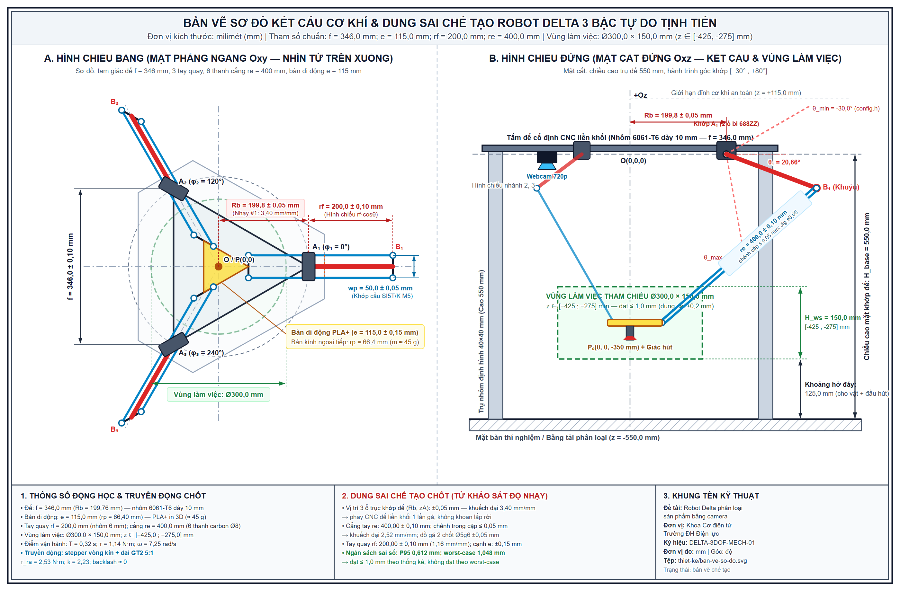
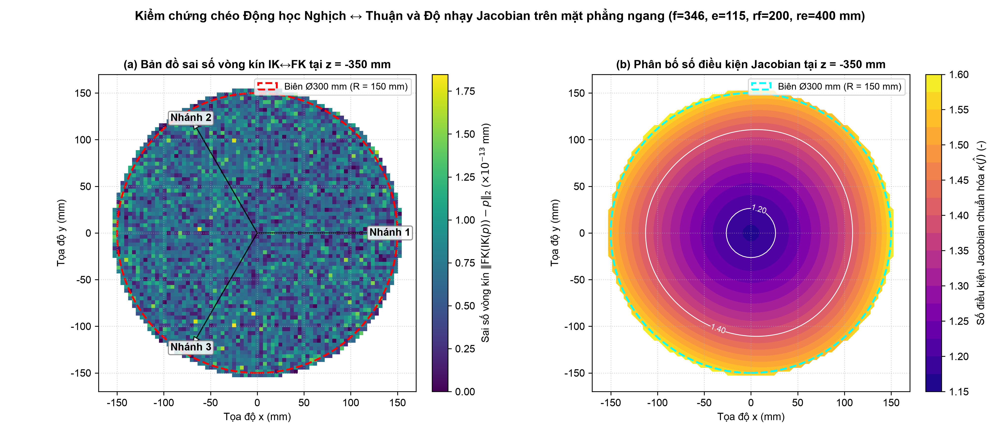
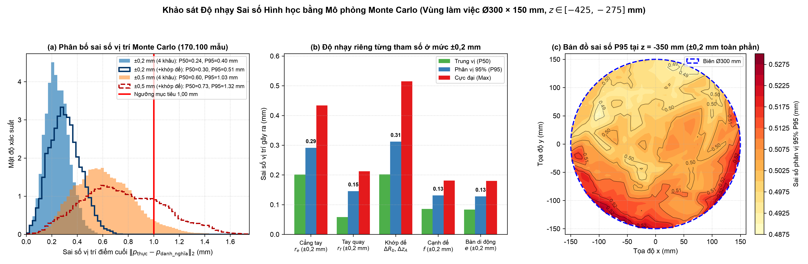
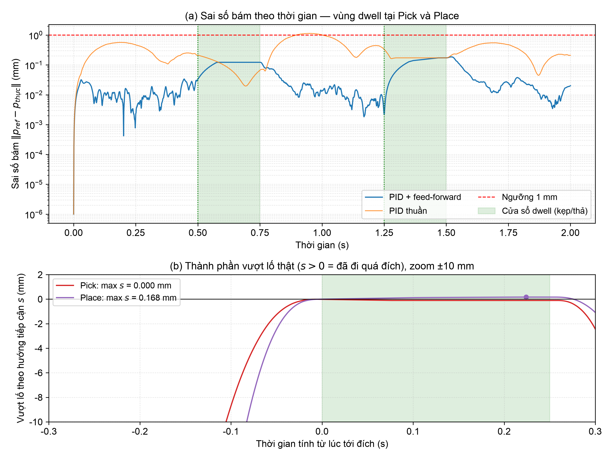
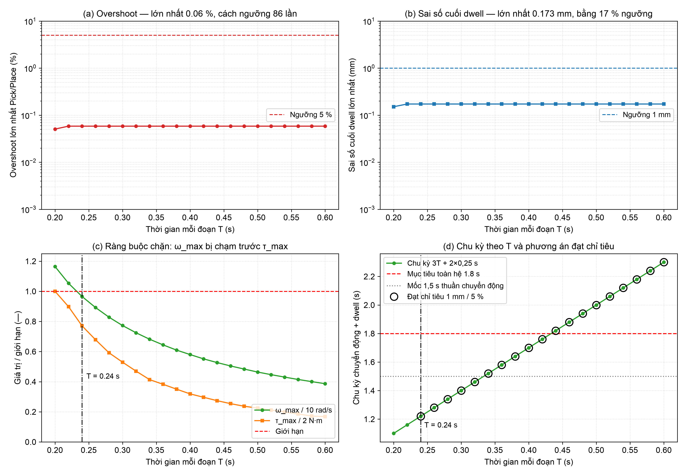
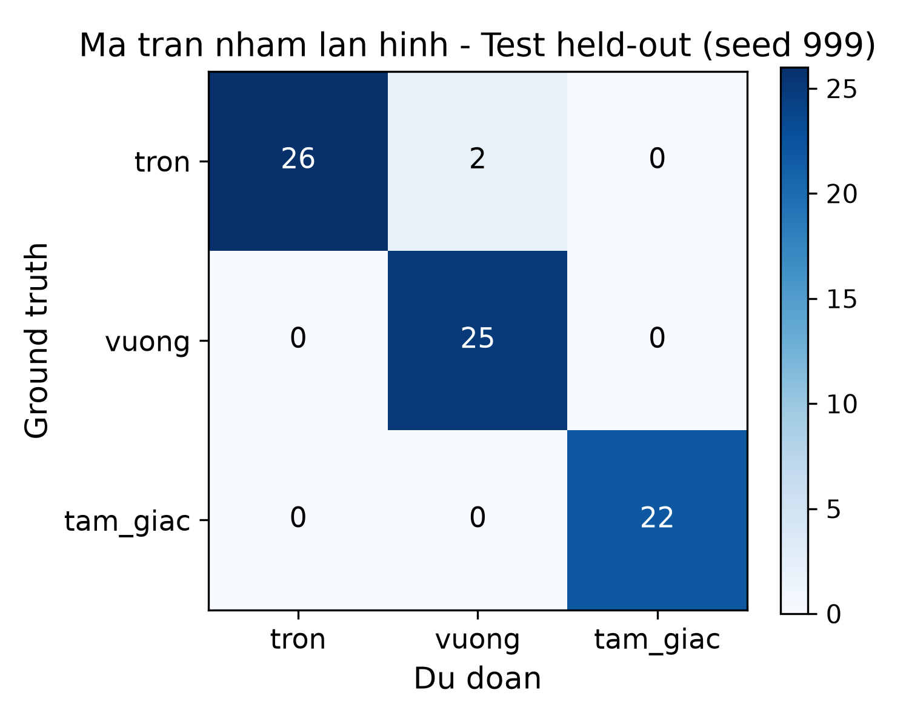
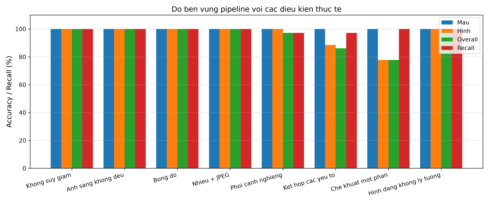

TRƯỜNG ĐẠI HỌC ĐIỆN LỰC
KHOA [CẦN BỔ SUNG: tên khoa]

BÁO CÁO NGHIÊN CỨU KHOA HỌC

ĐỀ TÀI: Thiết kế, mô phỏng và kiểm chứng hệ robot Delta 3 bậc tự do
phục vụ phân loại sản phẩm bằng thị giác máy tính

Sinh viên thực hiện: [CẦN BỔ SUNG: họ tên, MSSV, lớp]
Giảng viên hướng dẫn: [CẦN BỔ SUNG]
Năm: 2026

---

# Tóm tắt

Phân loại sản phẩm theo màu sắc và hình dạng rồi gắp–thả tự động đòi hỏi robot phản hồi nhanh và chính xác. Đề tài xây dựng mô hình toán, mô phỏng và kiểm chứng một phần hệ robot Delta ba bậc tự do tịnh tiến, kết hợp webcam và Arduino Uno. Nguyên mẫu chưa có khung cơ khí hoàn chỉnh. Phương pháp gồm ba phần: (i) giải động học nghịch bằng biểu thức giải tích và động học thuận bằng phương pháp Newton–Raphson, rồi kiểm chứng chéo trên 1.859 điểm lưới trong hình trụ Ø300 × 150 mm; (ii) quỹ đạo gắp–thả đa thức bậc 5 có pha dừng 0,25 s, điều khiển PID và PID cộng bù tiến; (iii) nhận dạng màu và hình bằng ngưỡng HSV và contour trong OpenCV.

Kết quả chính: sai số vòng kín IK↔FK cực đại đạt 1,583 × 10⁻¹³ mm. Khảo sát dung sai ±0,2 mm cho sai số điểm cuối phân vị 95 % (P95) 0,402 mm và cực đại 0,689 mm. Ngân sách sai số sau hiệu chuẩn là 0,612 mm theo P95 có tách nhóm, nhưng 1,048 mm theo cận trên giải tích với dung sai phân cấp. Chỉ tiêu 1 mm vì vậy đạt theo thống kê và không đạt theo worst-case. Với T = 0,50 s, PID thuần có sai số bám cực đại 1,137 mm, còn PID cộng bù tiến giảm còn 0,186 mm. Chu kỳ danh định tại T = 0,32 s là 1,506 s, thấp hơn ngân sách 1,8 s. Trễ truyền thông Serial và trễ cơ cấu chấp hành chưa được đo. Trên tập test seed 999 gồm 75 vật tổng hợp, độ chính xác phân loại đạt 97,33 % (khoảng tin cậy Wilson 95 %: 90,8–99,3 %).

Mục tiêu 1 và mục tiêu 2 đạt trong phạm vi mô phỏng, kèm điều kiện nêu rõ trong báo cáo. **Mục tiêu 3 chưa đạt**, vì chưa có vật thật: mọi số phân loại đo trên ảnh tổng hợp. Báo cáo không khẳng định đề tài đạt cả ba mục tiêu. Kết quả là cơ sở cho thiết kế cơ khí và thí nghiệm tiếp theo, không thay thế phép đo trên robot thật.

**Từ khoá:** robot Delta; động học nghịch; điều khiển PID; bù tiến; thị giác máy tính; mô phỏng tái lập.

---

# Mục lục

**Tóm tắt**
**Từ khoá**

**Chương 1. Mở đầu**
- 1.1 Đặt vấn đề
- 1.2 Mục tiêu
- 1.3 Câu hỏi nghiên cứu
- 1.4 Đối tượng, phạm vi và giới hạn
- 1.5 Đóng góp dự kiến
- 1.6 Bố cục báo cáo

**Chương 2. Tổng quan nghiên cứu**
- 2.1 Phạm vi và cách tổ chức
- 2.2 Động học, hiệu chuẩn và giải số động học
- 2.3 Điều khiển bám quỹ đạo
- 2.4 Tích hợp thị giác và robot Delta chi phí thấp
- 2.5 Xu hướng nghiên cứu
- 2.6 Mâu thuẫn giữa các nhóm
- 2.7 Khoảng trống nghiên cứu

**Chương 3. Cơ sở lý thuyết và phương pháp**
- 3.1 Cấu trúc robot Delta 3 bậc tự do
- 3.2 Động học nghịch giải tích
- 3.3 Động học thuận
- 3.4 Quy hoạch quỹ đạo đa thức bậc 5
- 3.5 Mô hình khớp và điều khiển
- 3.6 Thị giác máy tính
- 3.7 Giả thiết và hạn chế của chương 3

**Chương 4. Thiết kế và hiện thực hệ thống**
- 4.1 Tham số hình học chốt
- 4.2 Thiết kế cơ khí
- 4.3 Truyền động và mô-men yêu cầu
- 4.4 Ngân sách sai số
- 4.5 Kiến trúc điều khiển và firmware
- 4.6 Danh mục vật tư (BOM)
- 4.7 Giả thiết và hạn chế của chương 4
- 4.8 Bản vẽ sơ đồ kết cấu

**Chương 5. Kết quả và thảo luận**
- 5.1 Kiểm chứng động học
- 5.2 Độ nhạy dung sai chế tạo
- 5.3 Quỹ đạo và điều khiển
- 5.4 Chu kỳ toàn hệ thống
- 5.5 Thị giác
- 5.6 Thảo luận
- 5.7 Hiệu lực và giới hạn

**Chương 6. Kết luận và hướng phát triển**
- 6.1 Đối chiếu với mục tiêu
- 6.2 Đóng góp của đề tài
- 6.3 Hạn chế
- 6.4 Hướng phát triển

**Tài liệu tham khảo**

**Phụ lục**
- A. Tham số mô phỏng
- B. Dữ liệu thô và lệnh tái lập
- C. Danh sách [CẦN BỔ SUNG] còn lại

**Ghi chú cho sinh viên**

**Danh mục bảng**
- Bảng 2.1. So sánh rút gọn tám công trình theo chỉ tiêu liên quan đề tài
- Bảng 3.1. Ký hiệu và đơn vị trong động học nghịch
- Bảng 3.2. Kết quả kiểm chứng chéo trên 1 859 điểm lưới
- Bảng 3.3. Tham số mô hình khớp và bộ điều khiển
- Bảng 3.4. Ngưỡng HSV ban đầu cho ba màu
- Bảng 4.1. Tham số hình học chốt của robot Delta
- Bảng 4.2. Vật liệu và khối lượng ước tính các chi tiết chính
- Bảng 4.3. Dung sai chế tạo đề xuất và đóng góp cận trên vào sai số điểm cuối
- Bảng 4.4. Mô-men và tốc độ yêu cầu tại trục khớp, T = 0,32 s
- Bảng 4.5. So sánh ba phương án truyền động tại τ_yc = 1,14 N·m
- Bảng 4.6. Ngân sách sai số điểm cuối sau hiệu chuẩn gốc 0,03°, truyền đai GT2
- Bảng 4.7. Giao thức Serial giữa PC và Arduino
- Bảng 4.8. Ngân sách trễ khâu truyền thông và cơ cấu chấp hành
- Bảng 4.9. Phân rã chu kỳ toàn hệ thống tại T = 0,32 s
- Bảng 4.10. Tổng hợp dự toán, triệu VNĐ
- Bảng 5.1. Kiểm chứng chéo IK↔FK trên 1.859 điểm lưới
- Bảng 5.2. Phân bố sai số điểm cuối theo kịch bản dung sai
- Bảng 5.3. Ngân sách sai số điểm cuối cho phương án đai GT2 5:1
- Bảng 5.4. Đáp ứng bám tại T = 0,50 s
- Bảng 5.5. Chọn điểm vận hành theo T
- Bảng 5.6. Phân rã chu kỳ toàn hệ thống tại T = 0,32 s
- Bảng 5.7. Ma trận nhầm lẫn hình dạng, tập test seed 999
- Bảng 5.8. Độ bền vững của pipeline với tám điều kiện
- Bảng 5.9. So sánh chỉ tiêu với các công trình chương 2
- Bảng 6.1. Đối chiếu mục tiêu của đề cương với kết quả

**Danh mục hình**
- Hình 4.1. Bản vẽ sơ đồ kết cấu
- Hình 5.1. Bản đồ sai số IK↔FK và số điều kiện Jacobian trên mặt phẳng z = −350 mm
- Hình 5.2. Kết quả Monte Carlo độ nhạy sai số hình học
- Hình 5.3. Sai số bám và vùng pha dừng tại T = 0,50 s
- Hình 5.4. Quét chu kỳ T và phương án đạt chỉ tiêu
- Hình 5.5. Ma trận nhầm lẫn màu và hình dạng, tập test seed 999
- Hình 5.6. Độ chính xác tổng thể theo điều kiện, có khoảng tin cậy 95 %

---

# Chương 1. Mở đầu

> Bản nháp do AI soạn từ dữ liệu trong repo. Sinh viên phải kiểm chứng số liệu và trích dẫn trước khi nộp.

## 1.1 Đặt vấn đề

Trong dây chuyền thực phẩm, linh kiện điện tử và bao bì, sản phẩm phải được phân loại theo màu sắc hoặc hình dạng trước khi đóng gói. Phân loại thủ công chậm và dễ sai khi băng tải chạy nhanh. Kết hợp camera với cơ cấu gắp cho phép tự động hóa khâu gắp–phân loại.

Robot song song kiểu Delta (Delta parallel robot) là lựa chọn phổ biến cho bài toán gắp–đặt. Bài báo gốc về robot Delta nhấn mạnh tốc độ cao nhờ hình học song song [1]. Cơ cấu gồm ba chuỗi động học song song. Các khớp quay chủ động đặt trên đế cố định, còn bàn công tác chuyển động tịnh tiến theo ba trục x, y, z [1]. Lập luận về độ cứng kết cấu của cơ cấu song song so với cơ cấu nối tiếp cần nguồn định lượng: [CẦN BỔ SUNG: nguồn so sánh độ cứng kết cấu robot song song và nối tiếp].

Tiền lệ gần nhất là hệ Delta phân loại vật theo màu bằng xử lý ảnh trong không gian HSV. Vo và Le (2023) báo cáo thời gian phân loại trung bình 1,8 s/vật [2]. Con số này là mốc đối chiếu thực nghiệm của đề tài.

Chế tạo robot Delta hoàn chỉnh tốn kém. Sinh viên thường mô phỏng động học mà chưa đo trễ thực của chuỗi camera đến vi điều khiển. Khi lắp thật, chu kỳ có thể vượt xa thiết kế. Đề tài hướng tới thu hẹp khoảng cách giữa mô phỏng và phần cứng trước khi đầu tư cơ khí.

Đề tài được thực hiện tại Khoa Cơ điện tử, Trường Đại học Điện lực, trong 12 tuần. Phạm vi được chọn để phù hợp năng lực sinh viên năm 2: không dùng học sâu, không gia công cơ khí chính xác.

## 1.2 Mục tiêu

Mục tiêu tổng quát là xây dựng mô hình toán, mô phỏng và một nguyên mẫu thí nghiệm một phần cho bài toán phân loại sản phẩm bằng camera. Nguyên mẫu gồm webcam và Arduino, chưa có khung cơ khí Delta. Kết quả làm cơ sở cho thiết kế phần cứng hoàn chỉnh.

Đề tài đặt ba mục tiêu đo được:

1. Dẫn giải và kiểm chứng chéo động học nghịch (inverse kinematics — IK) và động học thuận (forward kinematics — FK) của robot Delta ba bậc tự do. Sai số vòng kín cực đại không vượt 1 mm trên không gian làm việc tham chiếu Ø300 × 150 mm.
2. Thiết kế quỹ đạo gắp–thả bậc 5 kết hợp bộ điều khiển tỉ lệ–tích phân–vi phân (PID) và bù tiến (feed-forward). Chu kỳ chuyển động 3 đoạn 0,96 s (T = 0,32 s) cộng hai pha dừng 0,25 s, độ vọt lố (overshoot) không vượt 5 %. Chu kỳ toàn hệ thống không vượt 1,8 s khi cộng trễ thực đo được.
3. Xây dựng module phân loại trên vật thật bằng webcam. Độ chính xác đạt ít nhất 90 % trên ít nhất 120 vật mẫu gồm 3 màu và 3 hình dạng. Kết quả có ma trận nhầm lẫn và trễ xử lý ảnh đo thực tế.

## 1.3 Câu hỏi nghiên cứu

Đề tài trả lời hai câu hỏi:

- **Câu hỏi 1:** Mô hình động học thuận và nghịch của robot Delta ba bậc tự do đạt sai số nào khi kiểm chứng chéo trên toàn vùng làm việc?
- **Câu hỏi 2:** Trễ thực tế của chuỗi camera → OpenCV → Arduino chiếm bao nhiêu trong chu kỳ phân loại? Chu kỳ tổng có đạt mốc 1,8 s/vật đã công bố không?

## 1.4 Đối tượng, phạm vi và giới hạn

**Đối tượng nghiên cứu** là robot Delta ba bậc tự do tịnh tiến x–y–z, không có bậc quay đầu gắp. Hệ thống thị giác dùng webcam USB đặt cố định trên cao. Vật mẫu gồm 3 màu và 3 hình dạng (tròn, vuông, tam giác).

**Phạm vi** theo phương án 3 của đề cương: mô phỏng kết hợp thí nghiệm phần cứng một phần (hardware-in-the-loop thu nhỏ). Các nội dung cụ thể gồm:

- Động học là trọng tâm. Động lực học chỉ xét ở mức cơ bản.
- Điều khiển dừng ở PID. Không dùng ADRC hay LADRC.
- Nhận dạng màu và hình bằng ngưỡng HSV và contour trong OpenCV. Không dùng học sâu.
- Arduino Uno nhận góc khớp qua cổng Serial và xuất PWM. Chi phí phần cứng dự kiến dưới 500.000 VNĐ.

**Giới hạn** gồm các nội dung không thực hiện:

- Không dựng khung cơ khí Delta hoàn chỉnh. Phần cơ khí dừng ở bản vẽ CAD và danh mục linh kiện (BOM).
- Không gia công cơ khí chính xác.
- Không hiệu chuẩn động học trên robot thật.
- Không điều khiển bám quỹ đạo tốc độ cao.

**Tình trạng thực hiện tại thời điểm báo cáo.** Nhóm chưa hoàn thành hai hạng mục phụ thuộc
phần cứng vì hạn chế ngân sách, không phải vì thiếu phương pháp. Cụ thể:

- **Đã hoàn thành:** động học và kiểm chứng chéo IK↔FK trên 1.859 điểm; khảo sát độ nhạy
  dung sai bằng Monte Carlo; mô phỏng quỹ đạo bậc 5 với PID và bù tiến; phần mềm điều khiển
  nhúng (biên dịch đạt, chưa nạp bo mạch); pipeline thị giác HSV trên ảnh tổng hợp; bản vẽ
  chế tạo 2D và danh mục vật tư.
- **Chưa thực hiện:** đo trễ truyền thông Serial trên phần cứng thật (hiện chỉ có dry-run);
  thu và phân loại ≥ 120 vật mẫu thật; hiệu chuẩn động học trên khung thật.
- **Thay thế tạm thời:** bản vẽ chế tạo 2D kèm dung sai và BOM thay cho mô hình CAD 3D.
  Bản vẽ này đủ để đặt gia công và lắp ráp; mô hình 3D là bước bổ sung, không làm thay đổi
  kết luận của báo cáo.

Giả thiết tách khớp (decoupled joints) được áp dụng khi dùng PID đơn biến cho từng khớp. Giả thiết này làm bỏ qua tương tác động lực học giữa các nhánh song song. Báo cáo nêu rõ giả thiết này khi kết luận.

## 1.5 Đóng góp dự kiến

Đề tài dự kiến có ba đóng góp:

1. **Kiểm chứng chéo định lượng IK↔FK trên toàn vùng làm việc.** Nghiệm IK giải tích được đối chiếu với FK bằng phương pháp Newton–Raphson trên lưới điểm dày trong Ø300 × 150 mm. Báo cáo sai số cực đại và sai số căn quân phương (root mean square error — RMSE).
2. **Chỉ tiêu dung sai chế tạo suy ra từ mô phỏng độ nhạy.** Chiều dài khâu được cộng sai lệch ±0,2 mm. Báo cáo phân bố sai số điểm cuối gồm giá trị cực đại và phân vị 95 %, đối chiếu với ngưỡng 1 mm. Từ đó đề xuất dung sai chế tạo cho khâu.
3. **Pipeline mô phỏng đầu–cuối tái lập được.** Pipeline nối đầu ra tọa độ và nhãn của OpenCV với quy hoạch quỹ đạo, IK và điều khiển khớp. Mỗi lần chạy lưu tham số, phiên bản thư viện và seed để chạy lại được.

## 1.6 Bố cục báo cáo

Chương 2 tổng quan 8 công trình liên quan theo ba nhóm phương pháp. Chương 2 cũng nêu bốn khoảng trống dẫn đến đề tài. Chương 3 trình bày mô hình động học, giả thiết và thuật toán. Chương 4 mô tả thiết kế phần cứng, firmware và cấu hình mô phỏng. Chương 5 trình bày kết quả và thảo luận so với chỉ tiêu đề cương và tiền lệ. Chương 6 nêu kết luận và hướng phát triển. Danh mục tài liệu tham khảo theo chuẩn IEEE đặt cuối báo cáo và đánh số thống nhất cho toàn báo cáo.

---

# Chương 2. Tổng quan nghiên cứu

> Bản nháp do AI soạn từ `tong-quan.md` và `references.bib`. Số liệu lấy từ metadata và tóm tắt (abstract). Sinh viên phải đọc toàn văn trước khi nộp.

## 2.1 Phạm vi và cách tổ chức

Chương này tổng hợp tám công trình trong giai đoạn 1988–2024. Bảy công trình có mã định danh số (DOI) đã kiểm chứng qua Crossref. Công trình [1] là bài hội nghị năm 1988 và chưa có DOI, nên cần đối chiếu kỷ yếu gốc. Các công trình được xếp thành ba nhóm theo bài toán cốt lõi: động học và hiệu chuẩn, điều khiển bám quỹ đạo, và tích hợp thị giác chi phí thấp.

## 2.2 Động học, hiệu chuẩn và giải số động học

Robot Delta là cơ cấu song song ba bậc tự do tịnh tiến. Ba khớp quay chủ động đặt trên đế cố định. Cơ cấu hình bình hành giữ bàn công tác chỉ tịnh tiến theo x, y, z [1]. Bài toán nền tảng gồm hai chiều. Động học nghịch (inverse kinematics — IK) ánh xạ tọa độ điểm cuối sang góc khớp. Động học thuận (forward kinematics — FK) ánh xạ ngược lại. Với IK, mỗi nhánh đưa về phương trình lượng giác và có nghiệm giải tích tường minh [1]. Với FK, hệ phương trình phi tuyến có nhiều nghiệm và khó rút gọn [3].

Hiệu chuẩn động học xử lý sai số hình học do chế tạo và lắp ráp, như chiều dài khâu và vị trí khớp đế. Vischer và Clavel (1998) xây dựng mô hình hiệu chuẩn cho robot Delta thực [4]. Tóm tắt của công trình này không nêu sai số vị trí trước và sau hiệu chuẩn tính bằng mm. [CẦN BỔ SUNG: sai số điểm cuối trước và sau hiệu chuẩn (mm) từ toàn văn [4]].

Yang và Xiao (2024) giải FK bằng phương pháp số kết hợp ràng buộc nghiệm. Nhóm tác giả dùng mô phỏng Monte Carlo để ước lượng vùng làm việc trên MATLAB [3]. Công trình không công bố sai số định lượng giữa nghiệm FK và IK. Nghiệm FK cũng không được kiểm chứng vòng kín trên toàn vùng làm việc.

## 2.3 Điều khiển bám quỹ đạo

Hai công trình áp dụng điều khiển kháng nhiễu chủ động (active disturbance rejection control — ADRC) cho robot Delta tốc độ cao. Ý tưởng chung là coi bất định mô hình, ma sát và tương tác giữa các nhánh là một nhiễu tổng hợp [5], [6]. Bộ quan sát trạng thái mở rộng (extended state observer — ESO) ước lượng nhiễu này để bù theo thời gian thực [5], [6].

Castañeda, Luviano-Juárez và Chairez (2015) đề xuất ADRC thích nghi dựa trên đầu ra. Phương pháp không cần đo vận tốc khớp và dùng bình phương tối thiểu trung bình (least mean squares — LMS) để xấp xỉ phần bất định [5]. Tác giả đối chiếu với PID có bù tiến và ADRC không thích nghi. Kết quả được báo cáo là tốt hơn ở cả thực nghiệm và mô phỏng với quỹ đạo nhanh gấp 5 lần [5]. Tóm tắt không nêu sai số bám cụ thể.

Liu và cộng sự (2020) dùng ADRC tuyến tính (linear ADRC — LADRC) để giải ghép ba khớp khi bám quỹ đạo số 8 xoắn ốc trong không gian ba chiều. Công trình chỉ có mô phỏng, với nhiễu nội và ngoại [6]. Tóm tắt mô tả kết quả là "nhanh và chính xác" nhưng không có số liệu [6].

Kết quả định tính của [5] cho thấy PID có bù tiến kém hơn ADRC thích nghi khi quỹ đạo nhanh hơn. Công trình [6] đưa ra nhận xét tương tự cho bài toán ba khớp ghép. Tuy nhiên, cả hai không cung cấp baseline PID định lượng trên quỹ đạo gắp–thả. [CẦN BỔ SUNG: chỉ số sai số bám (mm) và độ vọt lố (%) của PID và PID + bù tiến từ toàn văn [5], [6]].

## 2.4 Tích hợp thị giác và robot Delta chi phí thấp

Nhóm này dùng kiến trúc phân tán giá thấp. Một máy tính nhúng xử lý ảnh, và một vi điều khiển Arduino điều khiển khớp.

Vo và Le (2023) chuyển ảnh từ không gian BGR sang HSV, rồi phân ngưỡng để nhận ba màu. Hệ thống dẫn động bằng ba servo DC và dùng Raspberry Pi 4 để xử lý ảnh [2]. Công trình báo cáo độ chính xác 100 % cho màu đỏ và vàng, 97,5 % cho màu xanh lá, và thời gian phân loại trung bình 1,8 s/vật [2]. Tóm tắt không nêu số mẫu thử và điều kiện chiếu sáng.

Elassal và cộng sự (2024) lọc dải màu và dùng contour để xác định bounding box của vật. Tính IK chạy trên Arduino, còn Raspberry Pi làm bộ điều phối [7]. Tác giả kết luận hệ thống "hiệu quả và chính xác", nhưng không có số liệu định lượng [7].

Hoai và cộng sự (2023) xác định đồng thời tọa độ 3D và kích thước vật để điều chỉnh độ mở tay kẹp. Hệ thống dùng động cơ bước, Arduino Uno và khung chế tạo bằng cắt laser và in 3D [8]. Bài báo báo cáo "sai số nhỏ" nhưng không nêu giá trị tính bằng mm [8]. [CẦN KIỂM CHỨNG: thứ tự và tên tác giả [8] trên trang bìa; Crossref ghi tên chưa khớp chuẩn tên Việt].

Bảng 2.1 so sánh rút gọn tám công trình theo các chỉ tiêu liên quan đề tài.

**Bảng 2.1.** So sánh rút gọn tám công trình theo chỉ tiêu liên quan đề tài.

| Công trình | Phương pháp chính | Phần cứng / mô phỏng | Chỉ tiêu định lượng (theo tóm tắt) | Điểm còn thiếu |
| --- | --- | --- | --- | --- |
| [2] Vo & Le, 2023 | Ngưỡng HSV, 3 màu | 3 servo DC, Arduino, Raspberry Pi 4 | 100 %; 97,5 %; 1,8 s/vật | Cỡ mẫu, điều kiện sáng, định nghĩa chu kỳ |
| [4] Vischer & Clavel, 1998 | Hiệu chuẩn sai số hình học | Robot Delta thực | Không nêu | Sai số điểm cuối (mm) |
| [3] Yang & Xiao, 2024 | FK số + Monte Carlo | Mô phỏng MATLAB | Không nêu | Sai số IK↔FK; thông số hình học |
| [5] Castañeda, 2015 | ADRC thích nghi đầu ra + LMS | Delta thực + mô phỏng 5× | Định tính: tốt hơn PID + bù tiến | Sai số bám (mm), vọt lố (%) |
| [6] Liu, 2020 | LADRC giải ghép 3 khớp | Chỉ mô phỏng | Định tính: "nhanh và chính xác" | Sai số bám; thông số quỹ đạo |
| [7] Elassal, 2024 | Lọc màu + contour; IK trên Arduino | Raspberry Pi, Arduino, giác hút | Định tính: "hiệu quả và chính xác" | Độ chính xác gắp (%), sai số (mm) |
| [8] Hoai, 2023 | Tọa độ 3D + kích thước vật | Động cơ bước, Arduino Uno | Định tính: "sai số nhỏ" | Sai số (mm), chu kỳ (s) |

## 2.5 Xu hướng nghiên cứu

Từ tám công trình, có thể rút ra bốn xu hướng sau. Các nhận định này là suy luận của người viết từ dữ liệu trên.

1. **Chuyển sang nguyên mẫu chi phí thấp.** Ba công trình thực nghiệm gần nhất [2], [7], [8] dùng in 3D, cắt laser, động cơ bước hoặc servo DC phổ thông. Các hệ thống này kết hợp Raspberry Pi xử lý ảnh với Arduino điều khiển khớp.
2. **Ưu tiên thị giác cổ điển cho phân loại đơn giản.** Với sản phẩm có màu và hình dạng rõ, các nhóm [2], [7] chọn ngưỡng HSV và contour thay vì học sâu. Cách này chạy được trên Raspberry Pi mà không cần GPU.
3. **Giải số và mô phỏng Monte Carlo cho động học thuận.** [3] dùng nghiệm số và quét đám mây điểm để trực quan hóa vùng làm việc.
4. **ADRC cho bám quỹ đạo tốc độ cao.** Khi tốc độ hoặc độ phức tạp của quỹ đạo tăng, các nhóm [5], [6] chuyển sang ESO để bù nhiễu thay cho PID cố định hệ số.

## 2.6 Mâu thuẫn giữa các nhóm

Có ba điểm chưa thống nhất giữa các công trình.

**Thứ nhất**, độ phức tạp điều khiển và mức đơn giản của hệ thống thực tế. [5], [6] cho rằng cần mô hình động lực học và ADRC để bám quỹ đạo chính xác. Ngược lại, [2], [7], [8] chỉ dùng IK và điều khiển vị trí mức cơ bản, và vẫn báo cáo hiệu quả. Hai nhóm khác chế độ vận hành. Nhóm điều khiển xét bám quỹ đạo liên tục tốc độ cao. Nhóm thực nghiệm xét gắp–thả điểm đến điểm với vật nhẹ. Nguyên nhân này là nhận định của người viết.

**Thứ hai**, lựa chọn động cơ dẫn động. [8] dùng động cơ bước, còn [2] dùng servo DC. Động cơ bước đơn giản vì điều khiển góc bằng xung, nhưng có nguy cơ trượt bước và giới hạn tốc độ (nhận định của người viết). Servo DC có phản hồi vị trí vòng kín [2]. Chưa có công trình nào so sánh hai lựa chọn này trên cùng một điều kiện.

**Thứ ba**, định nghĩa chu kỳ. Đề cương đặt mục tiêu chu kỳ chuyển động thuần không vượt 1,5 s. Mốc thực nghiệm [2] là 1,8 s/vật. Theo người viết, con số này có thể bao gồm xử lý ảnh, truyền thông nối tiếp và thời gian đóng mở cơ cấu chấp hành. Tóm tắt của [2] không định nghĩa rõ thời gian đo. [CẦN BỔ SUNG: phân rã thời gian 1,8 s/vật từ toàn văn [2]].

## 2.7 Khoảng trống nghiên cứu

Phân tích tám công trình cho bốn khoảng trống. Mỗi khoảng trống dẫn đến một phần của đề tài.

**Khoảng trống 1: thiếu kiểm chứng chéo định lượng IK↔FK.** [3] giải FK và vẽ vùng làm việc nhưng không báo cáo sai số. Chưa có công trình nào trong tám bài đối chiếu vòng kín IK–FK trên toàn vùng làm việc. Robot song song nhạy với kỳ dị và đa nghiệm. Nếu sai số công thức hoặc chọn nhầm nhánh không được kiểm tra, mọi khâu điều khiển phía sau đều chịu ảnh hưởng. Đề tài đáp ứng khoảng trống này bằng đóng góp 1: nghiệm IK giải tích được đối chiếu với FK Newton–Raphson trên lưới điểm dày.

**Khoảng trống 2: thiếu chỉ tiêu dung sai chế tạo gắn với sai số điểm cuối.** [4] mô tả hiệu chuẩn sai số hình học nhưng tóm tắt không nêu mm. Tóm tắt của [3] không nêu sai số chế tạo. Người viết nhận định rằng cần một khảo sát độ nhạy để biết sai lệch chiều dài khâu cỡ bao nhiêu thì vượt ngưỡng 1 mm. Đề tài đáp ứng bằng đóng góp 2, dựa trên sai lệch ±0,2 mm.

**Khoảng trống 3: thiếu baseline PID trên quỹ đạo gắp–thả.** [5], [6] so sánh với ADRC và không công bố số liệu PID theo chỉ tiêu thống nhất. [2], [7] bỏ qua đáp ứng quá độ. Đề tài đáp ứng bằng PID và PID + bù tiến trên quỹ đạo bậc 5, đo chu kỳ và độ vọt lố theo định nghĩa rõ ràng. Chỉ tiêu overshoot ≤ 5 % và chu kỳ ≤ 1,5 s thuộc mục tiêu 2.

**Khoảng trống 4: thiếu thống kê phân loại và pipeline tái lập.** [2] chỉ phân loại ba màu và không nêu cỡ mẫu hoặc ma trận nhầm lẫn. [7], [8] không có số liệu phần trăm chính xác. Các công trình mô phỏng [3], [6] tách rời phần cứng thử nghiệm. Chưa có công trình nào nối liền tọa độ từ OpenCV, quỹ đạo, IK và điều khiển khớp trong cùng một bộ chỉ tiêu. Đề tài đáp ứng bằng mục tiêu 3 (≥ 120 vật, có ma trận nhầm lẫn) và đóng góp 3 (pipeline tái lập).

Bốn khoảng trống trên định hướng ba đóng góp của đề tài trong Chương 1. Đề tài không nhằm vượt trội về điều khiển nâng cao. Mục tiêu là làm cho từng bước của chuỗi gắp–phân loại có số đo kiểm chứng được.

---

# Chương 3. Cơ sở lý thuyết và phương pháp

> **Bản nháp để sinh viên kiểm chứng — không phải bản nộp.** Mọi số liệu lấy từ `nghien-cuu/` trong repo; nguồn ghi trong ngoặc khi cần. Chỗ thiếu dữ liệu được đánh dấu `[CẦN BỔ SUNG]`.

Chương này trình bày các mô hình mà đề tài dùng: cấu trúc cơ cấu (3.1), động học nghịch và thuận (3.2–3.3), quy hoạch quỹ đạo (3.4), mô hình khớp và bộ điều khiển (3.5), và chuỗi thị giác máy tính (3.6). Cuối chương liệt kê giả thiết và hạn chế.

## 3.1 Cấu trúc robot Delta 3 bậc tự do

Robot Delta là cơ cấu song song (*parallel mechanism*) ba bậc tự do tịnh tiến, do Clavel đề xuất [1]. Cơ cấu gồm một đế cố định, ba khớp quay chủ động đặt trên đế, ba tay quay và ba cặp cẳng tay song song nối tới bàn di động. Ba khớp chủ động đặt tại ba đỉnh của tam giác đều, lệch nhau $120^\circ$ quanh trục $Oz$.

Mỗi nhánh gồm một tay quay dài $r_f$ và hai thanh song song dài $r_e$, cách nhau $w_p = 50\,\text{mm}$. Hai thanh cùng chiều dài và song song tạo thành hình bình hành phẳng. Hình bình hành giữ cạnh bàn di động song song với cạnh tương ứng của đế. Khi cả ba nhánh cùng ràng buộc như vậy, bàn di động bị khóa ba góc quay ($\alpha = \beta = \gamma = 0$) và chỉ còn ba bậc tự do tịnh tiến $(x, y, z)$. Đầu gắp nhờ đó luôn thẳng đứng, không cần thêm cổ tay.

Hai đầu mỗi thanh song song phải dùng khớp cầu (*ball joint*). Khớp bản lề một bậc tự do không cho thanh nghiêng ngang khi bàn di động lệch khỏi mặt phẳng nhánh. Điều kiện hình học là $|y_i| \le r_e$ với $y_i$ là độ lệch ngang so với mặt phẳng nhánh $i$ [`dong-hoc-delta.md`, mục 3.2].

Các tham số hình học chốt được trình bày ở Bảng 4.1 (chương 4). Từ $f$ và $e$ suy ra bán kính ngoại tiếp:

$$R_b = \frac{f}{\sqrt{3}} = 199{,}76\ \text{mm}, \qquad r_p = \frac{e}{\sqrt{3}} = 66{,}40\ \text{mm}, \qquad R = R_b - r_p = 133{,}37\ \text{mm} \tag{3.1}$$

Vùng làm việc là hình trụ $\varnothing 300 \times 150\,\text{mm}$ với $z \in [-425;\, -275]\,\text{mm}$ [`dong-hoc-delta.md`, mục 5.1].

## 3.2 Động học nghịch giải tích

**Bài toán.** Cho vị trí điểm tác động cuối $\mathbf{p} = [x, y, z]^T$, tìm ba góc khớp $\theta_i$. Quy ước: $\theta_i = 0$ khi tay quay nằm ngang hướng $+Ox_i$; $\theta_i > 0$ khi tay quay chúc xuống.

**Bước 1 — Chiếu về hệ địa phương.** Ràng buộc chiều dài cẳng tay là $\|\mathbf{p} - \mathbf{c}_i(\theta_i)\|^2 = r_e^2$, với tâm mặt cầu ảo $\mathbf{c}_i(\theta_i) = [(R + r_f\cos\theta_i)\cos\phi_i,\ (R + r_f\cos\theta_i)\sin\phi_i,\ -r_f\sin\theta_i]^T$. Chiếu $\mathbf{p}$ vào hệ địa phương nhánh $i$ bằng phép quay $\mathbf{R}_z^T(\phi_i)$:

$$x_i = x\cos\phi_i + y\sin\phi_i, \qquad y_i = -x\sin\phi_i + y\cos\phi_i, \qquad z_i = z \tag{3.2}$$

**Bước 2 — Phương trình lượng giác tuyến tính.** Khai triển và dùng $\cos^2 + \sin^2 = 1$ thu được:

$$E_i\cos\theta_i + F_i\sin\theta_i + G_i = 0 \tag{3.3}$$

$$E_i = -2r_f(x_i - R), \qquad F_i = 2r_f z_i, \qquad G_i = (x_i - R)^2 + y_i^2 + z_i^2 + r_f^2 - r_e^2 \tag{3.4}$$

**Bước 3 — Thế nửa góc.** Đặt $t_i = \tan(\theta_i/2)$, phương trình (3.3) trở thành bậc hai:

$$(G_i - E_i)\,t_i^2 + 2F_i\,t_i + (G_i + E_i) = 0 \tag{3.5}$$

Biệt thức rút gọn là $\Delta_i = E_i^2 + F_i^2 - G_i^2$. Điều kiện để điểm $\mathbf{p}$ nằm trong không gian khả đạt là $\Delta_i \ge 0$ với mọi $i$.

**Bước 4 — Chọn nhánh và dạng số ổn định.** Đề tài chọn nhánh khuỷu hướng ra ngoài (*elbow-out*) cho cả ba nhánh, tức $\cos\theta_i > 0$. Với dạng trực tiếp $t_i = (-F_i - \sqrt{\Delta_i})/(G_i - E_i)$, mẫu số tiến tới 0 khi $x_i \to R$ và $y_i^2 + z_i^2 \to r_e^2 - r_f^2$. Khi đó tử số là hiệu hai số gần bằng nhau, gây mất chữ số có nghĩa. Dùng định lý Viète để đổi sang dạng Citardauq:

$$t_i = \frac{-F_i - \sqrt{\Delta_i}}{G_i - E_i} \equiv \frac{G_i + E_i}{-F_i + \sqrt{\Delta_i}}, \qquad \theta_i = 2\arctan t_i \tag{3.6}$$

Trong vùng làm việc có $z < 0$, nên $F_i < 0$ và $-F_i + \sqrt{\Delta_i} \ge |F_i| > 0$. Mẫu số không bao giờ triệt tiêu, nên dạng (3.6) tránh được phép trừ gần bằng nhau. Các ký hiệu và đơn vị được tổng hợp ở Bảng 3.1.

**Bảng 3.1.** Ký hiệu và đơn vị trong động học nghịch.

| Ký hiệu | Ý nghĩa | Đơn vị |
| --- | --- | :---: |
| $\mathbf{p} = [x, y, z]^T$ | Vị trí điểm tác động cuối | mm |
| $\theta_i$ | Góc khớp chủ động, $i = 1, 2, 3$ | rad (hoặc $^\circ$) |
| $f$, $e$ | Cạnh tam giác đế cố định, cạnh tam giác bàn di động | mm |
| $r_f$, $r_e$ | Chiều dài tay quay, chiều dài cẳng tay | mm |
| $R$ | Hiệu bán kính $R_b - r_p$ | mm |
| $E_i$, $F_i$, $G_i$ | Hệ số trung gian (3.4) | mm² |
| $t_i$ | $\tan(\theta_i/2)$ | — |
| $\Delta_i$ | Biệt thức (điều kiện tồn tại nghiệm) | mm⁴ |

Lưu ý: mô hình tính bằng mm; các công thức trong báo cáo giữ đơn vị SI với tiền tố mm. Hồ sơ mô hình ghi rằng dạng trực tiếp làm sai số vòng kín "nhảy lên khoảng $10^{-10}$ mm" [`dong-hoc-delta.md`, mục 3.2]. Tuy nhiên, repo chưa có phép so sánh số hai dạng trên cùng một lưới. `[CẦN BỔ SUNG: sai số IK→FK của dạng trực tiếp và dạng Citardauq trên cùng lưới điểm]`.

## 3.3 Động học thuận

**Bài toán.** Cho ba góc khớp, tìm $\mathbf{p}$. Từ $\theta_i$ suy ra ba tâm mặt cầu $\mathbf{c}_i$, rồi $\mathbf{p}$ là giao điểm của ba mặt cầu bán kính $r_e$. Hai nghiệm đối xứng qua mặt phẳng chứa ba tâm. Mô hình chọn nghiệm nằm dưới đế ($z < 0$) [`dong-hoc-delta.md`, giả thiết 3].

Động học thuận là hệ phương trình phi tuyến. Yang và Xiao [3] giải bài này bằng phương pháp số. Đề tài dùng hai cách giải độc lập để kiểm chứng nhau.

**(a) Giải tích.** Trừ từng cặp phương trình mặt cầu để khử các số hạng bậc hai. Thu được hai mặt phẳng, từ đó biểu diễn $x = u_x + v_x z$ và $y = u_y + v_y z$. Thế vào phương trình mặt cầu thứ nhất được phương trình bậc hai $A_q z^2 + B_q z + C_q = 0$. Nghiệm vật lý là nghiệm nhỏ hơn:

$$z = \frac{-B_q - \sqrt{B_q^2 - 4A_qC_q}}{2A_q} \tag{3.7}$$

**(b) Newton–Raphson.** Đặt $F_i(\mathbf{p}) = \|\mathbf{p} - \mathbf{c}_i\|^2 - r_e^2$ và $\mathbf{F} = [F_1, F_2, F_3]^T$. Bước lặp là $\mathbf{p}_{k+1} = \mathbf{p}_k - \mathbf{J}_F(\mathbf{p}_k)^{-1}\mathbf{F}(\mathbf{p}_k)$, với hàng $i$ của $\mathbf{J}_F$ bằng $2(\mathbf{p} - \mathbf{c}_i)^T$.

**Kiểm chứng chéo IK ↔ FK.** Lưới đều gồm 1 859 điểm trong hình trụ $\varnothing 300 \times 150\,\text{mm}$ (11 mặt cắt $z$ × 169 điểm). Kết quả được tóm tắt ở Bảng 3.2.

**Bảng 3.2.** Kết quả kiểm chứng chéo trên 1 859 điểm lưới.

| Chỉ tiêu | Giá trị | Nguồn |
| --- | :---: | --- |
| Điểm có nghiệm IK hợp lệ | 1 859 / 1 859 (100 %) | `tom-tat-kiem-chung.json` |
| Sai số vòng kín cực đại, FK giải tích (mm) | $1{,}583 \times 10^{-13}$ | `tom-tat-kiem-chung.json` |
| Sai số vòng kín cực đại, FK Newton–Raphson (mm) | $1{,}836 \times 10^{-13}$ | `tom-tat-kiem-chung.json` |
| Độ lệch cực đại giữa hai bộ giải (mm) | $1{,}729 \times 10^{-13}$ | `tom-tat-kiem-chung.json` |
| Điểm Newton–Raphson không hội tụ | 0 / 1 859 | `dong-hoc-delta.md`, mục 6.4 |
| Số vòng lặp Newton–Raphson, trung bình / tối đa | 5,73 / 6 | `tom-tat-kiem-chung.json` |

Kiểm tra đại số bằng SymPy cho sai số đa thức bằng 0 [`dong-hoc-delta.md`, mục 3]. Các kết quả trên cho thấy cặp IK–FK nhất quán và nghiệm FK hội tụ trên toàn vùng làm việc. Chúng **không** chứng minh độ chính xác vật lý của robot. Độ chính xác vật lý được ước lượng bằng ngân sách sai số ở mục 4.4.

## 3.4 Quy hoạch quỹ đạo đa thức bậc 5

Mỗi đoạn chuyển động dùng đa thức bậc 5 chuẩn hóa theo thời gian $\tau = t/T \in [0, 1]$:

$$s(\tau) = 10\tau^3 - 15\tau^4 + 6\tau^5 \tag{3.8}$$

Đa thức (3.8) thỏa $s(0) = 0$, $s(1) = 1$, $\dot s(0) = \dot s(1) = 0$ (vận tốc bằng 0 tại hai đầu) và $\ddot s(0) = \ddot s(1) = 0$ (gia tốc bằng 0 tại hai đầu). Hai điều kiện sau bảo đảm robot dừng êm ở mỗi điểm mốc. Đỉnh vận tốc và gia tốc của đa thức chuẩn bằng $1{,}875\,\Delta/T$ và $10/\sqrt{3}\,\Delta/T^2 \approx 5{,}77\,\Delta/T^2$, với $\Delta$ là quãng đường đoạn.

Chu trình gồm ba đoạn `home → pick`, `pick → place`, `place → home`, tổng thời gian chuyển động $3T$. Quỹ đạo được nội suy trong không gian thao tác, sau đó mỗi mẫu được đổi sang góc khớp bằng động học nghịch (3.6) [`run.py`, lớp `JointReferenceInterpolator`]. Tại `pick` và `place` robot dừng một pha $t_{\text{dwell}} = 0{,}25\,\text{s}$ để kẹp và thả vật. Giá trị này là danh định, chọn trong dải $0{,}2$–$0{,}3\,\text{s}$ từ `tai-lieu/tong-quan.md`, mục 7.1; chưa có số đo thực nghiệm.

**Vì sao cần pha dừng.** Chỉ tiêu vọt lố (*overshoot*) và thời gian xác lập chỉ có nghĩa khi đo trong một cửa sổ robot đã tới đích. Bản chạy đầu (`2026-11-18-pid-quy-dao-bac5`) đo cửa sổ kéo sang đoạn kế tiếp. Kết quả ghi vọt lố $6{,}52\,\text{mm}$, lớn hơn cả sai số bám cực đại $1{,}158\,\text{mm}$ của cùng lần chạy. Đại lượng đó là khoảng cách robot **rời** đích, không phải vọt lố [`mo-phong/runs/2026-11-24-pid-v2-dung-nghi/KETQUA.md`, mục 1].

Bản v2 khắc phục bằng cách đo trong cửa sổ $[t_{\text{đến}},\ t_{\text{đến}} + t_{\text{dwell}}]$. Gọi $\hat{\mathbf{u}}$ là hướng tiếp cận từ điểm mốc trước tới đích, vọt lố được định nghĩa:

$$\text{OS} = \max\Big(0,\ \max_{t \in \text{dwell}} \big(\mathbf{p}(t) - \mathbf{p}_{\text{đích}}\big)\cdot\hat{\mathbf{u}}\Big) \tag{3.9}$$

Sai số cuối pha dừng cũng được đo, vì đây là đại lượng quyết định robot có kẹp đúng vật hay không.

## 3.5 Mô hình khớp và điều khiển

**Mô hình khớp.** Mỗi khớp chủ động được mô hình hóa là khối quán tính–nhớt:

$$J\,\ddot\theta + b\,\dot\theta = \tau \tag{3.10}$$

với $J = 0{,}01\,\text{kg·m}^2$, $b = 0{,}05\,\text{N·m·s/rad}$ là giá trị giả định trong `config.json`. Mô-men bị giới hạn $|\tau| \le 2{,}0\,\text{N·m}$ và tốc độ góc bị giới hạn $\omega_{\max} = 10\,\text{rad/s}$ như ràng buộc của mô hình.

**Bộ điều khiển PID và bù tiến.** Luật điều khiển là:

$$\tau = K_p\,e + K_i\int e\,dt + K_d\,\dot e_\omega + \underbrace{J\,\ddot\theta_{\text{ref}} + b\,\dot\theta_{\text{ref}}}_{\text{bù tiến (feed-forward)}} \tag{3.11}$$

Trong đó $e = \theta_{\text{ref}} - \theta$ và $\dot e_\omega = \omega_{\text{ref}} - \omega$. Hệ số là $K_p = 80$, $K_i = 5$, $K_d = 4$ (`config.json`). Khi mô-men chạm giới hạn, thành phần tích phân được đóng băng để tránh bão hòa tích phân (*anti-windup*). Phần bù tiến dùng mô hình (3.10) để tính mô-men cần thiết trên quỹ đạo tham chiếu.

**Lượng tử hóa encoder.** Phản hồi góc được lượng tử hóa theo bước $2\pi/4\,096 \approx 1{,}53\,\text{mrad}$ (`config.json`, `encoder_counts_per_rev = 4096`). Theo `KETQUA.md` (run v2, mục 6), chỉ tiêu sai số 1 mm hiện do độ phân giải encoder quyết định. Thí dụ với $T = 0{,}30\,\text{s}$, RMSE là $0{,}0813\,\text{mm}$ khi bật lượng tử hóa và $0{,}0001\,\text{mm}$ khi tắt.

**Vì sao cần bù tiến.** Ở $T = 0{,}50\,\text{s}$, PID thuần cho sai số bám cực đại $1{,}137\,\text{mm}$, vượt chỉ tiêu 1 mm. PID cộng bù tiến cho $0{,}186\,\text{mm}$ [`KETQUA.md`, mục 2]. Baseline PID có bù tiến tương tự được Castañeda và cộng sự [5] dùng khi so với ADRC thích nghi. Hai công trình ADRC [5], [6] không công bố số liệu PID định lượng trên quỹ đạo gắp–thả (chương 2).

Bảng 3.3 tổng hợp tham số mô hình khớp và bộ điều khiển.

**Bảng 3.3.** Tham số mô hình khớp và bộ điều khiển (`config.json`).

| Tham số | Ký hiệu | Giá trị | Đơn vị |
| --- | :---: | :---: | :---: |
| Mô-men quán tính khớp (giả định) | $J$ | 0,01 | kg·m² |
| Hệ số nhớt | $b$ | 0,05 | N·m·s/rad |
| Giới hạn mô-men | $\tau_{\max}$ | 2,0 | N·m |
| Giới hạn tốc độ góc | $\omega_{\max}$ | 10,0 | rad/s |
| Hệ số tỷ lệ / tích phân / vi phân | $K_p$ / $K_i$ / $K_d$ | 80 / 5 / 4 | N·m/rad; N·m/(rad·s); N·m·s/rad |
| Độ phân giải encoder | — | 4 096 | xung/vòng |
| Bước mô phỏng | $\Delta t$ | 1 | ms (`simulation.dt_s`) |

## 3.6 Thị giác máy tính

Chuỗi xử lý ảnh gồm bốn bước: chuyển không gian màu, phân ngưỡng, lọc contour, và trích đặc trưng hình học. Cách tiếp cận này là ngưỡng HSV kết hợp contour, không dùng học sâu [2], [7].

**Phân ngưỡng màu.** Ảnh BGR được đổi sang HSV. Ngưỡng ban đầu cho ba màu được cho ở Bảng 3.4. Các ngưỡng này lấy từ `mo-phong/runs/2026-11-18-thi-giac-hsv/KETQUA.md`, mục 1. Chúng được tinh chỉnh trên tập huấn luyện và validation gồm ảnh tổng hợp.

**Bảng 3.4.** Ngưỡng HSV ban đầu cho ba màu.

| Màu | Hue $H$ | Saturation $S \ge$ | Value $V \ge$ |
| --- | :---: | :---: | :---: |
| Đỏ | $[0, 10] \cup [170, 180]$ | 100 | 50 |
| Vàng | $[20, 40]$ | 100 | 50 |
| Xanh lá | $[100, 140]$ | 80 | 50 |

**Lọc contour và đặc trưng hình học.** Contour được lọc theo diện tích tương đối trong khoảng $[0{,}0002;\ 0{,}70]$. Bốn đặc trưng được tính cho mỗi vật, với $A$ là diện tích, $P$ là chu vi:

$$\text{circularity} = \frac{4\pi A}{P^2}, \qquad \text{extent} = \frac{A}{A_{\text{bbox}}}, \qquad \text{solidity} = \frac{A}{A_{\text{hull}}} \tag{3.12}$$

Số cạnh được xác định bằng `cv2.approxPolyDP` với $\varepsilon = 0{,}025\,P$. Phân bố góc tại các đỉnh phân biệt vuông (góc khoảng $90^\circ$) với tam giác (ba góc nhọn) [`KETQUA.md`, mục 1].

**Chuyển đổi pixel sang mm.** Ma trận homography được xác định từ bốn điểm mốc, giả định vùng làm việc $300 \times 200\,\text{mm}$. Đây là giả định của mô phỏng, chưa phải hiệu chuẩn trên bàn thật. `[CẦN BỔ SUNG: hiệu chuẩn homography trên bàn thí nghiệm, kèm sai số đo]`.

**Hạn chế của chuỗi thị giác.** Mọi số liệu thị giác hiện có là ảnh tổng hợp do nhóm tạo bằng OpenCV/NumPy. Repo chưa có vật mẫu thật. Quy tắc góc đỉnh đã được ghi trong `KETQUA.md` của lần chạy thị giác: một hình được nhận là vuông nếu có ít nhất ba góc trong khoảng $70^\circ$–$110^\circ$. Ngưỡng của circularity và solidity thì chỉ có trong mã, không có trong tài liệu tóm tắt. `[CẦN BỔ SUNG: bảng ngưỡng quyết định cho circularity và solidity, lấy từ mã nguồn]`.

## 3.7 Giả thiết và hạn chế của chương 3

**Giả thiết:**

1. Các khâu là vật rắn tuyệt đối; độ võng đàn hồi không được mô hình hóa [`dong-hoc-delta.md`, giả thiết 1].
2. Hình học danh định và khe hở khớp bằng 0 trong mô hình; sai số chế tạo được xét riêng ở mục 4.4.
3. Ba nhánh chọn nghiệm khuỷu hướng ra ngoài; FK chọn nghiệm dưới đế.
4. Mô hình khớp tách rời: bỏ qua trọng lực, tương tác chéo giữa ba khớp, và ma sát Coulomb.
5. Pha dừng 0,25 s là giá trị danh định.
6. Ảnh thị giác là ảnh tổng hợp với điều kiện chiếu sáng giả định.

**Hạn chế:**

- Mô hình khớp không có trọng lực. Mô-men trọng lực được cộng thủ công ở mục 4.3 (Bảng 4.4); phần này không được mô phỏng.
- Quán tính $J = 0{,}01\,\text{kg·m}^2$ là giả định bảo thủ. Ước tính khối lượng thực cho $J_{\text{eq}} \approx 0{,}0066$–$0{,}0075\,\text{kg·m}^2$ [`thong-so-co-khi.md`, mục 2]. Hai mô hình chưa được thống nhất.
- Chưa có dữ liệu đo động cơ hay đo trễ thực tế để kiểm chứng mô hình khớp.
- Kết quả động học trong chương này đến từ kiểm chứng đại số và mô phỏng Monte Carlo trên máy tính, không phải đo trên khung robot thật.

---

# Chương 4. Thiết kế và hiện thực hệ thống

> **Bản nháp để sinh viên kiểm chứng — không phải bản nộp.** Số liệu lấy từ `nghien-cuu/thiet-ke/`, `nghien-cuu/mo-hinh/`, `nghien-cuu/mo-phong/runs/2026-11-24-pid-v2-dung-nghi/` và `nghien-cuu/firmware/uno-serial-servo/`. Các số đo thực nghiệm chưa có được đánh dấu rõ. Chương này **không** báo cáo kết quả đo trên robot; kết quả đo thuộc chương 5.

Chương này chốt tham số hình học (4.1), thiết kế cơ khí và dung sai (4.2), phương án truyền động và mô-men yêu cầu (4.3), ngân sách sai số (4.4), kiến trúc điều khiển và firmware (4.5), và danh mục vật tư (4.6).

## 4.1 Tham số hình học chốt

Bảng 4.1 liệt kê tham số hình học dùng cho toàn bộ mô phỏng, dung sai và thiết kế cơ khí. Các giá trị này được giữ nguyên qua mô hình động học (chương 3), kiểm chứng chéo và ngân sách sai số.

**Bảng 4.1.** Tham số hình học chốt của robot Delta.

| Tham số | Ký hiệu | Giá trị | Đơn vị | Ghi chú |
| --- | :---: | :---: | :---: | --- |
| Cạnh tam giác đế cố định | $f$ | 346,00 | mm | Ba khớp $A_i$ đặt tại ba đỉnh |
| Bán kính ngoại tiếp đế | $R_b$ | 199,76 | mm | $= f/\sqrt{3}$ |
| Cạnh tam giác bàn di động | $e$ | 115,00 | mm | Ba khớp cầu $P_i$ |
| Bán kính ngoại tiếp bàn | $r_p$ | 66,40 | mm | $= e/\sqrt{3}$ |
| Hiệu bán kính | $R$ | 133,37 | mm | $= R_b - r_p$ |
| Tay quay chủ động | $r_f$ | 200,00 | mm | Từ $A_i$ tới khuỷu $B_i$ |
| Cẳng tay song song | $r_e$ | 400,00 | mm | Hai thanh mỗi nhánh |
| Khoảng cách hai thanh trong cặp | $w_p$ | 50,00 | mm | Đồng bộ tại khuỷu và bàn |
| Vùng làm việc | $\varnothing \times H$ | 300,0 × 150,0 | mm | Hình trụ |
| Dải cao độ vùng làm việc | $[z_{\min}, z_{\max}]$ | $[-425,0;\ -275,0]$ | mm | Tâm $\mathbf{p}_0 = (0, 0, -350)$ |
| Dải góc khớp thực | $[\theta_{\min}, \theta_{\max}]$ | $[-27{,}05;\ +77{,}30]$ | deg | Trong vùng làm việc |
| Giới hạn kẹp phần mềm | — | $[-30;\ +80]$ | deg | `config.h` |
| Trần cao độ gắp | $z_{\text{trần}}$ | $-250$ | mm | Xem ghi chú bên dưới |
| Khoảng hở trên mặt đế | $h_{\text{top}}$ | $\ge 115$ | mm | 100 mm khuỷu nhô lên + 15 mm dự trữ |
| Chiều cao mặt đế so với bàn | $H_{\text{base}}$ | 550,0 | mm | Từ mặt bàn đến $z = 0$ |
| Khoảng hở dưới bàn di động | $h_{\text{clear}}$ | 125 ÷ 275 | mm | Trong vùng làm việc |

Nguồn: `dong-hoc-delta.md` (mục 5.1, 6.6), `thong-so-co-khi.md` (mục 1.2), `config.h`.

**Kết quả động học trong vùng làm việc.** Dải góc khớp $[-27{,}05^\circ;\ +77{,}30^\circ]$ nằm trong giới hạn kẹp $[-30^\circ;\ +80^\circ]$. Biên dự trữ là $2{,}95^\circ$ ở phía âm và $2{,}70^\circ$ ở phía dương. Góc truyền lực nhỏ nhất là $\gamma_{\min} = 39{,}00^\circ$, cao hơn ngưỡng $25^\circ$ của giả thiết. Số điều kiện Jacobian chuẩn hóa $\kappa(\hat{J})$ dao động trong $[1{,}013;\ 1{,}981]$, trung bình $1{,}403$ [`tom-tat-kiem-chung.json`].

**Ghi chú về trần cao độ.** Giới hạn trần là $z > -250\,\text{mm}$: khi vượt mốc này, góc khớp $\theta_i$ vượt quá $-40^\circ$ và bán kính khả dụng tụt từ $245\,\text{mm}$ xuống dưới $150\,\text{mm}$ (`dong-hoc-delta.md`, mục 6.6). Vùng làm việc được giữ trong $z \in [-425;\ -275]\,\text{mm}$ để còn biên an toàn.

**Ghi chú về mặt phẳng gắp.** Mặt phẳng gắp–thả đặt trong dải $z \in [-425;\ -275]\,\text{mm}$ để tay quay không vượt góc giới hạn. Khoảng $125\,\text{mm}$ dưới đáy vùng làm việc dành cho giác hút ($45\,\text{mm}$), vật mẫu ($30\,\text{mm}$) và khay phân loại ($50\,\text{mm}$) [`thong-so-co-khi.md`, mục 1.2].

## 4.2 Thiết kế cơ khí

**Vật liệu và cấu trúc.** Nguyên tắc chọn vật liệu: đế cố định nặng và cứng; khâu chuyển động nhẹ nhưng đủ cứng. Khối lượng ảnh hưởng trực tiếp đến mô-men yêu cầu ở khớp (mục 4.3). Bảng 4.2 tóm tắt phương án chọn.

**Bảng 4.2.** Vật liệu và khối lượng ước tính các chi tiết chính.

| Chi tiết | Vật liệu | Khối lượng ước tính | Lý do chính |
| --- | --- | :---: | --- |
| Tấm đế cố định ($f = 346$ mm) | Nhôm 6061-T6 dày 10 mm (hoặc thép dày 8 mm) | ≈ 2,5–3 kg sau phay (phôi 480 × 480 × 10 mm ≈ 6,2 kg trước khi cắt góc) | Đứng yên nên khối lượng không tăng $\tau$; cần mô-đun đàn hồi cao để giữ ba ổ trục |
| Khung trụ và giằng | Nhôm định hình 40 × 40 mm | ≈ 4,5 kg | Hạ trọng tâm, giảm rung khi đảo chiều |
| Tay quay ($r_f$) | Nhôm 6061-T6 dày 6 mm, phay giảm tải | ≈ 110 g/tay | Chịu mô-men uốn; nhựa PLA bị từ biến nên không dùng |
| Cẳng tay ($r_e$) | Ống sợi carbon $\varnothing 8 \times \varnothing 6$ mm, dài 350 mm | ≈ 18 g/thanh | Chỉ chịu kéo–nén dọc trục; khối lượng nhỏ |
| Bàn di động ($e$) | PLA+ hoặc PETG (infill 40 %) | ≈ 45 g | Nằm xa trục quay nhất, nên giảm khối lượng là quan trọng |

Mỗi khớp chủ động dùng trục thép tôi mài $\varnothing 8\,\text{g6}$, đỡ ở hai đầu bằng hai ổ bi 688ZZ (hoặc 608ZZ) cách nhau $L = 36\,\text{mm}$. Cách lắp hai đầu nhằm giảm độ đảo của mặt phẳng quay so với lắp công-xôn. Mười hai khớp cầu M5 (SI5T/K) gắn ở hai đầu sáu thanh song song. Trục bu-lông đặt song song với $Oy_i$, kèm đệm vát và lò xo kéo khử rơ ở mỗi cặp thanh [`thong-so-co-khi.md`, mục 3].

**Quán tính.** Từ khối lượng ước tính, $J_{\text{mech}} = 0{,}00483\,\text{kg·m}^2$. Khi cộng quán tính rotor và puly, $J_{\text{eq,thực}} \approx 0{,}0066$–$0{,}0075\,\text{kg·m}^2$. Mô phỏng dùng $J = 0{,}01\,\text{kg·m}^2$, tức cao hơn $J_{\text{eq}}$ khoảng **33–52 %** (và gấp đôi $J_{\text{mech}}$). Mô phỏng vì vậy là cận trên bảo thủ cho mô-men. Hai con số chưa được thống nhất [`thong-so-co-khi.md`, mục 2].

**Dung sai chế tạo.** Bảng 4.3 là bảng dung sai đề xuất, suy từ độ nhạy của sai số điểm cuối. Cột "đóng góp" là tích của hệ số khuếch đại xấu nhất (`tom-tat-do-nhay.json`, phương pháp OAT trong `dong-hoc-delta.md`, mục 6.5c) với dung sai đề xuất. Tổng các đóng góp là cận trên tuyến tính của năm nhóm: đế và bốn khâu hình học.

**Bảng 4.3.** Dung sai chế tạo đề xuất và đóng góp cận trên vào sai số điểm cuối.

| TT | Chi tiết | Danh nghĩa | Dung sai | Hệ số khuếch đại xấu nhất (mm/mm) | Đóng góp cận trên (mm) |
| :-: | --- | :---: | :---: | :---: | :---: |
| 1 | Vị trí ổ trục đế ($R_b$, $z_A$) | 199,76 mm; $z_A = 0$ | ±0,05 mm | 3,40 | 0,170 |
| 2 | Cẳng tay $r_e$ | 400,00 mm | ±0,10 mm; chênh trong cặp ≤ 0,05 mm | 2,52 | 0,252 |
| 3 | Tay quay $r_f$ | 200,00 mm | ±0,10 mm | 1,16 | 0,116 |
| 4 | Cạnh đế $f$; góc chia | 346,00 mm; 120° | ±0,10 mm; ±0,03° | 0,97 | 0,097 |
| 5 | Cạnh bàn $e$ | 115,00 mm | ±0,15 mm | 0,97 | 0,145 |
| 6 | Khoảng cách cặp thanh $w_p$ | 50,00 mm | ±0,05 mm | `[CẦN BỔ SUNG]` | — |
| 7 | Khe hở khớp cầu và ổ bi | 0 mm | ≤ 0,03 mm | `[CẦN BỔ SUNG]` | — |
| | **Tổng** (năm nhóm, 1–5) | | | | **0,780** |

Nguồn hệ số khuếch đại: `dong-hoc-delta.md`, mục 6.5(c). Dung sai đề xuất: `thong-so-co-khi.md`, mục 4.

**Lý do suy từ độ nhạy.** Thứ tự dung sai theo hệ số khuếch đại: vị trí ổ trục đế (3,40), cẳng tay (2,52), tay quay (1,16), rồi hai cạnh tam giác (0,97). Vì vậy đế được gia công CNC liền khối với dung sai ±0,05 mm. Ba gối đỡ rời lắp bằng thước dây có thể lệch 0,5–1,0 mm, tương đương sai số điểm cuối 1,7–3,4 mm [`thong-so-co-khi.md`, mục 6]. Cạnh $f$ và $e$ được nới hơn vì sai số của chúng chia cho $\sqrt{3}$ qua $R_b$ và $r_p$.

Phép thử Monte Carlo cho thấy ở mức ±0,2 mm, 100 % vùng làm việc có $\text{P95} \le 1{,}0\,\text{mm}$. Ở mức ±0,5 mm, tỷ lệ này chỉ còn 31,57 % [`dong-hoc-delta.md`, mục 6.5(b)]. Đây là cơ sở để chọn dung sai ±0,2 mm làm điều kiện của kết luận.

**Ba dung sai của cụm cẳng tay.** Ba đại lượng này khác nhau, không mâu thuẫn: (1) dung sai chiều dài thanh (chi tiết) $\pm 0{,}10\,\text{mm}$; (2) chênh lệch chiều dài trong cùng một cặp bình hành $\le 0{,}05\,\text{mm}$; (3) độ chính xác định vị của đồ gá $\pm 0{,}05\,\text{mm}$. Cả ba đã được ghi thống nhất trong `thong-so-co-khi.md`, `BOM.md` và `README.md`.

**Góc chia của đế.** Yêu cầu trong bảng dung sai là $120^\circ \pm 0{,}03^\circ$; ghi chú gia công nêu năng lực của máy CNC đạt $\pm 0{,}01^\circ$, chặt hơn yêu cầu nên không mâu thuẫn. Bảng 4.3 dùng $\pm 0{,}03^\circ$.

**Phương án gia công.** Đế được gia công một lần gá để các lỗ ổ trục đạt $R_b$ với sai số khoảng cách tâm ≤ ±0,03 mm và góc chia $120^\circ \pm 0{,}01^\circ$ [`thong-so-co-khi.md`, mục 6]. Sáu thanh cẳng tay được cắt và keo vào đầu khớp trên đồ gá hai chốt $\varnothing 5\,\text{g6}$. Bàn di động in PLA+, lỗ khớp cầu khoan nhỏ rồi doa đến $\varnothing 5{,}0$ sau khi in.

## 4.3 Truyền động và mô-men yêu cầu

**Mô-men yêu cầu tại trục khớp.** Mô-men đỉnh động $\tau_{\max,\text{động}} = 0{,}940\,\text{N·m}$ và tốc độ góc đỉnh $\omega_{\max} = 7{,}25\,\text{rad/s}$ lấy từ mô phỏng tại $T = 0{,}32\,\text{s}$. Điểm này được chọn vì đạt chỉ tiêu bám (chương 5), không vượt $\omega_{\max}$ và có chu kỳ phù hợp (mục 4.5). Mô phỏng không có trọng lực. Mô-men trọng lực được cộng thủ công như Bảng 4.4. Ba phương án truyền động được so sánh ở Bảng 4.5.

**Bảng 4.4.** Mô-men và tốc độ yêu cầu tại trục khớp, $T = 0{,}32\,\text{s}$.

| Đại lượng | Giá trị | Đơn vị | Nguồn / cách tính |
| --- | :---: | :---: | --- |
| Mô-men động đỉnh $\tau_{\max,\text{động}}$ | 0,940 | N·m | Mô phỏng PID+FF, $J = 0{,}01$ |
| Mô-men trọng lực $\Delta\tau_g = m g r_f$ | 0,196 | N·m | $m = 0{,}1\,\text{kg}$, $g = 9{,}81$, $r_f = 0{,}2\,\text{m}$ |
| Mô-men yêu cầu $\tau_{\text{yc}}$ | 1,14 (1,136) | N·m | Cộng hai thành phần trên |
| Tốc độ góc đỉnh $\omega_{\max}$ | 7,25 | rad/s | Mô phỏng; tương đương 69,2 vòng/phút |
| Giới hạn tốc độ mô hình | 10,0 | rad/s | Ràng buộc mô hình |
| Hệ số $k_\omega = 10{,}0/7{,}25$ | 1,38 | — | Dư tốc độ so với giới hạn |

Ghi chú: $\Delta\tau_g$ là phép cộng bảo thủ, không mô phỏng trong vòng kín. Khối lượng $0{,}1\,\text{kg}$ là khối lượng quy đổi đã làm tròn từ $0{,}084$–$0{,}092\,\text{kg}$ [`thong-so-co-khi.md`, mục 2].

**Bảng 4.5.** So sánh ba phương án truyền động tại $\tau_{\text{yc}} = 1{,}14\,\text{N·m}$.

| Phương án | Tỷ số | $\tau_{\text{ra}}$ (N·m) | $k_\tau = \tau_{\text{ra}}/\tau_{\text{yc}}$ | $e_{\text{backlash}}$ (mm) | $e_{\text{enc}}$ (mm) | Kết luận |
| --- | :---: | :---: | :---: | :---: | :---: | --- |
| T1: hộp số hành tinh ≤ 5 arcmin | 5:1 | 2,48 | 2,18 | 0,291 | 0,063 | Đạt $k_\tau$ và đạt 0,803 mm sau hiệu chuẩn; không chọn vì chi phí 4,8–7,2 triệu VNĐ cho ba bộ |
| **T2: đai răng GT2 10 mm, căng đai** | **5:1** | **2,53** | **2,23** | ≈ 0 hình học; **0,100 giả thiết** | 0,063 | **Chọn** |
| T3: truyền trực tiếp, stepper vòng kín | 1:1 | 1,50 | 1,32 | 0,020 | 0,314 | Loại: $k_\tau < 2{,}0$; bước encoder quá thô |

Nguồn: `BOM.md`, mục 1.2. Hiệu suất đai (0,92) và hộp số (0,90), mô-men giữ động cơ (0,55 N·m) là giả định `[CẦN KIỂM CHỨNG]`.

**Vì sao không dùng hộp số hành tinh phổ thông.** Hộp số rẻ có độ rơ 10–15 arcmin. Sai số backlash quy đổi là $e_{\text{backlash}} \approx r_f\,\delta\theta_b$, với $r_f = 200\,\text{mm}$. Một arcmin tương đương $2{,}909 \times 10^{-4}\,\text{rad}$. Do đó 15 arcmin cho $0{,}873\,\text{mm}$ và 10 arcmin cho $0{,}582\,\text{mm}$ chỉ riêng backlash. Trước hiệu chuẩn, nhóm hệ thống của 15 arcmin là $1{,}222\,\text{mm}$, vượt ngân sách $1{,}0\,\text{mm}$ ngay cả khi chưa tính dung sai chế tạo. Ngay cả hộp số 5 arcmin cũng cho $0{,}640\,\text{mm}$ trước hiệu chuẩn, nên chỉ đạt sau hiệu chuẩn [`thong-so-co-khi.md`, mục 5.2b].

**Vì sao chọn đai GT2 5:1.** Đai GT2 có tỷ số 16T:80T và con lăn căng đai. Khe hở hình học gần bằng 0. Đàn hồi tĩnh của nhánh đai dưới tải gắp–thả được ước lượng theo $\Delta L = F L/(E A)$. Với $F = 4{,}7$–$7{,}7\,\text{N}$, $L = 120\,\text{mm}$ và $EA = 45\,000$–$73\,000\,\text{N}$, $\Delta L \approx 0{,}013\,\text{mm}$. Quy đổi qua $r_f/R_{80T} = 7{,}855$, sai số điểm cuối khoảng $0{,}100\,\text{mm}$.

Đây là **giả thiết**, không phải số đo. Mô-đun $EA$ chưa có datasheet của đai cụ thể. `[CẦN KIỂM CHỨNG BẰNG ĐO: độ giãn đai dưới tải tĩnh]`. Đây là đầu vào then chốt của kết luận ở mục 4.4.

**Mô-men động cơ và tốc độ.** Mô-men phía động cơ xấp xỉ $\tau_{\text{yc}}/(i\eta) = 1{,}14/(5 \times 0{,}92) \approx 0{,}25\,\text{N·m}$. Tốc độ: giới hạn mô hình $10\,\text{rad/s}$ tại khớp tương đương $95{,}5$ vòng/phút, qua tỷ số $5{:}1$ cần động cơ định mức $\ge 480$ vòng/phút; điểm vận hành thực chỉ cần $5 \times 69{,}2 \approx 346$ vòng/phút (giá trị đỉnh, không phải định mức). Cần động cơ có mô-men giữ $\ge 0{,}55\,\text{N·m}$ và tốc độ định mức $\ge 480$ vòng/phút; **hai thông số này chưa có datasheet** nên đánh dấu `[CẦN KIỂM CHỨNG]`. Dư tốc độ tại trục khớp là $1{,}38\times$ so với giới hạn mô hình, không phải $2\times$.

**Encoder.** Encoder 1 000 PPR, giải mã $4\times$, cho 4 000 cpr; qua tỷ số 5:1 đạt 20 000 xung/vòng tại khớp. Bước lượng tử điểm cuối $e_{\text{enc}} = 200 \times 2\pi/20\,000 = 0{,}063\,\text{mm}$, dùng trọn 1 count làm biên trên bảo thủ. Mô phỏng dùng 4 096 cpr, khác BOM nhưng chênh lệch sai số chỉ $0{,}0015\,\text{mm}$. `[CẦN BỔ SUNG: xác nhận 4 096 cpr trong mô phỏng là đặt ở trục khớp hay trục động cơ]`.

## 4.4 Ngân sách sai số

Sai số điểm cuối trên thực tế gồm bốn nguồn: dung sai chế tạo, backlash/đàn hồi truyền động, lượng tử encoder và lệch gốc khớp. Mô hình sai số hình học theo tinh thần của Vischer và Clavel [4] là cơ sở cho cách tiếp cận này. Tóm tắt của [4] không nêu đơn vị mm, nên ngân sách dưới đây là kết quả mô phỏng của nhóm, không phải đối chiếu trực tiếp với số liệu của [4]. Ba nguồn đầu quy về điểm cuối qua $r_f = 200\,\text{mm}$. Bảng 4.6 tách hai nhóm có bản chất khác nhau: nhóm **hệ thống** (cộng tuyến tính, vì có chiều xác định và lặp lại) và nhóm **ngẫu nhiên** (cộng căn bậc hai, giả thiết độc lập).

**Bảng 4.6.** Ngân sách sai số điểm cuối sau hiệu chuẩn gốc $0{,}03^\circ$, truyền đai GT2.

| Thành phần | Giá trị (mm) | Cách tính | Nhóm |
| --- | :---: | --- | :---: |
| Đàn hồi đai $e_{\text{belt}}$ | 0,100 | Giả thiết, mục 4.3 | Hệ thống |
| Lệch gốc sau hiệu chuẩn $e_{\text{home}}$ | 0,105 | $3{,}491\,\text{mm/°} \times 0{,}03°$ | Hệ thống |
| **Tổng nhóm hệ thống** $e_{\text{sys}}$ | **0,205** | Cộng tuyến tính | Hệ thống |
| Dung sai chế tạo P95 (±0,2 mm, 4 khâu) | 0,402 | Monte Carlo, 170 100 mẫu | Ngẫu nhiên |
| Lượng tử encoder $e_{\text{enc}}$ | 0,063 | 1 count bảo thủ | Ngẫu nhiên |
| **Tổng nhóm ngẫu nhiên P95** $e_{\text{rand}}$ | **0,407** | $\sqrt{0{,}402^2 + 0{,}063^2}$ | Ngẫu nhiên |
| **Tổng P95** $e_{\text{sys}} + e_{\text{rand}}$ | **0,612** | Cộng hai nhóm | — |
| Tổng khi dùng cực đại Monte Carlo 0,689 | 0,897 | $0{,}205 + \sqrt{0{,}689^2 + 0{,}063^2}$ | — |
| Tổng tuyến tính, cực đại Monte Carlo | 0,957 | $0{,}689 + 0{,}100 + 0{,}063 + 0{,}105$ | — |
| Cận trên giải tích, 4 khâu ±0,2 mm | 1,123 | $\sum \lvert g_i\rvert\delta$ | — |
| Cận trên giải tích, dung sai Bảng 4.3 | 1,048 | $0{,}780 + 0{,}100 + 0{,}063 + 0{,}105$ | — |

Nguồn: `thong-so-co-khi.md`, mục 5.2 và `tom-tat-do-nhay.json`. Các phép cộng được tính lại và khớp với bảng nguồn.

**Đọc đúng kết quả.** Có ba cách cộng, cho ba con số khác nhau:

1. Tách nhóm (kiến nghị): $0{,}612\,\text{mm}$. Đây là ước lượng P95 có điều kiện giả thiết độc lập giữa hai nhóm.
2. Tuyến tính theo cực đại Monte Carlo: $0{,}957\,\text{mm}$. Đây là cực đại quan sát trong mẫu, không phải cận trên toán học.
3. Cận trên giải tích với dung sai Bảng 4.3: $1{,}048\,\text{mm}$. Con số này **vượt** $1{,}0\,\text{mm}$.

**Điều kiện kết luận "đạt ≤ 1 mm".** Kết luận chỉ đúng khi thỏa đồng thời:

- (a) Dung sai chế tạo đạt thực tế: đế CNC ±0,05 mm, đồ gá cẳng tay, $r_e$ ±0,10 mm, hiệu chuẩn gốc ≤ ±0,03°, và đàn hồi đai ≤ 0,10 mm.
- (b) Kết luận được nêu như ước lượng thống kê P95, không phải bảo đảm cận trên. Với dung sai phân cấp, cận trên giải tích là $1{,}048\,\text{mm}$, nên không được viết "đảm bảo ≤ 1 mm".

Phương án hộp số phổ thông không đạt ở bất kỳ cách cộng nào. Phương án đai đạt P95 nhưng phụ thuộc giả thiết đàn hồi đai chưa đo.

`[CẦN BỔ SUNG: kết quả đo sai số điểm cuối trên khung thật sau quy trình hiệu chuẩn 9 điểm (thiet-ke/README.md, mục 4, Giai đoạn B), và đo độ giãn đai]`.

## 4.5 Kiến trúc điều khiển và firmware

**Sơ đồ khối.** Hệ thống gồm một máy tính (PC) xử lý ảnh, sinh quỹ đạo và giải động học nghịch, và một Arduino Uno nhận góc khớp qua cổng Serial.

```
Webcam USB ──► PC (Python + OpenCV)
                 HSV → contour → homography (px → mm)
                 quỹ đạo bậc 5 + pha dừng → IK (3.6) → θ₁, θ₂, θ₃
                        │
                        │  Serial 115200 bps, 8N1: "J,t1,t2,t3\n"
                        ▼
              Arduino Uno (firmware uno-serial-servo)
                 kẹp góc [−30°, +80°] → xuất xung tức thì
                        │
                        ▼
              3 khớp chủ động (servo trong firmware hiện tại;
              stepper vòng kín trong phương án cơ khí — xem ghi chú)
```

**Giao thức.** Bảng 4.7 liệt kê hai lệnh và các ràng buộc của firmware.

**Bảng 4.7.** Giao thức Serial giữa PC và Arduino.

| Lệnh | Phản hồi | Ghi chú |
| --- | --- | --- |
| `J,<t1>,<t2>,<t3>\n` | `A,<micros>\n` | Đặt ba góc khớp (độ, cho phép âm); trả lời ngay khi nhận |
| `H\n` | `A,<micros>\n` | Về vị trí home |

Nguồn: `config.h`, `README.md` mục 2. Tốc độ 115 200 bps, 8N1. Lệnh dài nhất `J,-30.0,-30.0,-30.0\n` có 20 byte. Bộ đệm nhận 64 byte. Giới hạn kẹp góc là $[-30;\ +80]$ độ.

Firmware ghi góc ngay khi nhận lệnh, **không** chờ khớp đạt vị trí và không đọc lại vị trí. Vòng PID+FF chỉ có trong mô phỏng; firmware hiện không cài đặt vòng điều khiển [`GHICHU.md`, mục 1 và 6]. Lệnh `J` không có bước dốc (ramp). Khuyến nghị kiểm thử không nhảy $-30° \to +80°$ trong một lệnh [`GHICHU.md`, mục 6].

**Độ phân giải góc.** Hàm `writeMicroseconds()` nhận số nguyên µs; dải 500–2 500 µs quét 180°, nên 1 µs ≈ 0,09°. Servo có vùng chết khoảng 5–8 µs ≈ 0,5–0,7° [`GHICHU.md`, mục 4]. `micros()` có bước 4 µs [`GHICHU.md`, mục 5].

**Ngân sách trễ.** Bảng 4.8 phân biệt số tính, ước lượng và đo. Ngoài ra, không có số đo trễ thực tế nào trong repo.

**Bảng 4.8.** Ngân sách trễ khâu truyền thông và cơ cấu chấp hành. Chưa có số đo phần cứng.

| Khâu | Giá trị | Loại nguồn |
| --- | :---: | --- |
| Truyền lệnh `J,...` (≤ 20 byte) qua UART | 1,5–1,7 ms | `[TÍNH]` |
| Truyền phản hồi `A,<micros>` (≤ 13 byte) | 0,7–1,1 ms | `[TÍNH]` |
| Đệm USB–UART (CH340) | 1–4 ms | `[ƯỚC LƯỢNG]` |
| Lịch trình OS và Python `readline` | 1–15 ms | `[ƯỚC LƯỢNG]` |
| Tổng vòng đo bằng script | 3–20 ms, trung bình ≈ 5 ms | `[ƯỚC LƯỢNG]` |
| Trễ cơ khí servo, 110° | 0,18–0,37 s | `[DATASHEET]`, nằm **ngoài** phép đo |

Số `[ƯỚC LƯỢNG]` là dự đoán, chưa được đo. Script `do-tre-serial.py` đã viết; chạy trên board thật là bước cần làm `[CẦN BỔ SUNG: đo trễ vòng thật, n = 500, báo cáo mean/P95/P99]`. Trong run mô phỏng, khâu Serial là "~2,0 ms, dry-run, CHƯA ĐO THẬT" [`KETQUA.md` run v2, mục 4].

**Ghi chú về loại chấp hành.** Phương án cơ khí (`BOM.md`) chọn động cơ bước vòng kín có encoder. Firmware hiện tại xuất góc theo kiểu servo (xung `writeMicroseconds`) và đo trễ với servo. Hai hướng chưa được thống nhất. Trễ cơ khí servo $0{,}18$–$0{,}37\,\text{s}$ không áp dụng trực tiếp cho stepper. `[CẦN BỔ SUNG: chốt loại chấp hành; nếu stepper, cần firmware xuất xung bước/hướng và đo trễ cơ khí tương ứng]`.

**Bảng 4.9.** Phân rã chu kỳ toàn hệ thống tại $T = 0{,}32\,\text{s}$ (danh định và cận bảo thủ).

| Thành phần | Danh định (s) | P95 (s) | Nguồn |
| --- | :---: | :---: | --- |
| Chuyển động 3 đoạn $3T$ | 0,960 | 0,960 | Mô phỏng |
| Kẹp và thả: $2 \times 0{,}25$ | 0,500 | 0,500 | Danh định, `tong-quan.md` 7.1 |
| Xử lý ảnh | 0,00341 | 0,00412 | `metrics.json`, 273 mẫu |
| Chờ khung hình camera | 0,04105 | 0,07906 | `webcam_info.json`, 24,4 fps |
| Truyền Serial và phản hồi | 0,002 | 0,002 | Dry-run, **chưa đo** |
| **Tổng** | **1,506** | **1,545** | So với ngân sách 1,8 s |

Mốc đối chiếu 1,8 s/vật của Vo và Le [2] không nêu rõ có gồm xử lý ảnh, truyền thông và thời gian chấp hành hay không (chương 2). Vì vậy bảng này chỉ dùng để đối chiếu với ngân sách 1,8 s của đề tài, không so trực tiếp với [2]. Tổng P95 là cộng từng P95, nên là cận trên bảo thủ của P95 thật. Ngân sách 1,8 s còn dư $0{,}29\,\text{s}$ (danh định) và $0{,}26\,\text{s}$ (P95).

**Giả định cần ghi rõ.** Bảng 4.9 không bao gồm trễ cơ khí của cơ cấu chấp hành. Nếu cộng nối tiếp trễ servo $0{,}18$–$0{,}37\,\text{s}$, tổng danh định thành $1{,}69$–$1{,}88\,\text{s}$, vượt 1,8 s ở đầu trên. Cách cộng này là giả định bảo thủ, chưa được kiểm chứng. `[CẦN BỔ SUNG: đo trễ cơ khí của cơ cấu thật và bảng phân rã cuối cùng]`.

## 4.6 Danh mục vật tư (BOM)

Ba nhóm vật tư gồm cơ khí và khung (A), khớp–ổ bi–truyền động (B), và động cơ–điều khiển–thị giác (C). Bảng 4.10 tổng hợp khoảng giá tham khảo từ các dòng của BOM. Giá tham khảo theo thị trường Việt Nam, cần kiểm tra lại khi mua.

**Bảng 4.10.** Tổng hợp dự toán, triệu VNĐ (tham khảo).

| Nhóm | Số dòng | Khoảng cộng từ dòng | Ghi chú |
| --- | :---: | :---: | --- |
| A. Cơ khí, khung, tay quay, cẳng tay, bàn | 7 | 3,01–4,17 | Cộng từ 7 dòng nhóm A |
| B. Khớp cầu, ổ bi, trục, đai GT2 | 4 | 1,05–1,62 | Cộng từ 4 dòng nhóm B |
| C. Động cơ vòng kín, cảm biến gốc, nguồn, Arduino, thị giác | 5 | 2,64–3,55 | Cộng từ 5 dòng nhóm C |
| **Tổng** | **16** | **6,70–9,34** | Khớp tổng BOM |
| Tham chiếu (cột thành tiền) | — | **7,86** | Cộng đúng từng dòng |

Nguồn: `BOM.md`, mục 2. Khoảng giá từng nhóm cộng từ đơn giá × số lượng của các dòng tương ứng; tổng ba nhóm khớp tổng cộng của BOM (6,70–9,34 triệu) và cột thành tiền (7,86 triệu). Báo cáo dùng khoảng tổng và giá trị tham chiếu $7{,}86$ triệu VNĐ.

Các linh kiện đắt nhất là ba động cơ bước vòng kín với driver (1,65–2,10 triệu, 3 bộ) và tấm đế CNC (0,85–1,10 triệu). Phương án hộp số hành tinh chính xác cho ba bộ hộp số riêng 4,8–7,2 triệu VNĐ (`BOM.md`, mục 1.2). Gói phần cứng tối thiểu phục vụ đo trễ (webcam, Arduino Uno, nút E-stop, hộp đèn, 120 vật mẫu) khoảng 0,42 triệu VNĐ, không có khung cơ khí [`BOM.md`, mục 3].

Các thông số chưa có datasheet: mô-men giữ động cơ, độ cứng đai, khe hở khớp cầu, cấp ổ bi, quán tính rotor. Tất cả được đánh dấu `[CẦN KIỂM CHỨNG]` trong BOM.

## 4.7 Giả thiết và hạn chế của chương 4

**Giả thiết:**

1. Dung sai chế tạo đạt ±0,2 mm trên thực tế, nhờ đế CNC và đồ gá. Đây là điều kiện của kết luận sai số.
2. Đàn hồi đai tĩnh 0,100 mm theo mô hình thanh chịu kéo, chưa đo.
3. Sai số hệ thống và ngẫu nhiên độc lập khi cộng theo tách nhóm.
4. Mô-men trọng lực 0,196 N·m là cộng thủ công; mô-men động dùng quán tính giả định $0{,}01\,\text{kg·m}^2$.
5. Hiệu chuẩn gốc đạt $0{,}03^\circ$ bằng quy trình 9 điểm.

**Hạn chế:**

- Chưa có số đo trễ Serial hay trễ cơ cấu chấp hành trên phần cứng. Mọi số trễ trong chương là ước lượng hoặc dry-run.
- Chưa có số đo độ chính xác điểm cuối trên khung thật. Kết luận "≤ 1 mm" là ước lượng thống kê có điều kiện.
- Mô hình khớp không có trọng lực và tương tác chéo. Quán tính giả định khác ước tính khối lượng thực.
- Firmware hiện xuất góc không có ramp và không có vòng điều khiển vị trí. Loại chấp hành (servo hay stepper) chưa được chốt.
- Khối lượng các chi tiết là ước lượng từ hình học và mật độ vật liệu, chưa cân thực tế; riêng khối lượng đế chỉ là khoảng sau phay.

## 4.8 Bản vẽ sơ đồ kết cấu

Hình 4.1 là bản vẽ sơ đồ kết cấu của robot Delta. Các kích thước trên bản vẽ cần được đối chiếu với Bảng 4.1 trước khi nộp (xem ghi chú cho sinh viên).



*Hình 4.1. Bản vẽ sơ đồ kết cấu robot Delta 3 bậc tự do. Nguồn: `nghien-cuu/thiet-ke/ban-ve-so-do.svg`.*

> Lưu ý: nếu hình SVG không hiển thị trong trình xem Markdown, mở file `nghien-cuu/thiet-ke/ban-ve-so-do.svg` bằng trình duyệt web.

---

# Chương 5. Kết quả và thảo luận

Chương này trình bày kết quả theo bốn nhóm chỉ tiêu của đề cương: động học và dung sai (mục 5.1–5.2), quỹ đạo và chu kỳ (mục 5.3–5.4), thị giác (mục 5.5). Mục 5.6 so sánh với các công trình ở chương 2. Mục 5.7 nêu hiệu lực và giới hạn của kết quả. Mọi số liệu lấy từ thư mục kết quả của đề tài, và mỗi bảng ghi nguồn ngay bên dưới. Các kết quả mô phỏng không phải số đo trên phần cứng; mục 5.4 và 5.7 nêu rõ phần nào chưa đo được.

## 5.1 Kiểm chứng động học

Động học nghịch (inverse kinematics — IK) của robot Delta 3 bậc tự do được giải giải tích. Động học thuận (forward kinematics — FK) được giải số bằng phương pháp Newton–Raphson (NR). Phép kiểm chứng chéo dùng 1.859 điểm lưới phủ hình trụ Ø300 × 150 mm, tương ứng cao độ z ∈ [−425; −275] mm. Bảng 5.1 tóm tắt kết quả.

**Bảng 5.1.** Kiểm chứng chéo IK↔FK trên 1.859 điểm lưới

| Chỉ tiêu | Giá trị |
| --- | --- |
| Điểm có nghiệm IK hợp lệ | 1.859 / 1.859 (100 %) |
| Sai số vòng kín cực đại, IK → FK giải tích (mm) | 1,583 × 10⁻¹³ |
| RMSE, IK → FK giải tích (mm) | 6,907 × 10⁻¹⁴ |
| Sai số vòng kín cực đại, IK → FK Newton–Raphson (mm) | 1,836 × 10⁻¹³ |
| Lệch cực đại giữa hai bộ giải (mm) | 1,729 × 10⁻¹³ |
| Điểm NR không hội tụ | 0 / 1.859 |
| Số vòng lặp NR trung bình / tối đa | 5,73 / 6 |
| Số điều kiện Jacobian chuẩn hoá κ(Ĵ): nhỏ nhất / trung bình / lớn nhất | 1,013 / 1,403 / 1,981 |
| Góc truyền lực nhỏ nhất (°) | 39,00 |
| Dải góc khớp chủ động θᵢ (°) | −27,05 đến 77,30 |

*Nguồn: `mo-hinh/ket-qua/tom-tat-kiem-chung.json` (mục `grid_evaluation`); `mo-hinh/dong-hoc-delta.md` mục 6.4.*

Sai số vòng kín cực đại đạt cỡ 10⁻¹³ mm, tức sai số làm tròn của số thực 64 bit. Con số này không nói lên độ chính xác của robot vật lý. Nó cho biết hai điều. Thứ nhất, công thức IK giải tích thoả mãn đúng các phương trình hình học của cấu trúc đã chọn. Thứ hai, nghiệm IK trùng với nghiệm của một bộ giải số khác trên toàn bộ lưới. Hai điều này khác với việc "khớp vì cùng một công thức", vì NR giải bằng lặp và không dùng biểu thức IK. [CẦN BỔ SUNG: xác nhận trong `kiem-chung-ik-fk.py` rằng hàm phần dư của NR chỉ dựa trên ràng buộc hình học, không gọi lại công thức IK.]

Không có điểm nào mất nghiệm, và NR hội tụ trong tối đa 6 vòng lặp. Số điều kiện Jacobian chuẩn hoá lớn nhất là 1,981, vẫn dưới 2,0. Hình 5.1 cho thấy bản đồ sai số vòng kín và đường đồng mức κ(Ĵ) trên mặt phẳng z = −350 mm. Góc truyền lực nhỏ nhất 39,00° cách biên kỳ dị (γ = 0°) khá xa và vượt ngưỡng 25° được đặt trong file mô hình. Dải góc khớp [−27,05°; 77,30°] nằm trong giới hạn phần mềm [−30°; +80°] của firmware.



*Hình 5.1. Bản đồ sai số vòng kín IK↔FK và đường đồng mức κ(Ĵ). Nguồn: `mo-hinh/ket-qua/ban-do-sai-so-xy.png`.*

## 5.2 Độ nhạy dung sai chế tạo

Chỉ tiêu 1 của đề cương yêu cầu biết sai số điểm cuối khi chiều dài khâu lệch ±0,2 mm. Khảo sát Monte Carlo lấy 300 bộ tham số ngẫu nhiên phân bố đều trong khoảng ±δ, nhân với 567 điểm lưới trong hình trụ. Tổng cộng 170.100 phép đánh giá cho mỗi kịch bản. Bảng 5.2 tóm tắt phân vị sai số, và Hình 5.2 trình bày cùng kết quả.

**Bảng 5.2.** Phân bố sai số điểm cuối theo kịch bản dung sai (mm)

| Kịch bản | P50 | P95 | P99 | Max | Mẫu ≤ 1,0 mm | Vùng có P95 ≤ 1,0 mm |
| --- | --- | --- | --- | --- | --- | --- |
| ±0,2 mm, 4 khâu (f, e, rf, re) | 0,236 | 0,402 | 0,476 | 0,689 | 100,00 % | 100,00 % |
| ±0,2 mm, thêm lệch khớp đế | 0,297 | 0,514 | 0,604 | 0,795 | 100,00 % | 100,00 % |
| ±0,5 mm, 4 khâu | 0,596 | 1,030 | 1,244 | 1,681 | 93,99 % | 31,57 % |
| ±0,5 mm, thêm lệch khớp đế | 0,733 | 1,321 | 1,506 | 2,410 | 76,45 % | 0,00 % |

*Nguồn: `mo-hinh/ket-qua/tom-tat-do-nhay.json`; `mo-hinh/dong-hoc-delta.md` mục 6.5(b). Cột cuối là tỷ lệ 567 điểm lưới có P95 (trên 300 mẫu) ≤ 1,0 mm.*

Ở dung sai ±0,2 mm, 100 % mẫu có sai số ≤ 1,0 mm, và 100 % điểm lưới có P95 ≤ 1,0 mm. Cực đại quan sát được là 0,689 mm với 4 khâu và 0,795 mm khi cộng lệch khớp đế. Ở dung sai ±0,5 mm, chỉ 31,57 % vùng làm việc giữ P95 ≤ 1,0 mm, và tỷ lệ này bằng 0,00 % khi có lệch khớp đế. Chỉ tiêu 1 mm vì vậy phụ thuộc mạnh vào cấp dung sai chế tạo.



*Hình 5.2. Phân bố sai số điểm cuối theo kịch bản dung sai. Nguồn: `mo-hinh/ket-qua/do-nhay-sai-so-hinh-hoc.png`.*

Khảo sát từng tham số (one-at-a-time) xếp vị trí khớp đế có hệ số khuếch đại xấu nhất 3,40 mm/mm, cẳng tay r_e là 2,52 mm/mm, tay quay r_f là 1,16 mm/mm, còn f và e đều 0,97 mm/mm. Cẳng tay r_e có P95 đơn lẻ là 0,291 mm, nên cần đồ gá để giữ đồng đều các thanh. Đây là lý do thiết kế cơ khí đặt dung sai chặt cho đế và r_e.

Cận trên giải tích là tổng |gᵢ|·δᵢ trên hộp dung sai. Đây là cận trên bậc nhất (tuyến tính hoá), tức giới hạn khi mọi khâu lệch cùng lúc theo dấu xấu nhất. Bảng 5.3 ghép các thành phần sai số của phương án truyền đai GT2 5:1 để đối chiếu với ngưỡng 1,0 mm.

**Bảng 5.3.** Ngân sách sai số điểm cuối cho phương án đai GT2 5:1 (mm)

| Thành phần | Không hiệu chuẩn gốc | Sau hiệu chuẩn 0,03° |
| --- | --- | --- |
| e_mech: Max mẫu Monte Carlo, ±0,2 mm | 0,689 | 0,689 |
| e_mech: cận trên giải tích, ±0,2 mm | 1,123 | 1,123 |
| e_mech: dung sai phân cấp (đế 0,05; r_e, r_f, f 0,10; e 0,15) | 0,780 | 0,780 |
| e_backlash: đai GT2, giả thiết | 0,100 | 0,100 |
| e_enc: 1 bước encoder, 20.000 xung/vòng | 0,063 | 0,063 |
| e_home: lệch gốc 0,10° / 0,03° | 0,349 | 0,105 |
| Tổng tuyến tính, e_mech = Max mẫu MC | 1,201 | 0,957 |
| Tổng tuyến tính, e_mech = cận trên giải tích | 1,635 | 1,391 |
| Tổng tuyến tính, e_mech = dung sai phân cấp | 1,292 | 1,048 |
| Tách nhóm: hệ thống + RSS ngẫu nhiên (P95) | 0,856 | 0,612 |
| Tách nhóm: hệ thống + RSS ngẫu nhiên (Max mẫu MC) | 1,141 | 0,897 |
| RSS, chỉ để tham chiếu (e_mech = P95 0,402) | 0,545 | 0,432 |

*Nguồn: `thiet-ke/thong-so-co-khi.md` mục 5.1 và Bảng 5.2a; số học được tính lại và khớp với Bảng 5.2a của `thong-so-co-khi.md`. Giá trị e_backlash = 0,100 mm là giả thiết chưa đo, `[CẦN KIỂM CHỨNG BẰNG ĐO]` độ giãn đai.*

Bảng 5.3 cho kết luận khác nhau tùy cách cộng. Theo thống kê, P95 của e_mech là 0,402 mm, và tổng dùng cực đại mẫu Monte Carlo đạt 0,957 mm sau hiệu chuẩn. Theo worst-case tuyến tính, tổng đạt 1,391 mm sau hiệu chuẩn với dung sai ±0,2 mm, và vẫn vượt 1,0 mm với 1,048 mm khi dùng dung sai phân cấp. Vì vậy, chỉ tiêu 1 mm **đạt theo thống kê và không đạt theo worst-case**. Cách tách nhóm cho kết quả trung gian: cộng tuyến tính phần hệ thống với RSS phần ngẫu nhiên, được 0,612 mm (P95) và 0,897 mm (max mẫu) sau hiệu chuẩn — khớp Bảng 4.6 và bảng nguồn `thong-so-co-khi.md` mục 5.2b.

## 5.3 Quỹ đạo và điều khiển

Quỹ đạo gắp–thả dùng đa thức bậc 5 với pha dừng 0,25 s tại điểm gắp và điểm thả. Hai bộ điều khiển được so sánh: PID thuần và PID cộng feed-forward (FF). Bảng 5.4 tóm tắt kết quả tại T = 0,50 s, chu kỳ 3T + 0,5 = 2,00 s.

**Bảng 5.4.** Đáp ứng bám tại T = 0,50 s (pha dừng 0,25 s)

| Chỉ số | PID thuần | PID + feed-forward |
| --- | --- | --- |
| Sai số bám cực đại (mm) | 1,137 | 0,186 |
| RMSE sai số bám (mm) | 0,435 | 0,070 |
| Overshoot tại Pick (mm / %) | 0,202 / 0,134 | 0,000 / 0,000 |
| Overshoot tại Place (mm / %) | 0,331 / 0,115 | 0,168 / 0,058 |
| Sai số cuối pha dừng tại Pick / Place (mm) | 0,067 / 0,173 | 0,122 / 0,173 |
| Mô-men cực đại (N·m) | 0,453 | 0,455 |
| Tốc độ góc cực đại (rad/s) | 4,665 | 4,645 |

*Nguồn: `mo-phong/runs/2026-11-24-pid-v2-dung-nghi/KETQUA.md` mục 2.*

Kết quả này cho thấy feed-forward cần thiết để đạt chỉ tiêu 1 mm. Với PID thuần, sai số bám cực đại 1,137 mm đã vượt 1 mm. Overshoot trong mô phỏng nằm dưới 0,15 % với PID thuần và bằng 0 với PID+FF.

**Sửa metric.** Bản mô phỏng cũ (`2026-11-18-pid-quy-dao-bac5`) báo overshoot 4,35 % với PID thuần. Con số này sai về định nghĩa. Cửa sổ đo của bản cũ kéo dài đến target + 0,15T, nhưng quỹ đạo không có pha dừng nên phần đuôi này nằm trong đoạn kế tiếp. Đại lượng đo được là khoảng cách robot rời khỏi điểm đích. Dấu hiệu rõ nhất là overshoot 6,52 mm lớn hơn cả sai số bám cực đại 1,158 mm của cùng bản chạy. Bản v2 đo trong cửa sổ [t đến đích, t đến đích + dwell]. Overshoot được định nghĩa là phần vượt theo hướng tiếp cận, max(0; max s(t)). Script còn dừng với lỗi nếu overshoot lớn hơn sai số bám cực đại. Bản v2 cho overshoot 0,134 % với PID thuần, và con số 4,35 % được thay thế.

**Thời gian xác lập bằng 0.** Trong bản v2, sai số lớn nhất trong pha dừng chỉ 0,12–0,33 mm, nên robot đã vào vùng ±1 mm ngay khi tới đích. Ngưỡng 1 mm quá rộng để phân giải thời gian xác lập. Cột thời gian xác lập vì vậy không có ý nghĩa ở ngưỡng này.

**Nguồn sai số 0,12–0,17 mm.** Mô phỏng có lượng tử hoá encoder 4096 xung/vòng. Với T = 0,30 s, tắt lượng tử hoá cho RMSE 0,0001 mm, còn bật lên 0,0813 mm. Như vậy, sai số cuối pha dừng do độ phân giải encoder, không phải do động học. Kết quả "đạt 1 mm" phụ thuộc giả thiết 4096 xung/vòng.

Bảng 5.5 trình bày quét chu kỳ và điểm vận hành được chốt.

**Bảng 5.5.** Chọn điểm vận hành theo T, có xét giới hạn mô-men và tốc độ góc

| T (s) | Chu kỳ có pha dừng (s) | Tổng hệ thống (s) | ω_max (rad/s) | τ_max động (N·m) | τ + trọng lực (N·m) | k_τ | Kết luận |
| --- | --- | --- | --- | --- | --- | --- | --- |
| 0,22 | 1,16 | 1,21 | 10,53 | 1,796 | — | — | Loại: vượt ω_max = 10 rad/s |
| 0,24 | 1,22 | 1,27 | 9,66 | 1,542 | 1,74 | 1,46 | Loại: k_τ < 2,0 |
| **0,32** | **1,46** | **1,51** | **7,25** | **0,940** | **1,14** | **2,23** | **Chọn** |
| 0,50 | 2,00 | 2,05 | 4,64 | 0,450 | 0,65 | 3,92 | Loại: tổng > 1,8 s |

*Nguồn: `mo-phong/runs/2026-11-24-pid-v2-dung-nghi/KETQUA.md` mục 3 và 7; `output/quet-chu-ky.csv`. Tổng hệ thống được tính lại theo mục 5.4; file KETQUA ghi 1,26 / 1,50 / 2,04 s (đã gồm đủ overhead 0,046 s), khác biệt chỉ do làm tròn. Dòng T = 0,22 s lấy từ bảng quét mục 3; k_τ không tính ở dòng này vì chưa thuộc danh sách chọn.*

Với k_τ ≥ 2,0 là ngưỡng hệ số an toàn đặt cho đai GT2 5:1 (τ_ra = 2,53 N·m). Tại T = 0,32 s, k_τ = 2,23 đạt ngưỡng. Quét mịn hơn quanh 0,22–0,24 s chưa thực hiện. Hình 5.3 cho thấy sai số bám và vùng pha dừng, còn Hình 5.4 cho thấy quét chu kỳ.



*Hình 5.3. Sai số bám, vùng pha dừng và thành phần vượt lố. Nguồn: `mo-phong/runs/2026-11-24-pid-v2-dung-nghi/figures/sai_so_va_dwell.png`.*



*Hình 5.4. Quét T từ 0,20 s đến 0,60 s và các phương án đạt chỉ tiêu. Nguồn: `mo-phong/runs/2026-11-24-pid-v2-dung-nghi/figures/quet_chu_ky.png`.*

[CẦN BỔ SUNG: sai số bám cực đại của PID thuần tại T = 0,32 s. Bảng quét hiện chỉ có PID+FF (max_err 0,182 mm tại T = 0,32 s).]

## 5.4 Chu kỳ toàn hệ thống

Chu kỳ toàn hệ thống được cộng từ các thành phần trong Bảng 5.6. Thành phần chuyển động và dừng lấy từ mô phỏng và thông số danh định. Thành phần thị giác lấy từ phép đo trên máy tính và webcam thật. Truyền Serial chỉ là dry-run.

**Bảng 5.6.** Phân rã chu kỳ toàn hệ thống tại T = 0,32 s

| Thành phần | Giá trị | Mức độ tin cậy |
| --- | --- | --- |
| Chuyển động 3 đoạn: 3T | 0,960 s | Mô phỏng |
| Kẹp và thả: 2 × 0,25 s | 0,500 s | Danh định, chưa đo |
| Xử lý ảnh (trung bình / P95) | 3,41 ms / 4,12 ms | Đo trên 273 ảnh tổng hợp |
| Chờ khung hình camera (trung bình / P95) | 41,05 ms / 79,06 ms | Đo trên webcam thật, 24,4 fps |
| Truyền Serial và phản hồi | ~2,0 ms | Dry-run, **chưa đo** |
| **Tổng danh định** | **1,506 s** | Dư 0,29 s so với 1,8 s |
| **Tổng theo P95 thị giác** | **1,545 s** | Dư 0,26 s so với 1,8 s |

*Nguồn: `mo-phong/runs/2026-11-24-pid-v2-dung-nghi/KETQUA.md` mục 4; `mo-phong/runs/2026-11-18-thi-giac-hsv/output/metrics.json` (`timing_ms`); `output/webcam_info.json`. Dòng tổng là tính lại từ các dòng trên.*

Mốc đối chiếu 1,8 s/vật của Vo & Le [2] được dùng làm ngân sách. Với cấu hình trên, tổng danh định 1,506 s thấp hơn 1,8 s, nên chỉ tiêu toàn hệ thống đạt **trong ngân sách danh định**. Tuy nhiên, còn ba điểm chưa đo.

1. **Trễ Serial thật chưa đo.** Số 2,0 ms là dry-run. Thông số thực có thể lớn hơn đáng kể. Phép đo `do-tre-serial.py` cần thực hiện với board đã cắm.
2. **Trễ cơ cấu chấp hành: phải tách hai cấu hình.** Thiết kế trong BOM dùng **động cơ bước vòng kín + đai GT2**, không phải servo hobby. Với stepper, sai lệch vị trí là sai số bám trong lúc chạy (đã nằm trong ngân sách sai số 0,612 mm), không phải một khoảng trễ cố định cộng vào chu kỳ; pha dừng 0,25 s đã bao trùm thời gian ổn định. Ngược lại, **mô hình HIL** (Arduino + servo hobby trong `firmware/uno-serial-servo/`) có thời gian quay 110° khoảng 0,18–0,37 s; nếu lấy cấu hình đó làm chu kỳ thì tổng thành 1,69–1,88 s. Vì vậy HIL chỉ dùng để **đo trễ truyền thông**, không dùng để đánh giá chu kỳ. `[CẦN BỔ SUNG: đo thời gian bám thực của stepper vòng kín trên khung thật để xác nhận pha dừng 0,25 s là đủ.]`
3. **Pha dừng 0,25 s là ước lượng.** Dải 0,2–0,3 s lấy từ `tai-lieu/tong-quan.md` mục 7.1 và chưa có số đo. Nếu xy-lanh hoặc gắp chậm hơn, chu kỳ dịch theo.

Thành phần chờ khung hình giả định webcam chạy đúng nhịp đo được, tức 24,4 fps. Yêu cầu của đề cương là 30 fps, nên thành phần này có thể thay đổi khi thay camera. Kết luận chu kỳ là kết quả mô phỏng kết hợp đo thị giác, chưa phải kết quả của hệ thống hoàn chỉnh.

## 5.5 Thị giác

Pipeline dùng ngưỡng HSV và contour, không học sâu. Bộ dữ liệu là ảnh tổng hợp do nhóm tạo bằng OpenCV và NumPy, vì chưa có vật mẫu thật. Tập test cuối có seed 999, gồm 60 ảnh và 75 vật. Pipeline được đóng băng trước khi chạy tập này, và tập này chỉ chạy một lần. Tập seed 777 đã được dùng để chẩn đoán lỗi, nên không dùng làm bằng chứng không chệch.

Trên tập test seed 999, pipeline đạt độ chính xác tổng 97,33 % (73/75 vật đúng cả màu và hình), khoảng tin cậy Wilson 95 % là 90,8–99,3 %. Màu sắc đúng 75/75 (100 %, CI 95,1–100 %). Recall và precision cùng bằng 100 %. Phân loại hình dạng đúng 73/75. Bảng 5.7 là ma trận nhầm lẫn hình dạng; ma trận màu có đường chéo 29, 25, 21 cho đỏ, vàng, xanh và không có ô ngoài đường chéo. Hình 5.5 trình bày cả hai ma trận.

**Bảng 5.7.** Ma trận nhầm lẫn hình dạng, tập test seed 999 (số vật)

| Thật \ Dự đoán | Tròn | Vuông | Tam giác |
| --- | --- | --- | --- |
| Tròn | 26 | 2 | 0 |
| Vuông | 0 | 25 | 0 |
| Tam giác | 0 | 0 | 22 |

*Nguồn: `mo-phong/runs/2026-11-18-thi-giac-hsv/ket-qua/test-999/metrics-heldout.json` và `error_cases.csv`.*

Hai ca sai đều là vật đỏ tròn bị nhận thành đỏ vuông. Khoảng cách tâm giữa hai dự đoán là 0,0 px và 1,4 px, nên đây là cùng một vật. Lỗi chỉ nằm ở hình dạng, không nằm ở màu. Cùng kiểu lỗi xuất hiện ở các điều kiện khác trong Bảng 5.8.



*Hình 5.5. Ma trận nhầm lẫn hình dạng trên tập test seed 999; ma trận màu ở `mo-phong/runs/2026-11-18-thi-giac-hsv/ket-qua/test-999/figures/confusion_color_test_999.png`.*

**Độ bền vững.** Pipeline đã cố định được kiểm tra trên tám điều kiện. Mỗi điều kiện có 36 ảnh; riêng che khuất có 72 vật. Bảng 5.8 báo cáo độ chính xác tổng và hình dạng kèm khoảng tin cậy Wilson 95 %. Với 36 ảnh, một ca sai làm thay đổi tỷ lệ khoảng 2,8 điểm phần trăm, nên các khoảng tin cậy rất rộng.

**Bảng 5.8.** Độ bền vững của pipeline với tám điều kiện (36 ảnh/điều kiện; che khuất 72 vật)

| Điều kiện | n GT | Tổng thể, % (CI 95 %) | Màu, % | Hình, % (CI 95 %) | Recall, % | Precision, % | mean\|diff\| (/255) |
| --- | --- | --- | --- | --- | --- | --- | --- |
| Không suy giảm | 36 | 100,0 (90,4–100) | 100,0 | 100,0 (90,4–100) | 100,0 | 100,0 | 0,0 |
| Ánh sáng không đều (gradient 40–60 %) | 36 | 100,0 (90,4–100) | 100,0 | 100,0 (90,4–100) | 100,0 | 100,0 | 57,8 |
| Bóng đổ (bản tăng cường, 29,4 % diện tích) | 36 | 94,4 (81,9–98,5) | 100,0 | 94,4 (81,9–98,5) | 100,0 | 100,0 | 23,0 |
| Nhiễu cảm biến + JPEG | 36 | 100,0 (90,4–100) | 100,0 | 100,0 (90,4–100) | 100,0 | 100,0 | 9,4 |
| Phối cảnh nghiêng (8–12 %) | 36 | 100,0 (90,4–100) | 100,0 | 100,0 (90,4–100) | 100,0 | 100,0 | 6,4 |
| Hình dạng không lý tưởng (jitter + blur) | 36 | 91,7 (78,2–97,1) | 100,0 | 91,7 (78,2–97,1) | 100,0 | 100,0 | 10,8 |
| Che khuất một phần (15–25 %) | 72 | 77,8 (66,9–85,8) | 100,0 | 77,8 (66,9–85,8) | 100,0 | 97,3 | 16,8 |
| Kết hợp: gradient + bóng + JPEG + phối cảnh | 36 | 80,6 (65,0–90,2) | 100,0 | 80,6 (65,0–90,2) | 100,0 | 100,0 | 66,9 |

*Nguồn: `mo-phong/runs/2026-11-18-thi-giac-hsv/output/robustness.csv` và `KETQUA.md` mục 5.5. CI của màu là 90,4–100 % với n = 36 và 94,9–100 % với n = 72. Cột bóng đổ dùng bản tăng cường, không so sánh được với bản bóng nhẹ cũ.*

Màu đúng ở mọi điều kiện riêng lẻ, nên ngưỡng HSV đủ rộng cho các biến đổi đã thử. Nút thắt là hình dạng. Che khuất đưa độ chính xác xuống 77,8 %, và kết hợp nhiều yếu tố còn 80,6 %. Kiểu lỗi chủ đạo là tròn → vuông, xuất hiện trong bóng đổ, che khuất, hình dạng không lý tưởng và tổ hợp. Hình 5.6 so sánh các điều kiện.



*Hình 5.6. Độ chính xác tổng thể theo tám điều kiện. Nguồn: `mo-phong/runs/2026-11-18-thi-giac-hsv/figures/robustness-bar.png`.*

Bản bóng đổ cũ (mean|diff| = 3,48/255) đã được thay thế, vì quá nhẹ để kiểm chứng. Bản cũ cũng bỏ cột precision (78,57 %). Các số trong bảng này là bản tăng cường với mean|diff| 23,0/255, đã có đủ precision. Hai bảng không so sánh trực tiếp được.

## 5.6 Thảo luận

Bảng 5.9 đặt kết quả cạnh các công trình đã đọc ở chương 2. Các so sánh là định tính khi tài liệu không có số đo cùng chỉ tiêu.

**Bảng 5.9.** So sánh chỉ tiêu với các công trình chương 2

| Công trình | Chỉ tiêu có số | Kết quả đề tài | Ghi chú so sánh |
| --- | --- | --- | --- |
| Vo & Le, 2023 [2] | 1,8 s/vật; 100 % đỏ và vàng, 97,5 % xanh | Chu kỳ 1,506 s danh định; màu 100 % (75 vật) | Không rõ cỡ mẫu và định nghĩa chu kỳ trong tóm tắt; đề tài có 3 màu × 3 hình |
| Elassal, 2024 [7] | Định tính: "proved the effectiveness and accuracy" | Độ chính xác 97,33 % trên 75 vật | Không có số để so sánh trực tiếp |
| Hoai, 2023 [8] | Định tính: "small error" | Sai số vị trí chưa đo trên vật thật | Không có số mm để đối chiếu |
| Vischer & Clavel, 1998 [4] | Hiệu chuẩn sai số hình học | Ngân sách sai số 0,957 mm (Max MC, sau hiệu chuẩn) | [CẦN BỔ SUNG: sai số trước và sau hiệu chuẩn trong toàn văn [4]] |
| Castañeda, 2015 [5]; Liu, 2020 [6] | ADRC; định tính | PID + FF đạt 0,186 mm sai số bám cực đại tại T = 0,50 s | Chưa so sánh với ADRC; không suy ra đề tài tốt hơn |

*Nguồn: `tai-lieu/bang-so-sanh.md`; `bao-cao/02-tong-quan.md` mục 2.2–2.8; số đề tài lấy từ các bảng 5.1–5.8.*

Đề tài mạnh hơn các tài liệu này ở hai điểm. Thứ nhất, kiểm chứng chéo IK↔FK được định lượng trên 1.859 điểm, điều mà các bài đã đọc chưa làm. Thứ hai, chỉ tiêu dung sai được suy ra từ độ nhạy, kèm cận trên giải tích. Pipeline mô phỏng cũng tái lập được và có sửa một metric đo sai.

Đề tài yếu hơn ở chỗ chưa có vật thật. Tập phân loại là ảnh tổng hợp; mục tiêu 3 yêu cầu ≥ 120 vật thật và chưa đạt. Chu kỳ 1,506 s chưa đo trên phần cứng. Vì vậy, so với [2] chỉ có thể nói về chỉ tiêu được định nghĩa rõ, không so sánh hiệu năng trên cùng điều kiện.

## 5.7 Hiệu lực và giới hạn

Các giới hạn sau ảnh hưởng trực tiếp đến cách đọc kết quả.

1. **Ảnh tổng hợp không đại diện vật thật.** Mọi số phân loại ở mục 5.5 đo trên ảnh do bộ sinh của nhóm tạo, không đo trên vật mẫu và ánh sáng thật. Độ chính xác 97,33 % không chuyển trực tiếp sang bàn thí nghiệm.
2. **Chưa có trễ đo thật.** Serial là dry-run, trễ servo chưa đưa vào phép đo. Chu kỳ 1,506 s là danh định.
3. **Mô phỏng bỏ trọng lực và tương tác chéo.** Mô hình khớp dùng τ = J·θ̈ + b·θ̇, không có trọng lực hay ma sát Coulomb. Mô-men trọng lực 0,196 N·m được cộng thêm như một thành phần tĩnh khi chọn động cơ, chưa đi vào mô phỏng.
4. **J = 0,01 kg·m² là giả định.** Ước tính cơ khí từ khối lượng chi tiết cho 0,0066–0,0075 kg·m² (`thiet-ke/thong-so-co-khi.md` mục 2). Giá trị 0,01 được chọn bảo thủ. Nếu J thực thấp hơn, τ động giảm và k_τ = 2,23 tăng, nên kết luận hiện tại nghiêng về phía an toàn.
5. **Độ phân giải encoder quyết định một phần kết quả 1 mm.** Mô phỏng dùng 4096 xung/vòng, còn BOM chọn 4000 cpr × 5:1. Chênh lệch nhỏ (0,0015 mm) nhưng hai hệ thống số phải thống nhất.
6. **36 ảnh mỗi điều kiện cho khoảng tin cậy rất rộng.** Một ca sai làm tỷ lệ thay đổi khoảng 2,8 điểm phần trăm. Tập 75 vật cho CI 90,8–99,3 %, nên không nên trình bày 97,33 % như giá trị chính xác.
7. **Tập test đã bị nhìn trước.** Seed 777 đã dùng để chẩn đoán. Chỉ seed 999 là ước lượng không chệch, và nó chỉ chạy một lần.
8. **Dung sai ±0,2 mm là điều kiện giả định.** Kết luận 5.2 đúng khi đế và đồ gá đạt dung sai này. Chưa có bản vẽ gia công thật để kiểm chứng.

[CẦN BỔ SUNG: thông tin về kỹ thuật lấy mẫu của nhóm — ảnh chụp bằng webcam thật và số vật thật sẽ bổ sung khi đạt mục tiêu 3.]

---

# Chương 6. Kết luận và hướng phát triển

## 6.1 Đối chiếu với mục tiêu

Đề cương đặt ba mục tiêu đo được (`nghien-cuu/de-tai.md` mục 3). Bảng 6.1 đối chiếu từng mục tiêu với kết quả ở chương 5.

**Bảng 6.1.** Đối chiếu mục tiêu của đề cương với kết quả

| Mục tiêu | Chỉ tiêu trong đề cương | Kết quả | Trạng thái |
| --- | --- | --- | --- |
| 1. Động học và độ nhạy | Sai số vòng kín IK↔FK ≤ 1 mm trên ≥ 1.000 điểm; khảo sát ±0,2 mm báo cáo max và P95 | 1.859 điểm; sai số cực đại 1,583 × 10⁻¹³ mm; ±0,2 mm cho P95 0,402 mm (4 khâu) và max 0,689 mm | **Đạt** theo định nghĩa đo của đề cương; worst-case của phương án chọn (GT2) là 1,048 mm (dung sai phân cấp) và 1,391 mm (mọi khâu ±0,2 mm) — cả hai vượt 1 mm |
| 2. Quỹ đạo, chu kỳ | Chu kỳ 3 đoạn 0,96 s; overshoot ≤ 5 %; chu kỳ toàn hệ thống ≤ 1,8 s | T = 0,32 s, 3T = 0,96 s; overshoot 0,134 % (PID) và 0 % (PID+FF); tổng danh định 1,506 s | **Đạt trong mô phỏng**; chưa xác nhận trên phần cứng (trễ Serial và servo chưa đo) |
| 3. Phân loại trên vật thật | ≥ 90 % trên ≥ 120 vật thật, có ma trận nhầm lẫn, đo trễ xử lý ảnh | 97,33 % trên 75 vật tổng hợp (seed 999); 0 vật thật; trễ xử lý 3,41 ms trung bình | **Chưa đạt** (chưa có vật thật) |

*Nguồn: các bảng 5.1–5.8 và các file kết quả tương ứng.*

Đề tài đạt mục tiêu 1 và đạt mục tiêu 2 trong phạm vi mô phỏng. Mục tiêu 3 chưa đạt, vì mọi số phân loại đo trên ảnh tổng hợp và chưa có vật thật. Không thể viết rằng đề tài đạt cả ba mục tiêu.

Với mục tiêu 1, con số 1,583 × 10⁻¹³ mm chứng minh cặp IK và FK nhất quán về toán học, không phải độ chính xác của robot. Độ chính xác vật lý chỉ được ước lượng qua khảo sát dung sai. Theo khảo sát này, chỉ tiêu 1 mm đạt theo thống kê nhưng không đạt theo worst-case.

Với mục tiêu 2, chu kỳ 1,506 s là tổng danh định. Thành phần truyền Serial là dry-run. Cần phân biệt hai cấu hình: thiết kế dùng **stepper vòng kín + đai GT2**, sai lệch vị trí là sai số bám (đã nằm trong ngân sách 0,612 mm) chứ không phải trễ cộng thêm; còn **mô hình HIL dùng servo hobby** có thời gian quay 110° khoảng 0,18–0,37 s, nếu lấy cấu hình đó làm chu kỳ thì tổng thành 1,69–1,88 s. Vì vậy HIL dùng để đo trễ truyền thông, không dùng để đánh giá chu kỳ của thiết kế.

## 6.2 Đóng góp của đề tài

Đề tài có ba đóng góp trong phạm vi đã thực hiện.

1. **Kiểm chứng chéo IK↔FK định lượng trên toàn vùng làm việc.** Lưới 1.859 điểm trong hình trụ Ø300 × 150 mm cho 0 điểm Newton–Raphson không hội tụ, κ(Ĵ) ≤ 1,981 và góc truyền lực nhỏ nhất 39,00°. Các bài đã đọc ở chương 2 chưa báo cáo kiểm chứng này.
2. **Chỉ tiêu dung sai suy từ độ nhạy.** Monte Carlo cho P95 và max theo hai cấp dung sai. Cận trên giải tích 1,123 mm (4 khâu, ±0,2 mm) và 0,780 mm (dung sai phân cấp) được đặt cạnh nhau. Kết quả cho thấy chỉ tiêu 1 mm đạt theo thống kê và không đạt theo worst-case.
3. **Pipeline mô phỏng tái lập được, cùng một metric đo sai đã được phát hiện và sửa.** Mỗi lần chạy có cấu hình, dữ liệu thô và script sinh hình. Metric overshoot cũ báo 4,35 %, vì cửa sổ đo vượt sang đoạn kế tiếp. Metric đã sửa cho 0,134 % với PID thuần và 0 % với PID+FF. Phát hiện này cho thấy cần định nghĩa đo trước khi đọc số liệu.

## 6.3 Hạn chế

Ba hạn chế quyết định phạm vi kết luận.

- **Chưa có vật thật.** Mục 5.5 đo trên ảnh do nhóm tự sinh. Tập test có 75 vật, nên khoảng tin cậy 95 % là 90,8–99,3 %.
- **Chưa có trễ đo trên phần cứng.** Chu kỳ là giá trị danh định, và ngân sách 1,8 s chưa được kiểm chứng ở cấp hệ thống.
- **Mô phỏng còn đơn giản.** Mô hình khớp bỏ trọng lực và tương tác giữa các khớp. Hệ số J = 0,01 kg·m² là giả định.

## 6.4 Hướng phát triển

Các việc tiếp theo được sắp theo mức ảnh hưởng đến kết luận.

1. **Chụp ≥ 120 vật thật** (3 màu × 3 hình) trong hộp chụp cố định, lập ma trận nhầm lẫn và độ chính xác. Đây là điều kiện để đạt mục tiêu 3. Nếu sửa pipeline sau khi thấy kết quả, phải đánh giá trên seed mới, không dùng lại seed 999.
2. **Đo trễ Serial thật** bằng `do-tre-serial.py` với ít nhất 500 mẫu, và đo thời gian bám của stepper vòng kín (và trễ servo nếu triển khai cấu hình HIL). Sau đó cập nhật Bảng 5.6.
3. **Đo độ giãn đai GT2.** Giá trị 0,100 mm hiện là giả thiết và là thành phần lớn nhất của ngân sách sau hiệu chuẩn.
4. **Hiệu chuẩn gốc bằng 9 điểm** để kiểm chứng lệch gốc 0,03° và sai số 0,105 mm.
5. **Thêm trọng lực và ma sát** vào mô phỏng, rồi đối chiếu J = 0,01 kg·m² với ước tính 0,0066–0,0075 kg·m².
6. **Quét T mịn** với bước 0,005 s quanh 0,22–0,24 s, để chốt biên ω_max = 10 rad/s.
7. **Cải thiện phân loại hình dạng** cho lỗi tròn → vuông, bằng Hu moments hoặc template matching. Đánh giá trên seed mới theo nguyên tắc ở mục 1.

Đề tài sẽ đạt mục tiêu 3 khi có ≥ 120 vật thật và độ chính xác ≥ 90 % trên tập đó. Cho đến khi có dữ liệu này, mọi kết luận về phân loại chỉ áp dụng cho ảnh tổng hợp.

---

# Tài liệu tham khảo

Danh mục đánh số theo thứ tự xuất hiện trong toàn báo cáo, theo chuẩn IEEE. Các mục khớp với `references.bib`.

[1] R. Clavel, "Delta, a fast robot with parallel geometry," in *Proc. 18th Int. Symp. Industrial Robots*, Lausanne, Switzerland, 1988, pp. 91–100.

[2] D. C. Vo and H. P. Le, "Design and development of a delta robot system to classify objects using image processing," *Int. J. Electr. Comput. Eng. (IJECE)*, vol. 13, no. 3, pp. 2669–2676, 2023, doi: 10.11591/ijece.v13i3.pp2669-2676.

[3] H. Yang and B. Xiao, "Kinematics analysis of Delta parallel robot based on numerical solutions method," in *Proc. Int. Conf. Artificial Intelligence and Digital Technology (ICAIDT)*, 2024, pp. 294–297, doi: 10.1109/ICAIDT62617.2024.00070.

[4] P. Vischer and R. Clavel, "Kinematic calibration of the parallel Delta robot," *Robotica*, vol. 16, no. 2, pp. 207–218, 1998, doi: 10.1017/S0263574798000538.

[5] L. A. Castañeda, A. Luviano-Juárez, and I. Chairez, "Robust trajectory tracking of a Delta robot through adaptive active disturbance rejection control," *IEEE Trans. Control Syst. Technol.*, vol. 23, no. 4, pp. 1387–1398, 2015, doi: 10.1109/TCST.2014.2367313.

[6] C. Liu, Y. Cheng, D. Liu, G. Cao, and I. Lee, "Research on a LADRC strategy for trajectory tracking control of Delta high-speed parallel robots," *Math. Problems Eng.*, vol. 2020, Art. no. 9681530, 2020, doi: 10.1155/2020/9681530.

[7] A. Elassal, M. Abdelaal, M. Osama, and H. Elhnidy, "Low-cost parallel delta robot for a pick-and-place application with the support of the vision system," *e-Prime – Adv. Electr. Eng., Electron. Energy*, vol. 8, Art. no. 100518, 2024, doi: 10.1016/j.prime.2024.100518.

[8] Le Phuong Hoai, Vo Cong Duy, and Thai Hiep Thanh, "Design a low-cost delta robot arm for pick and place applications based on computer vision," *FME Transactions*, vol. 51, no. 1, pp. 99–108, 2023, doi: 10.5937/fme2301099p.

---

# Phụ lục

## Phụ lục A. Tham số mô phỏng

Bảng A.1 lấy từ `mo-phong/runs/2026-11-24-pid-v2-dung-nghi/config.json` (run v2, seed 42). Các giá trị hình học làm tròn hai chữ số thập phân như chương 3 và chương 4.

**Bảng A.1.** Tham số mô phỏng của run v2.

| Nhóm | Tham số | Ký hiệu | Giá trị | Đơn vị |
| --- | --- | :---: | :---: | :---: |
| Hình học | Cạnh đế / cạnh bàn | $f$ / $e$ | 346,00 / 115,00 | mm |
| Hình học | Tay quay / cẳng tay | $r_f$ / $r_e$ | 200,00 / 400,00 | mm |
| Hình học | Bán kính $R_b$ / $r_p$ / $R$ | — | 199,76 / 66,40 / 133,37 | mm |
| Vùng làm việc | Cao độ $z_{\min}$ / $z_{\max}$; bán kính $r_{\max}$ | — | −425 / −275; 150 | mm |
| Điểm mốc | home / pick / place | — | (0, 0, −350) / (100, −100, −400) / (−100, 100, −350) | mm |
| Quỹ đạo | Bậc đa thức; điều kiện biên | — | 5; $v = a = 0$ tại mỗi mốc | — |
| Quỹ đạo | Thời gian đoạn được chọn | $T$ | 0,32 | s |
| Quỹ đạo | Quét $T$ | — | 0,20 → 0,60, bước 0,02 | s |
| Quỹ đạo | Pha dừng tại pick, place | $t_{\text{dwell}}$ | 0,25 | s |
| Khớp | Mô-men quán tính | $J$ | 0,01 | kg·m² |
| Khớp | Hệ số nhớt | $b$ | 0,05 | N·m·s/rad |
| Khớp | Giới hạn mô-men; tốc độ góc | $\tau_{\max}$; $\omega_{\max}$ | 2,0; 10,0 | N·m; rad/s |
| Khớp | Encoder (lượng tử phản hồi) | — | 4 096 xung/vòng, bật | — |
| PID | Hệ số tỷ lệ / tích phân / vi phân | $K_p$ / $K_i$ / $K_d$ | 80 / 5 / 4 | — |
| PID | Lọc bộ vi phân | $\tau_d$ | 0,005 | s |
| Số học | Bước mô phỏng | $\Delta t$ | 0,001 | s |
| Số học | Bộ giải | — | `scipy.integrate.solve_ivp`, RK45; atol 1e-6; rtol 1e-4; max_step 0,005 | — |
| Tiêu chí | Vọt lố tối đa; sai số xác lập; chu kỳ mục tiêu; chu kỳ toàn hệ thống | — | 5 %; 1 mm; 1,5 s; 1,8 s | — |
| Môi trường | Seed; Python; thư viện | — | 42; `D:\Python312\python.exe`; numpy 2.5.5, scipy 1.18.1, matplotlib 3.11.2 | — |

Lưu ý: `config.json` ghi $T_{\text{mặc định}} = 0{,}5$ s. Điểm vận hành $T = 0{,}32$ s được chốt từ quét chu kỳ (Bảng 5.5) và ghi trong `KETQUA.md`, không phải giá trị mặc định của file cấu hình.

## Phụ lục B. Dữ liệu thô và lệnh tái lập

Mỗi dòng dưới đây là một run hoặc một nhóm dữ liệu. Đường dẫn tương đối từ thư mục gốc `D:\NCKH-Co-Dien-Tu`.

| Run / nhóm dữ liệu | Thư mục và file chính | Lệnh chạy | Ghi chú |
| --- | --- | --- | --- |
| Kiểm chứng IK↔FK (chương 3, 5.1) | `nghien-cuu/mo-hinh/kiem-chung-ik-fk.py` → `nghien-cuu/mo-hinh/ket-qua/tom-tat-kiem-chung.json`, `sai-so-ik-fk.csv` | `D:\Python312\python.exe nghien-cuu\mo-hinh\kiem-chung-ik-fk.py` | [CẦN KIỂM CHỨNG: lệnh chạy chưa được ghi trong file nguồn; script có khối `__main__`] |
| Độ nhạy dung sai (5.2) | `nghien-cuu/mo-hinh/do-nhay-hinh-hoc.py` → `nghien-cuu/mo-hinh/ket-qua/tom-tat-do-nhay.json`, `do-nhay-hinh-hoc-mc.csv` | `D:\Python312\python.exe nghien-cuu\mo-hinh\do-nhay-hinh-hoc.py` | [CẦN KIỂM CHỨNG: lệnh chạy] |
| Run v2 — PID, quỹ đạo, quét T (5.3, 5.4) | `nghien-cuu/mo-phong/runs/2026-11-24-pid-v2-dung-nghi/`: `config.json`, `run.py`, `KETQUA.md`, `output/metrics.json`, `output/PID_thuan.csv`, `output/PID_plus_FF.csv`, `output/quet-chu-ky.csv`, `figures/` | `cd nghien-cuu\mo-phong\runs\2026-11-24-pid-v2-dung-nghi` rồi `D:\Python312\python.exe run.py` | Thời gian chạy ghi trong `KETQUA.md`: 2514,3 s. [CẦN KIỂM CHỨNG: lệnh chạy chưa được ghi trong `KETQUA.md`] |
| Run v1 — đã thay thế (không dùng số overshoot) | `nghien-cuu/mo-phong/runs/2026-11-18-pid-quy-dao-bac5/` | Không chạy lại; giữ nguyên | Metric cũ đo sai cửa sổ; xem mục 5.3. Không sửa file trong thư mục này |
| Run thị giác HSV — tập huấn luyện/validation (3.6, 5.5) | `nghien-cuu/mo-phong/runs/2026-11-18-thi-giac-hsv/`: `config.json`, `generate_dataset.py`, `run.py`, `validation.py`, `output/metrics.json`, `output/timing_ms.csv`, `output/webcam_info.json`, `output/confusion_*.csv`, `output/error_cases.csv` | `D:\Python312\python.exe generate_dataset.py`, sau đó `run.py` (trong thư mục run) | Ảnh tổng hợp: `nghien-cuu/du-lieu/anh-mau/synthetic/` |
| Test giữ lại seed 999 (5.5) | `nghien-cuu/mo-phong/runs/2026-11-18-thi-giac-hsv/ket-qua/test-999/` (`metrics-heldout.json`, `figures/`) | `D:\Python312\python.exe heldout-test.py --seed 999 --out-dir ket-qua/test-999` | Chỉ chạy một lần; seed 777 đã dùng để chẩn đoán |
| Độ bền vững (5.5, Bảng 5.8) | `nghien-cuu/mo-phong/runs/2026-11-18-thi-giac-hsv/output/robustness.csv`, `robustness_errors.txt`, `figures/robustness-bar.png` | `D:\Python312\python.exe robustness-test.py` | Cột bóng đổ dùng bản tăng cường |
| Đo trễ Serial (4.5, 5.4) | `nghien-cuu/firmware/uno-serial-servo/do-tre-serial.py`; dữ liệu dry-run `ket-qua/latency-dryrun-*.csv` | `D:\Python312\python.exe do-tre-serial.py --port COMx --n 500` (có `--dry-run` để không cần board) | Chỉ dry-run hiện có. Số đo thật: [CẦN BỔ SUNG] |
| Firmware | `nghien-cuu/firmware/uno-serial-servo/uno-serial-servo.ino`, `config.h`, `GHICHU.md` | Nạp bằng Arduino IDE | Firmware xuất góc, không có vòng điều khiển vị trí |
| Bản vẽ và BOM | `nghien-cuu/thiet-ke/ban-ve-so-do.svg`, `BOM.md`, `thong-so-co-khi.md`, `README.md` | — | Hình 4.1 |

Quy tắc tái lập: mỗi run có `config.json` (tham số, seed, phiên bản thư viện); dữ liệu thô nằm trong `output/`. Không sửa file trong run cũ; muốn làm lại thì tạo run mới theo quy ước `YYYY-MM-DD-<tên>`.

## Phụ lục C. Danh sách [CẦN BỔ SUNG] còn lại

Gom từ tất cả các chương. Số trong ngoặc là vị trí trong báo cáo.

**Bìa và thông tin chung**
1. Tên khoa; họ tên, MSSV, lớp sinh viên; tên giảng viên hướng dẫn (trang bìa).

**Chương 1**
2. Nguồn so sánh độ cứng kết cấu robot song song và nối tiếp (1.1).

**Chương 2**
3. Sai số điểm cuối trước và sau hiệu chuẩn (mm) từ toàn văn [4] (2.2).
4. Chỉ số sai số bám (mm) và độ vọt lố (%) của PID và PID + bù tiến từ toàn văn [5], [6] (2.3).
5. Phân rã thời gian 1,8 s/vật từ toàn văn [2] (2.6).
6. [CẦN KIỂM CHỨNG] [8]: thứ tự và tên tác giả (2.4); [1]: đối chiếu kỷ yếu gốc (mục Tài liệu tham khảo).

**Chương 3**
7. Sai số IK→FK của dạng trực tiếp và dạng Citardauq trên cùng lưới điểm (3.2).
8. Hiệu chuẩn homography trên bàn thí nghiệm, kèm sai số đo (3.6).
9. Bảng ngưỡng quyết định cho circularity và solidity, lấy từ mã nguồn (3.6).

**Chương 4**
10. Hệ số khuếch đại và dung sai của khoảng cách cặp thanh $w_p$ (Bảng 4.3, dòng 6) (4.2).
11. Hệ số khuếch đại và dung sai của khe hở khớp cầu và ổ bi (Bảng 4.3, dòng 7) (4.2).
12. Kết quả đo sai số điểm cuối trên khung thật sau hiệu chuẩn 9 điểm; đo độ giãn đai (4.4).
13. Xác nhận 4 096 cpr trong mô phỏng đặt ở trục khớp hay trục động cơ (4.3).
14. Đo trễ vòng thật, n = 500, báo cáo mean/P95/P99 (4.5).
15. Chốt loại chấp hành (servo hay stepper); nếu stepper, firmware xuất xung bước/hướng và đo trễ cơ khí tương ứng (4.5).
16. Đo trễ cơ khí của cơ cấu thật và bảng phân rã cuối cùng (4.5).
17. [CẦN KIỂM CHỨNG] Đai GT2: mô-đun $EA$, độ giãn đai dưới tải tĩnh; mô-men giữ động cơ, tốc độ định mức, hiệu suất đai và hộp số (4.3); khối lượng và nhãn vật liệu tấm đế (Bảng 4.2, chưa có [CẦN BỔ SUNG] trong file gốc).

**Chương 5**
18. Xác nhận trong `kiem-chung-ik-fk.py` rằng hàm phần dư Newton–Raphson chỉ dựa trên ràng buộc hình học (5.1). Ghi chú: bản phản biện đợt 2 đã kiểm dòng 271–315 của script và xác nhận điều này; sinh viên có thể đưa xác nhận vào văn bản và xoá dấu này.
19. Sai số bám cực đại của PID thuần tại T = 0,32 s (5.3).
20. Đo thời gian bám thực của stepper vòng kín để xác nhận pha dừng 0,25 s (5.4).
21. Sai số trước và sau hiệu chuẩn trong toàn văn [4] (Bảng 5.9).
22. Thông tin kỹ thuật lấy mẫu: ảnh webcam thật và số vật thật khi đạt mục tiêu 3 (5.7).

Quy ước: Bảng và Hình có hai dãy số riêng, đánh theo chương. Bảng 2.1–6.1 và Hình 4.1, 5.1–5.6.

Các lệnh trong bảng trên suy từ khối `__main__` của script và từ ghi chú trong `KETQUA.md`. Chưa lệnh nào được chạy lại để xác nhận; những lệnh chưa được ghi rõ đã đánh dấu `[CẦN KIỂM CHỨNG]`.

---

# Ghi chú cho sinh viên

*Phần này nằm ngoài thân báo cáo. Xoá trước khi nộp.*

Trước khi nộp, kiểm chứng các mục sau:

1. **Trang bìa và tóm tắt.** Điền tên khoa, họ tên, MSSV, lớp, giảng viên hướng dẫn. Đọc lại tóm tắt: phải nêu rõ mục tiêu 3 chưa đạt.
2. **Khối lượng đế (Bảng 4.2).** 6,2 kg kiểm được từ tấm 480 × 480 × 10 mm nhôm (2700 kg/m³). Con số 2,5–3 kg sau phay là **ước lượng**, cần cân thực tế sau gia công.
3. **Hệ số k_τ.** Đã thống nhất **2,23** (theo τ_yc = 1,136 N·m) ở cả Bảng 4.5 và Bảng 5.5.
4. **Dư ngân sách P95.** Đã thống nhất **0,26 s** (1,8 − 1,545 = 0,255, làm tròn lên).
5. **Bảng 4.7.** Có thể bổ sung hai lệnh phụ `P` và `S` nếu đề cập đến `config.h`. Hiện chưa thêm.
6. **Bảng 3.3.** Chưa ghi bộ lọc vi phân $\tau_d = 0{,}005$ s có trong `config.json`. Nên thêm một dòng.
7. **Hình 4.1.** Nội dung `ban-ve-so-do.svg` chưa được đối chiếu trong quá trình gộp. Mở file bằng trình duyệt, kiểm tra các kích thước khớp Bảng 4.1 và Bảng 4.3. Nếu SVG không hiển thị, xem hướng dẫn ngay dưới hình.
8. **Chạy lại lệnh tái lập.** Các lệnh trong Phụ lục B cần chạy thử để khẳng định số trong Bảng 5.4–5.5 và Bảng 5.8. Nếu lệnh khác với ghi chú, cập nhật Phụ lục B.
9. **Tham chiếu Hình/Bảng.** Hình 4.1 được dẫn trong mục 4.8. Hình 5.1–5.6 giữ nguyên số. Bảng và hình có dãy số riêng, nên không cần đổi số hình chương 5.
10. **Kiểm chứng tài liệu.** [1] (Clavel 1988) chưa có DOI; [8] cần đối chiếu tên tác giả với trang bìa. Mọi mục trong danh mục phải khớp `references.bib` và đúng IEEE. Không thêm tài liệu ngoài danh mục.
11. **Nhãn nguồn `[CẦN KIỂM CHỨNG]`** trong BOM (mô-men giữ, độ cứng đai, khe hở khớp cầu, cấp ổ bi, quán tính rotor) phải được xác nhận bằng datasheet trước khi viết "đạt" cho chỉ tiêu liên quan.
12. **Kết luận ≤ 1 mm.** Chỉ viết "đạt theo thống kê P95" hoặc "đạt có điều kiện". Không viết "đảm bảo ≤ 1 mm" vì cận trên giải tích là 1,048 mm.
13. **Trích dẫn nguyên văn.** Mục 5.6 (Elassal) đã dùng nguyên văn "proved the effectiveness and accuracy". Kiểm lại mọi cụm trong ngoặc kép với note nguồn.
14. **Các blockquote "Bản nháp"** đầu chương 1–4 là lời nhắc của AI. Xoá trước khi nộp.
15. **Đọc lại toàn văn** [2], [5], [6], [4] để điền các mục [CẦN BỔ SUNG] ở chương 2 (Phụ lục C, mục 3–5). Không suy ra số liệu từ tóm tắt.
