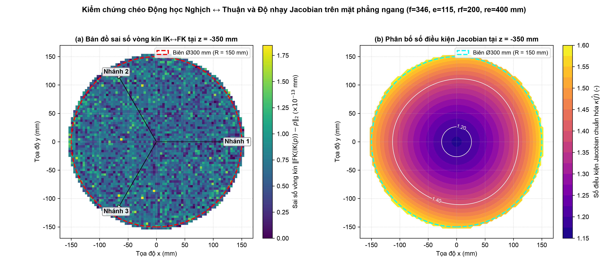
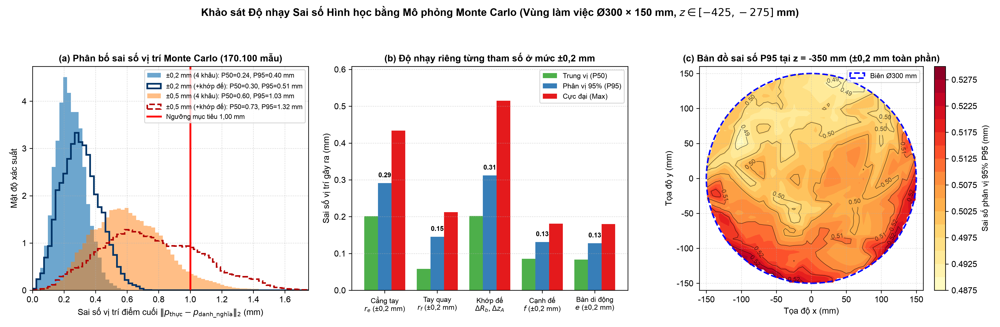
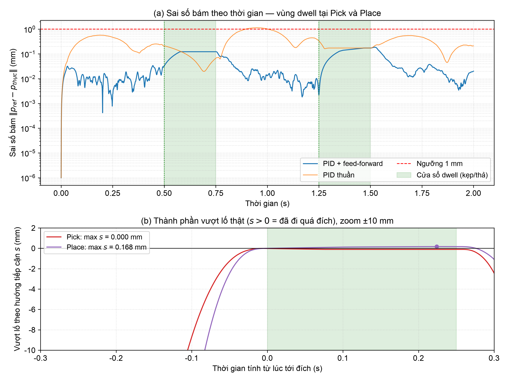
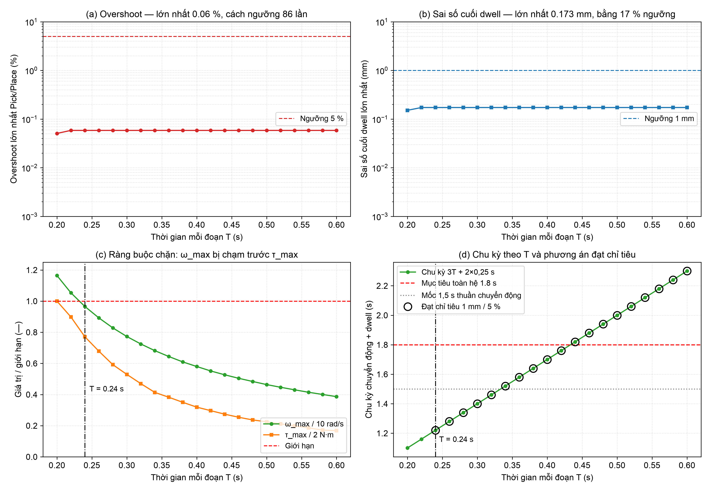
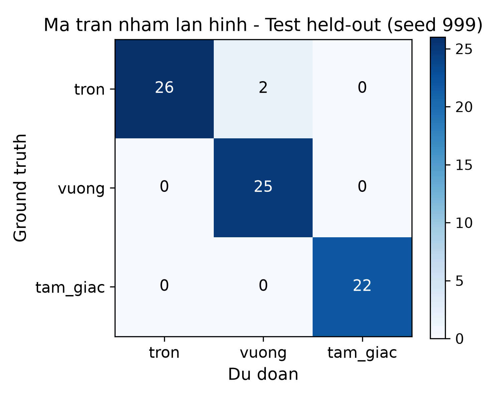
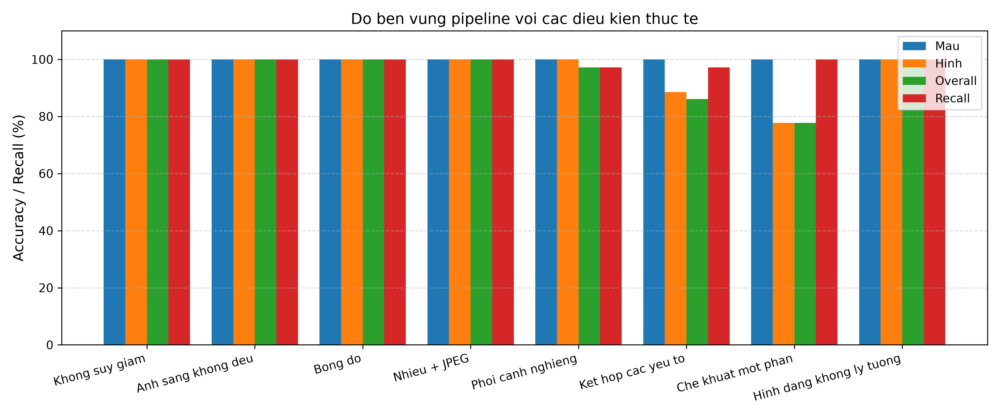

# Chương 5. Kết quả và thảo luận

Chương này trình bày kết quả theo bốn nhóm chỉ tiêu của đề cương: động học và dung sai (mục 5.1–5.2), quỹ đạo và chu kỳ (mục 5.3–5.4), thị giác (mục 5.5). Mục 5.6 so sánh với các công trình ở chương 2. Mục 5.7 nêu hiệu lực và giới hạn của kết quả. Mọi số liệu lấy từ thư mục kết quả của đề tài, và mỗi bảng ghi nguồn ngay bên dưới. Các kết quả mô phỏng không phải số đo trên phần cứng; mục 5.4 và 5.7 nêu rõ phần nào chưa đo được.

## 5.1 Kiểm chứng động học

Động học nghịch (inverse kinematics — IK) của robot Delta 3 bậc tự do được giải giải tích. Động học thuận (forward kinematics — FK) được giải số bằng phương pháp Newton–Raphson (NR). Phép kiểm chứng chéo dùng 1.859 điểm lưới phủ hình trụ Ø300 × 150 mm, tương ứng cao độ z ∈ [−425; −275] mm. Bảng 5.1 tóm tắt kết quả.

**Bảng 5.1.** Kiểm chứng chéo IK↔FK trên 1.859 điểm lưới

| Chỉ tiêu | Giá trị |
| --- | --- |
| Điểm có nghiệm IK hợp lệ | 1.859 / 1.859 (100 %) |
| Sai số vòng kín cực đại, IK → FK giải tích (mm) | 1,583 × 10⁻¹³ |
| RMSE, IK → FK giải tích (mm) | 6,907 × 10⁻¹⁴ |
| Sai số vòng kín cực đại, IK → FK Newton–Raphson (mm) | 1,836 × 10⁻¹³ |
| Lệch cực đại giữa hai bộ giải (mm) | 1,729 × 10⁻¹³ |
| Điểm NR không hội tụ | 0 / 1.859 |
| Số vòng lặp NR trung bình / tối đa | 5,73 / 6 |
| Số điều kiện Jacobian chuẩn hoá κ(Ĵ): nhỏ nhất / trung bình / lớn nhất | 1,013 / 1,403 / 1,981 |
| Góc truyền lực nhỏ nhất (°) | 39,00 |
| Dải góc khớp chủ động θᵢ (°) | −27,05 đến 77,30 |

*Nguồn: `mo-hinh/ket-qua/tom-tat-kiem-chung.json` (mục `grid_evaluation`); `mo-hinh/dong-hoc-delta.md` mục 6.4.*

Sai số vòng kín cực đại đạt cỡ 10⁻¹³ mm, tức sai số làm tròn của số thực 64 bit. Con số này không nói lên độ chính xác của robot vật lý. Nó cho biết hai điều. Thứ nhất, công thức IK giải tích thoả mãn đúng các phương trình hình học của cấu trúc đã chọn. Thứ hai, nghiệm IK trùng với nghiệm của một bộ giải số khác trên toàn bộ lưới. Hai điều này khác với việc "khớp vì cùng một công thức", vì NR giải bằng lặp và không dùng biểu thức IK. [CẦN BỔ SUNG: xác nhận trong `kiem-chung-ik-fk.py` rằng hàm phần dư của NR chỉ dựa trên ràng buộc hình học, không gọi lại công thức IK.]

Không có điểm nào mất nghiệm, và NR hội tụ trong tối đa 6 vòng lặp. Số điều kiện Jacobian chuẩn hoá lớn nhất là 1,981, vẫn dưới 2,0. Hình 5.1 cho thấy bản đồ sai số vòng kín và đường đồng mức κ(Ĵ) trên mặt phẳng z = −350 mm. Góc truyền lực nhỏ nhất 39,00° cách biên kỳ dị (γ = 0°) khá xa và vượt ngưỡng 25° được đặt trong file mô hình. Dải góc khớp [−27,05°; 77,30°] nằm trong giới hạn phần mềm [−30°; +80°] của firmware.

*Hình 5.1. Bản đồ sai số vòng kín IK↔FK và đường đồng mức κ(Ĵ). Nguồn: `mo-hinh/ket-qua/ban-do-sai-so-xy.png`.*

## 5.2 Độ nhạy dung sai chế tạo

Chỉ tiêu 1 của đề cương yêu cầu biết sai số điểm cuối khi chiều dài khâu lệch ±0,2 mm. Khảo sát Monte Carlo lấy 300 bộ tham số ngẫu nhiên phân bố đều trong khoảng ±δ, nhân với 567 điểm lưới trong hình trụ. Tổng cộng 170.100 phép đánh giá cho mỗi kịch bản. Bảng 5.2 tóm tắt phân vị sai số, và Hình 5.2 trình bày cùng kết quả.

**Bảng 5.2.** Phân bố sai số điểm cuối theo kịch bản dung sai (mm)

| Kịch bản | P50 | P95 | P99 | Max | Mẫu ≤ 1,0 mm | Vùng có P95 ≤ 1,0 mm |
| --- | --- | --- | --- | --- | --- | --- |
| ±0,2 mm, 4 khâu (f, e, rf, re) | 0,236 | 0,402 | 0,476 | 0,689 | 100,00 % | 100,00 % |
| ±0,2 mm, thêm lệch khớp đế | 0,297 | 0,514 | 0,604 | 0,795 | 100,00 % | 100,00 % |
| ±0,5 mm, 4 khâu | 0,596 | 1,030 | 1,244 | 1,681 | 93,99 % | 31,57 % |
| ±0,5 mm, thêm lệch khớp đế | 0,733 | 1,321 | 1,506 | 2,410 | 76,45 % | 0,00 % |

*Nguồn: `mo-hinh/ket-qua/tom-tat-do-nhay.json`; `mo-hinh/dong-hoc-delta.md` mục 6.5(b). Cột cuối là tỷ lệ 567 điểm lưới có P95 (trên 300 mẫu) ≤ 1,0 mm.*

Ở dung sai ±0,2 mm, 100 % mẫu có sai số ≤ 1,0 mm, và 100 % điểm lưới có P95 ≤ 1,0 mm. Cực đại quan sát được là 0,689 mm với 4 khâu và 0,795 mm khi cộng lệch khớp đế. Ở dung sai ±0,5 mm, chỉ 31,57 % vùng làm việc giữ P95 ≤ 1,0 mm, và tỷ lệ này bằng 0,00 % khi có lệch khớp đế. Chỉ tiêu 1 mm vì vậy phụ thuộc mạnh vào cấp dung sai chế tạo.

*Hình 5.2. Phân bố sai số điểm cuối theo kịch bản dung sai. Nguồn: `mo-hinh/ket-qua/do-nhay-sai-so-hinh-hoc.png`.*

Khảo sát từng tham số (one-at-a-time) xếp vị trí khớp đế có hệ số khuếch đại xấu nhất 3,40 mm/mm, cẳng tay r_e là 2,52 mm/mm, tay quay r_f là 1,16 mm/mm, còn f và e đều 0,97 mm/mm. Cẳng tay r_e có P95 đơn lẻ là 0,291 mm, nên cần đồ gá để giữ đồng đều các thanh. Đây là lý do thiết kế cơ khí đặt dung sai chặt cho đế và r_e.

Cận trên giải tích là tổng |gᵢ|·δᵢ trên hộp dung sai. Đây là cận trên bậc nhất (tuyến tính hoá), tức giới hạn khi mọi khâu lệch cùng lúc theo dấu xấu nhất. Bảng 5.3 ghép các thành phần sai số của phương án truyền đai GT2 5:1 để đối chiếu với ngưỡng 1,0 mm.

**Bảng 5.3.** Ngân sách sai số điểm cuối cho phương án đai GT2 5:1 (mm)

| Thành phần | Không hiệu chuẩn gốc | Sau hiệu chuẩn 0,03° |
| --- | --- | --- |
| e_mech: Max mẫu Monte Carlo, ±0,2 mm | 0,689 | 0,689 |
| e_mech: cận trên giải tích, ±0,2 mm | 1,123 | 1,123 |
| e_mech: dung sai phân cấp (đế 0,05; r_e, r_f, f 0,10; e 0,15) | 0,780 | 0,780 |
| e_backlash: đai GT2, giả thiết | 0,100 | 0,100 |
| e_enc: 1 bước encoder, 20.000 xung/vòng | 0,063 | 0,063 |
| e_home: lệch gốc 0,10° / 0,03° | 0,349 | 0,105 |
| Tổng tuyến tính, e_mech = Max mẫu MC | 1,201 | 0,957 |
| Tổng tuyến tính, e_mech = cận trên giải tích | 1,635 | 1,391 |
| Tổng tuyến tính, e_mech = dung sai phân cấp | 1,292 | 1,048 |
| Tách nhóm: hệ thống + RSS ngẫu nhiên (P95) | 0,856 | 0,612 |
| Tách nhóm: hệ thống + RSS ngẫu nhiên (Max mẫu MC) | 1,141 | 0,897 |
| RSS, chỉ để tham chiếu (e_mech = P95 0,402) | 0,545 | 0,432 |

*Nguồn: `thiet-ke/thong-so-co-khi.md` mục 5.1 và Bảng 5.2a; số học được tính lại trong `bao-cao/phan-bien-01.md` mục 2. Giá trị e_backlash = 0,100 mm là giả thiết chưa đo, `[CẦN KIỂM CHỨNG BẰNG ĐO]` độ giãn đai.*

Bảng 5.3 cho kết luận khác nhau tùy cách cộng. Theo thống kê, P95 của e_mech là 0,402 mm, và tổng dùng cực đại mẫu Monte Carlo đạt 0,957 mm sau hiệu chuẩn. Theo worst-case tuyến tính, tổng đạt 1,391 mm sau hiệu chuẩn với dung sai ±0,2 mm, và vẫn vượt 1,0 mm với 1,048 mm khi dùng dung sai phân cấp. Vì vậy, chỉ tiêu 1 mm **đạt theo thống kê và không đạt theo worst-case**. Cách tách nhóm cho kết quả trung gian: cộng tuyến tính phần hệ thống với RSS phần ngẫu nhiên, được 0,612 mm (P95) và 0,897 mm (max mẫu) sau hiệu chuẩn — khớp Bảng 4.6 và bảng nguồn `thong-so-co-khi.md` mục 5.2b.

## 5.3 Quỹ đạo và điều khiển

Quỹ đạo gắp–thả dùng đa thức bậc 5 với pha dừng 0,25 s tại điểm gắp và điểm thả. Hai bộ điều khiển được so sánh: PID thuần và PID cộng feed-forward (FF). Bảng 5.4 tóm tắt kết quả tại T = 0,50 s, chu kỳ 3T + 0,5 = 2,00 s.

**Bảng 5.4.** Đáp ứng bám tại T = 0,50 s (pha dừng 0,25 s)

| Chỉ số | PID thuần | PID + feed-forward |
| --- | --- | --- |
| Sai số bám cực đại (mm) | 1,137 | 0,186 |
| RMSE sai số bám (mm) | 0,435 | 0,070 |
| Overshoot tại Pick (mm / %) | 0,202 / 0,134 | 0,000 / 0,000 |
| Overshoot tại Place (mm / %) | 0,331 / 0,115 | 0,168 / 0,058 |
| Sai số cuối pha dừng tại Pick / Place (mm) | 0,067 / 0,173 | 0,122 / 0,173 |
| Mô-men cực đại (N·m) | 0,453 | 0,455 |
| Tốc độ góc cực đại (rad/s) | 4,665 | 4,645 |

*Nguồn: `mo-phong/runs/2026-11-24-pid-v2-dung-nghi/KETQUA.md` mục 2.*

Kết quả này cho thấy feed-forward cần thiết để đạt chỉ tiêu 1 mm. Với PID thuần, sai số bám cực đại 1,137 mm đã vượt 1 mm. Overshoot thực đo nằm dưới 0,15 % với PID thuần và bằng 0 với PID+FF.

**Sửa metric.** Bản mô phỏng cũ (`2026-11-18-pid-quy-dao-bac5`) báo overshoot 4,35 % với PID thuần. Con số này sai về định nghĩa. Cửa sổ đo của bản cũ kéo dài đến target + 0,15T, nhưng quỹ đạo không có pha dừng nên phần đuôi này nằm trong đoạn kế tiếp. Đại lượng đo được là khoảng cách robot rời khỏi điểm đích. Dấu hiệu rõ nhất là overshoot 6,52 mm lớn hơn cả sai số bám cực đại 1,158 mm của cùng bản chạy. Bản v2 đo trong cửa sổ [t đến đích, t đến đích + dwell]. Overshoot được định nghĩa là phần vượt theo hướng tiếp cận, max(0; max s(t)). Script còn dừng với lỗi nếu overshoot lớn hơn sai số bám cực đại. Bản v2 cho overshoot 0,134 % với PID thuần, và con số 4,35 % được thay thế.

**Thời gian xác lập bằng 0.** Trong bản v2, sai số lớn nhất trong pha dừng chỉ 0,12–0,33 mm, nên robot đã vào vùng ±1 mm ngay khi tới đích. Ngưỡng 1 mm quá rộng để phân giải thời gian xác lập. Cột thời gian xác lập vì vậy không có ý nghĩa ở ngưỡng này.

**Nguồn sai số 0,12–0,17 mm.** Mô phỏng có lượng tử hoá encoder 4096 xung/vòng. Với T = 0,30 s, tắt lượng tử hoá cho RMSE 0,0001 mm, còn bật lên 0,0813 mm. Như vậy, sai số cuối pha dừng do độ phân giải encoder, không phải do động học. Kết quả "đạt 1 mm" phụ thuộc giả thiết 4096 xung/vòng.

Bảng 5.5 trình bày quét chu kỳ và điểm vận hành được chốt.

**Bảng 5.5.** Chọn điểm vận hành theo T, có xét giới hạn mô-men và tốc độ góc

| T (s) | Chu kỳ có pha dừng (s) | Tổng hệ thống (s) | ω_max (rad/s) | τ_max động (N·m) | τ + trọng lực (N·m) | k_τ | Kết luận |
| --- | --- | --- | --- | --- | --- | --- | --- |
| 0,22 | 1,16 | 1,21 | 10,53 | 1,796 | — | — | Loại: vượt ω_max = 10 rad/s |
| 0,24 | 1,22 | 1,27 | 9,66 | 1,542 | 1,74 | 1,46 | Loại: k_τ < 2,0 |
| **0,32** | **1,46** | **1,51** | **7,25** | **0,940** | **1,14** | **2,23** | **Chọn** |
| 0,50 | 2,00 | 2,05 | 4,64 | 0,450 | 0,65 | 3,92 | Loại: tổng > 1,8 s |

*Nguồn: `mo-phong/runs/2026-11-24-pid-v2-dung-nghi/KETQUA.md` mục 3 và 7; `output/quet-chu-ky.csv`. Tổng hệ thống được tính lại theo mục 5.4; file KETQUA ghi 1,26 / 1,50 / 2,04 s (đã gồm đủ overhead 0,046 s), khác biệt chỉ do làm tròn. Dòng T = 0,22 s lấy từ bảng quét mục 3; k_τ không tính ở dòng này vì chưa thuộc danh sách chọn.*

Với k_τ ≥ 2,0 là ngưỡng hệ số an toàn đặt cho đai GT2 5:1 (τ_ra = 2,53 N·m). Tại T = 0,32 s, k_τ = 2,23 đạt ngưỡng. Quét mịn hơn quanh 0,22–0,24 s chưa thực hiện. Hình 5.3 cho thấy sai số bám và vùng pha dừng, còn Hình 5.4 cho thấy quét chu kỳ.

*Hình 5.3. Sai số bám, vùng pha dừng và thành phần vượt lố. Nguồn: `mo-phong/runs/2026-11-24-pid-v2-dung-nghi/figures/sai_so_va_dwell.png`.*

*Hình 5.4. Quét T từ 0,20 s đến 0,60 s và các phương án đạt chỉ tiêu. Nguồn: `mo-phong/runs/2026-11-24-pid-v2-dung-nghi/figures/quet_chu_ky.png`.*

[CẦN BỔ SUNG: sai số bám cực đại của PID thuần tại T = 0,32 s. Bảng quét hiện chỉ có PID+FF (max_err 0,182 mm tại T = 0,32 s).]

## 5.4 Chu kỳ toàn hệ thống

Chu kỳ toàn hệ thống được cộng từ các thành phần trong Bảng 5.6. Thành phần chuyển động và dừng lấy từ mô phỏng và thông số danh định. Thành phần thị giác lấy từ phép đo trên máy tính và webcam thật. Truyền Serial chỉ là dry-run.

**Bảng 5.6.** Phân rã chu kỳ toàn hệ thống tại T = 0,32 s

| Thành phần | Giá trị | Mức độ tin cậy |
| --- | --- | --- |
| Chuyển động 3 đoạn: 3T | 0,960 s | Mô phỏng |
| Kẹp và thả: 2 × 0,25 s | 0,500 s | Danh định, chưa đo |
| Xử lý ảnh (trung bình / P95) | 3,41 ms / 4,12 ms | Đo trên 273 ảnh tổng hợp |
| Chờ khung hình camera (trung bình / P95) | 41,05 ms / 79,06 ms | Đo trên webcam thật, 24,4 fps |
| Truyền Serial và phản hồi | ~2,0 ms | Dry-run, **chưa đo** |
| **Tổng danh định** | **1,506 s** | Dư 0,29 s so với 1,8 s |
| **Tổng theo P95 thị giác** | **1,545 s** | Dư 0,25 s so với 1,8 s |

*Nguồn: `mo-phong/runs/2026-11-24-pid-v2-dung-nghi/KETQUA.md` mục 4; `mo-phong/runs/2026-11-18-thi-giac-hsv/output/metrics.json` (`timing_ms`); `output/webcam_info.json`. Dòng tổng là tính lại từ các dòng trên.*

Mốc đối chiếu 1,8 s/vật của Vo & Le [2] được dùng làm ngân sách. Với cấu hình trên, tổng danh định 1,506 s thấp hơn 1,8 s, nên chỉ tiêu toàn hệ thống đạt **trong ngân sách danh định**. Tuy nhiên, còn ba điểm chưa đo.

1. **Trễ Serial thật chưa đo.** Số 2,0 ms là dry-run. Thông số thực có thể lớn hơn đáng kể. Phép đo `do-tre-serial.py` cần thực hiện với board đã cắm.
2. **Trễ cơ cấu chấp hành: phải tách hai cấu hình.** Thiết kế trong BOM dùng **động cơ bước vòng kín + đai GT2**, không phải servo hobby. Với stepper, sai lệch vị trí là sai số bám trong lúc chạy (đã nằm trong ngân sách sai số 0,612 mm), không phải một khoảng trễ cố định cộng vào chu kỳ; pha dừng 0,25 s đã bao trùm thời gian ổn định. Ngược lại, **mô hình HIL** (Arduino + servo hobby trong `firmware/uno-serial-servo/`) có thời gian quay 110° khoảng 0,18–0,37 s; nếu lấy cấu hình đó làm chu kỳ thì tổng thành 1,69–1,88 s. Vì vậy HIL chỉ dùng để **đo trễ truyền thông**, không dùng để đánh giá chu kỳ. `[CẦN BỔ SUNG: đo thời gian bám thực của stepper vòng kín trên khung thật để xác nhận pha dừng 0,25 s là đủ.]`
3. **Pha dừng 0,25 s là ước lượng.** Dải 0,2–0,3 s lấy từ `tai-lieu/tong-quan.md` mục 7.1 và chưa có số đo. Nếu xy-lanh hoặc gắp chậm hơn, chu kỳ dịch theo.

Thành phần chờ khung hình giả định webcam chạy đúng nhịp đo được, tức 24,4 fps. Yêu cầu của đề cương là 30 fps, nên thành phần này có thể thay đổi khi thay camera. Kết luận chu kỳ là kết quả mô phỏng kết hợp đo thị giác, chưa phải kết quả của hệ thống hoàn chỉnh.

## 5.5 Thị giác

Pipeline dùng ngưỡng HSV và contour, không học sâu. Bộ dữ liệu là ảnh tổng hợp do nhóm tạo bằng OpenCV và NumPy, vì chưa có vật mẫu thật. Tập test cuối có seed 999, gồm 60 ảnh và 75 vật. Pipeline được đóng băng trước khi chạy tập này, và tập này chỉ chạy một lần. Tập seed 777 đã được dùng để chẩn đoán lỗi, nên không dùng làm bằng chứng không chệch.

Trên tập test seed 999, pipeline đạt độ chính xác tổng 97,33 % (73/75 vật đúng cả màu và hình), khoảng tin cậy Wilson 95 % là 90,8–99,3 %. Màu sắc đúng 75/75 (100 %, CI 95,1–100 %). Recall và precision cùng bằng 100 %. Phân loại hình dạng đúng 73/75. Bảng 5.7 là ma trận nhầm lẫn hình dạng; ma trận màu có đường chéo 29, 25, 21 cho đỏ, vàng, xanh và không có ô ngoài đường chéo. Hình 5.5 trình bày cả hai ma trận.

**Bảng 5.7.** Ma trận nhầm lẫn hình dạng, tập test seed 999 (số vật)

| Thật \ Dự đoán | Tròn | Vuông | Tam giác |
| --- | --- | --- | --- |
| Tròn | 26 | 2 | 0 |
| Vuông | 0 | 25 | 0 |
| Tam giác | 0 | 0 | 22 |

*Nguồn: `mo-phong/runs/2026-11-18-thi-giac-hsv/ket-qua/test-999/metrics-heldout.json` và `error_cases.csv`.*

Hai ca sai đều là vật đỏ tròn bị nhận thành đỏ vuông. Khoảng cách tâm giữa hai dự đoán là 0,0 px và 1,4 px, nên đây là cùng một vật. Lỗi chỉ nằm ở hình dạng, không nằm ở màu. Cùng kiểu lỗi xuất hiện ở các điều kiện khác trong Bảng 5.8.

*Hình 5.5. Ma trận nhầm lẫn hình dạng trên tập test seed 999; ma trận màu ở `mo-phong/runs/2026-11-18-thi-giac-hsv/ket-qua/test-999/figures/confusion_color_test_999.png`.*

**Độ bền vững.** Pipeline đã cố định được kiểm tra trên tám điều kiện. Mỗi điều kiện có 36 ảnh; riêng che khuất có 72 vật. Bảng 5.8 báo cáo độ chính xác tổng và hình dạng kèm khoảng tin cậy Wilson 95 %. Với 36 ảnh, một ca sai làm thay đổi tỷ lệ khoảng 2,8 điểm phần trăm, nên các khoảng tin cậy rất rộng.

**Bảng 5.8.** Độ bền vững của pipeline với tám điều kiện (36 ảnh/điều kiện; che khuất 72 vật)

| Điều kiện | n GT | Tổng thể, % (CI 95 %) | Màu, % | Hình, % (CI 95 %) | Recall, % | Precision, % | mean\|diff\| (/255) |
| --- | --- | --- | --- | --- | --- | --- | --- |
| Không suy giảm | 36 | 100,0 (90,4–100) | 100,0 | 100,0 (90,4–100) | 100,0 | 100,0 | 0,0 |
| Ánh sáng không đều (gradient 40–60 %) | 36 | 100,0 (90,4–100) | 100,0 | 100,0 (90,4–100) | 100,0 | 100,0 | 57,8 |
| Bóng đổ (bản tăng cường, 29,4 % diện tích) | 36 | 94,4 (81,9–98,5) | 100,0 | 94,4 (81,9–98,5) | 100,0 | 100,0 | 23,0 |
| Nhiễu cảm biến + JPEG | 36 | 100,0 (90,4–100) | 100,0 | 100,0 (90,4–100) | 100,0 | 100,0 | 9,4 |
| Phối cảnh nghiêng (8–12 %) | 36 | 100,0 (90,4–100) | 100,0 | 100,0 (90,4–100) | 100,0 | 100,0 | 6,4 |
| Hình dạng không lý tưởng (jitter + blur) | 36 | 91,7 (78,2–97,1) | 100,0 | 91,7 (78,2–97,1) | 100,0 | 100,0 | 10,8 |
| Che khuất một phần (15–25 %) | 72 | 77,8 (66,9–85,8) | 100,0 | 77,8 (66,9–85,8) | 100,0 | 97,3 | 16,8 |
| Kết hợp: gradient + bóng + JPEG + phối cảnh | 36 | 80,6 (65,0–90,2) | 100,0 | 80,6 (65,0–90,2) | 100,0 | 100,0 | 66,9 |

*Nguồn: `mo-phong/runs/2026-11-18-thi-giac-hsv/output/robustness.csv` và `KETQUA.md` mục 5.5. CI của màu là 90,4–100 % với n = 36 và 94,9–100 % với n = 72. Cột bóng đổ dùng bản tăng cường, không so sánh được với bản bóng nhẹ cũ.*

Màu đúng ở mọi điều kiện riêng lẻ, nên ngưỡng HSV đủ rộng cho các biến đổi đã thử. Nút thắt là hình dạng. Che khuất đưa độ chính xác xuống 77,8 %, và kết hợp nhiều yếu tố còn 80,6 %. Kiểu lỗi chủ đạo là tròn → vuông, xuất hiện trong bóng đổ, che khuất, hình dạng không lý tưởng và tổ hợp. Hình 5.6 so sánh các điều kiện.

*Hình 5.6. Độ chính xác tổng thể theo tám điều kiện. Nguồn: `mo-phong/runs/2026-11-18-thi-giac-hsv/figures/robustness-bar.png`.*

Bản bóng đổ cũ (mean|diff| = 3,48/255) đã được thay thế, vì quá nhẹ để kiểm chứng. Bản cũ cũng bỏ cột precision (78,57 %). Các số trong bảng này là bản tăng cường với mean|diff| 23,0/255, đã có đủ precision. Hai bảng không so sánh trực tiếp được.

## 5.6 Thảo luận

Bảng 5.9 đặt kết quả cạnh các công trình đã đọc ở chương 2. Các so sánh là định tính khi tài liệu không có số đo cùng chỉ tiêu.

**Bảng 5.9.** So sánh chỉ tiêu với các công trình chương 2

| Công trình | Chỉ tiêu có số | Kết quả đề tài | Ghi chú so sánh |
| --- | --- | --- | --- |
| Vo & Le, 2023 [2] | 1,8 s/vật; 100 % đỏ và vàng, 97,5 % xanh | Chu kỳ 1,506 s danh định; màu 100 % (75 vật) | Không rõ cỡ mẫu và định nghĩa chu kỳ trong tóm tắt; đề tài có 3 màu × 3 hình |
| Elassal, 2024 [7] | Định tính: "proved the effectiveness and accuracy" | Độ chính xác 97,33 % trên 75 vật | Không có số để so sánh trực tiếp |
| Hoai, 2023 [8] | Định tính: "small error" | Sai số vị trí chưa đo trên vật thật | Không có số mm để đối chiếu |
| Vischer & Clavel, 1998 [4] | Hiệu chuẩn sai số hình học | Ngân sách sai số 0,957 mm (Max MC, sau hiệu chuẩn) | [CẦN BỔ SUNG: sai số trước và sau hiệu chuẩn trong toàn văn [4]] |
| Castañeda, 2015 [5]; Liu, 2020 [6] | ADRC; định tính | PID + FF đạt 0,186 mm sai số bám cực đại tại T = 0,50 s | Chưa so sánh với ADRC; không suy ra đề tài tốt hơn |

*Nguồn: `tai-lieu/bang-so-sanh.md`; `bao-cao/02-tong-quan.md` mục 2.2–2.8; số đề tài lấy từ các bảng 5.1–5.8.*

Đề tài mạnh hơn các tài liệu này ở hai điểm. Thứ nhất, kiểm chứng chéo IK↔FK được định lượng trên 1.859 điểm, điều mà các bài đã đọc chưa làm. Thứ hai, chỉ tiêu dung sai được suy ra từ độ nhạy, kèm cận trên giải tích. Pipeline mô phỏng cũng tái lập được và có sửa một metric đo sai.

Đề tài yếu hơn ở chỗ chưa có vật thật. Tập phân loại là ảnh tổng hợp; mục tiêu 3 yêu cầu ≥ 120 vật thật và chưa đạt. Chu kỳ 1,506 s chưa đo trên phần cứng. Vì vậy, so với [2] chỉ có thể nói về chỉ tiêu được định nghĩa rõ, không so sánh hiệu năng trên cùng điều kiện.

## 5.7 Hiệu lực và giới hạn

Các giới hạn sau ảnh hưởng trực tiếp đến cách đọc kết quả.

1. **Ảnh tổng hợp không đại diện vật thật.** Mọi số phân loại ở mục 5.5 đo trên ảnh do bộ sinh của nhóm tạo, không đo trên vật mẫu và ánh sáng thật. Độ chính xác 97,33 % không chuyển trực tiếp sang bàn thí nghiệm.
2. **Chưa có trễ đo thật.** Serial là dry-run, trễ servo chưa đưa vào phép đo. Chu kỳ 1,506 s là danh định.
3. **Mô phỏng bỏ trọng lực và tương tác chéo.** Mô hình khớp dùng τ = J·θ̈ + b·θ̇, không có trọng lực hay ma sát Coulomb. Mô-men trọng lực 0,196 N·m được cộng thêm như một thành phần tĩnh khi chọn động cơ, chưa đi vào mô phỏng.
4. **J = 0,01 kg·m² là giả định.** Ước tính cơ khí từ khối lượng chi tiết cho 0,0066–0,0075 kg·m² (`thiet-ke/thong-so-co-khi.md` mục 2). Giá trị 0,01 được chọn bảo thủ. Nếu J thực thấp hơn, τ động giảm và k_τ = 2,23 tăng, nên kết luận hiện tại nghiêng về phía an toàn.
5. **Độ phân giải encoder quyết định một phần kết quả 1 mm.** Mô phỏng dùng 4096 xung/vòng, còn BOM chọn 4000 cpr × 5:1. Chênh lệch nhỏ (0,0015 mm) nhưng hai hệ thống số phải thống nhất.
6. **36 ảnh mỗi điều kiện cho khoảng tin cậy rất rộng.** Một ca sai làm tỷ lệ thay đổi khoảng 2,8 điểm phần trăm. Tập 75 vật cho CI 90,8–99,3 %, nên không nên trình bày 97,33 % như giá trị chính xác.
7. **Tập test đã bị nhìn trước.** Seed 777 đã dùng để chẩn đoán. Chỉ seed 999 là ước lượng không chệch, và nó chỉ chạy một lần.
8. **Dung sai ±0,2 mm là điều kiện giả định.** Kết luận 5.2 đúng khi đế và đồ gá đạt dung sai này. Chưa có bản vẽ gia công thật để kiểm chứng.

[CẦN BỔ SUNG: thông tin về kỹ thuật lấy mẫu của nhóm — ảnh chụp bằng webcam thật và số vật thật sẽ bổ sung khi đạt mục tiêu 3.]

---

*Ghi chú biên tập (xoá trước khi nộp):*

- *Nhãn nguồn `[2]` trong `mo-hinh/dong-hoc-delta.md` mục 6.5 và trong script `do-nhay-hinh-hoc.py` ứng với Vischer & Clavel, tức `[4]` trong chương 2. Đã dùng số `[4]` ở đây.*
- *Chu kỳ 1,50 s trong các file là số làm tròn; tổng tính lại là 1,506 s. Khoảng dư là 0,29 s, không phải 0,30 s.*
- *Số P95 của thị giác: `metrics.json` ghi 4,12 ms, `KETQUA.md` cũ ghi 4,27 ms. Bản này dùng 4,12 ms.*
- *Mục tiêu 3 chưa đạt; không được viết "đạt ≥ 90 % trên ≥ 120 vật".*
