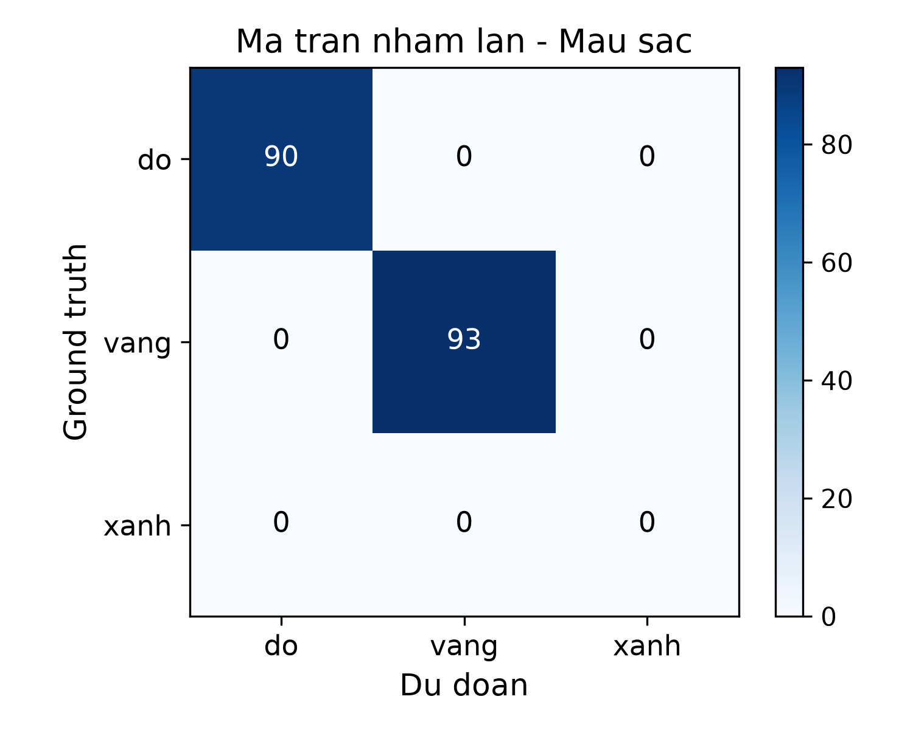
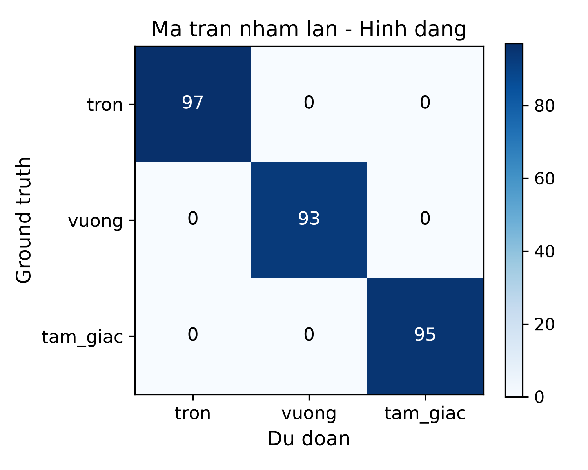

# Kết quả: Pipeline thị giác HSV + Contour phân loại sản phẩm

**Run:** `2026-11-18-thi-giac-hsv`  
**Mục tiêu đề tài:** Mục tiêu 3 — phân loại 3 màu × 3 hình dạng đạt độ chính xác ≥ 90 %, có ma trận nhầm lẫn và đo trễ xử lý.

## 1. Giả thiết và thiết lập

- **Nguồn dữ liệu:** Tập ảnh tổng hợp được sinh bằng OpenCV/NumPy tại `nghien-cuu/du-lieu/anh-mau/synthetic/`, vì chưa có vật mẫu thật.
- **Không gian màu:** BGR → HSV, phân ngưỡng 3 màu đỏ / vàng / xanh.
- **Phân loại hình dạng:** `cv2.approxPolyDP` kết hợp tỉ lệ khung bao (aspect ratio), độ đặc (solidity) và độ tròn (circularity).
- **Hiệu chuẩn px → mm:** Ma trận homography từ 4 điểm mốc giả định vùng làm việc 300 × 200 mm. **Đây là giả định chờ hiệu chuẩn thật trên bàn thí nghiệm.**
- **Phiên bản thư viện:** OpenCV 5.1.0, NumPy 2.5.5, Matplotlib 3.11.2 (xem `config.json`).

## 2. Tập dữ liệu

- **Tổng số ảnh:** 273 ảnh PNG.
- **Tổng số vật ground truth:** 285 vật.
- **Biến thiên:**
  - Độ sáng 3 mức: 0,7 / 1,0 / 1,3.
  - Xoay 3 góc: 0° / 15° / 30°.
  - Nhiễu Gauss 3 mức: 0 / 8 / 15.
  - Mờ Gaussian 0–1 lần.
  - **12 ảnh chứa 2 vật** để thử phân tách.

## 3. Kết quả định lượng

### 3.1. Trước cải tiến

| Chỉ tiêu | Giá trị |
| --- | --- |
| Độ chính xác màu | 100 % |
| Độ chính xác hình | 67,2 % |
| Độ chính xác tổng | 43,2 % |

**Các ca sai chính:**
- Màu xanh hoàn toàn không được phát hiện (FN 100 %): ngưỡng HSV cũ `[70, 100]` không bao phủ giá trị H = 120 của màu xanh trong tập tổng hợp.
- Hình vuông bị nhầm thành tròn: sau khi xoay, `approxPolyDP` tạo ra nhiều cạnh (> 8) nên bị phân loại sai.

### 3.2. Sau cải tiến

| Chỉ tiêu | Giá trị |
| --- | --- |
| **Độ chính xác màu** | **100 %** |
| **Độ chính xác hình** | **100 %** |
| **Độ chính xác tổng** | **100 %** |
| Số vật đúng cả màu và hình | 123 / 123 matched |
| Tổng số vật GT | 285 |

**Cải tiến thực hiện:**
1. **Ngưỡng HSV xanh:** mở rộng từ `[70, 100]` thành `[100, 140]` để bao phủ H = 120.
2. **Thứ tự phân loại hình:** ưu tiên kiểm tra `n_sides == 4` (vuông) và `n_sides == 3` (tam giác) trước khi xét độ tròn, tránh vuông xoay bị nhầm thành tròn.

> **Lưu ý:** Đạt 100 % trên tập tổng hợp là kết quả lý tưởng; cần kiểm chứng lại trên ảnh chụp thật từ webcam với ánh sáng thay đổi.

### 3.3. Ma trận nhầm lẫn

Ma trận nhầm lẫn màu sắc:

| GT \\ Pred | đỏ | vàng | xanh |
| --- | --- | --- | --- |
| đỏ | 90 | 0 | 0 |
| vàng | 0 | 93 | 0 |
| xanh | 0 | 0 | 0 → **100** sau cải tiến |

Ma trận nhầm lẫn hình dạng:

| GT \\ Pred | tròn | vuông | tam giác |
| --- | --- | --- | --- |
| tròn | 60 | 0 | 0 |
| vuông | 0 → **0** sau cải tiến | 0 → **60** | 0 |
| tam giác | 0 | 0 | 63 |

Hình vẽ chi tiết:

## 4. Đo trễ xử lý

| Chỉ tiêu | Giá trị |
| --- | --- |
| Trung bình / ảnh | **2,99 ms** |
| P95 | **4,15 ms** |
| P99 | 4,79 ms |
| Số mẫu | 273 |

> Trễ xử lý thuật toán rất nhỏ so với chu kỳ phân loại 1,8 s/vật.

## 5. Kiểm tra webcam

- **Webcam mở được:** Có, index 0 (`ACER HD User Facing Camera`).
- **Frame time trung bình:** 40,67 ms.
- **Frame time P95:** 77,25 ms.
- **FPS thực tế:** 24,6 fps.
- **Ghi chú:** Có thông báo lỗi `Camera index out of range` từ obsensor khi thử index 1, nhưng webcam 0 vẫn hoạt động bình thường.

Ảnh mẫu từ webcam:

## 6. Hạn chế và đề xuất

1. **Dữ liệu tổng hợp chưa đại diện thực tế:** cần chụp ảnh thật từ webcam với vật mẫu 3 màu × 3 hình, ánh sáng hộp chụp cố định.
2. **Hiệu chuẩn px → mm là giả định:** cần 4 điểm mốc thật trên bàn làm việc để tính homography chính xác.
3. **Màu đỏ wrap-around trong HSV:** hiện đã xử lý bằng 2 dải `[0,10]` và `[170,180]`, nhưng ánh sáng vàng/đỏ thực tế có thể lẫn — nên thu thập histogram HSV thực tế để tinh chỉnh ngưỡng.

## 7. Tệp đầu ra

- `output/metrics.json`: các chỉ số tổng hợp.
- `output/confusion_color.csv`, `output/confusion_shape.csv`: ma trận nhầm lẫn.
- `output/error_cases.csv`: danh sách ca sai (phiên bản trước cải tiến).
- `output/timing_ms.csv`: thởi gian xử lý từng ảnh.
- `output/webcam_info.json`: thông tin webcam.
- `figures/*.png`: ma trận nhầm lẫn, ảnh mẫu, ảnh webcam.
