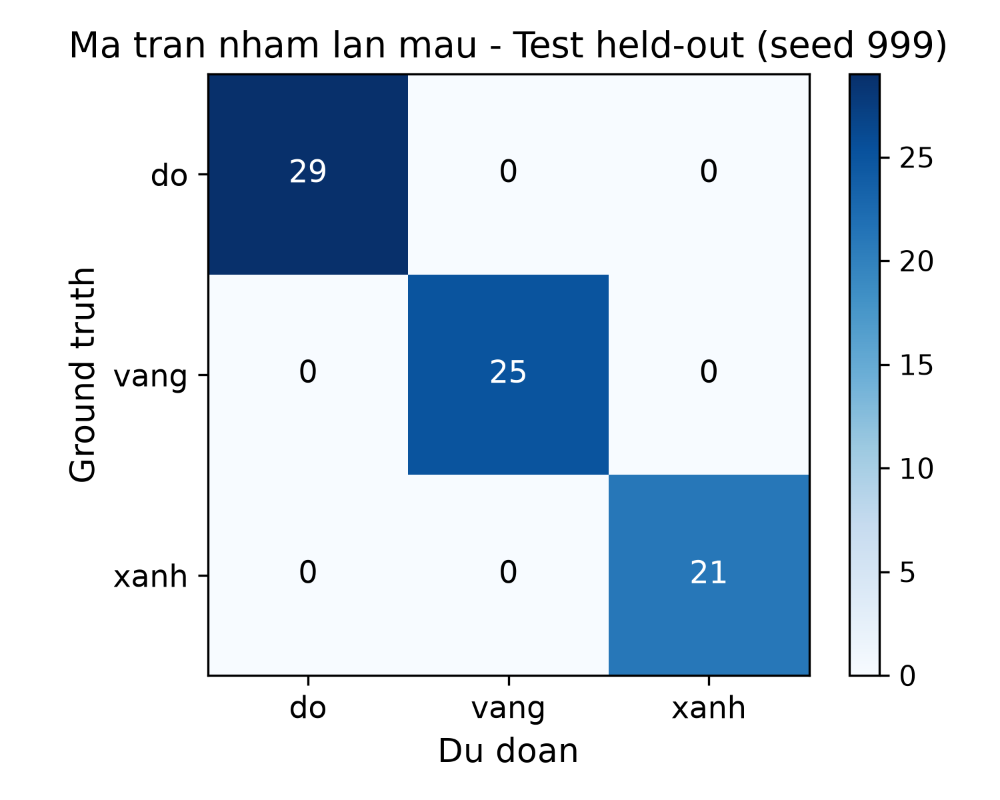
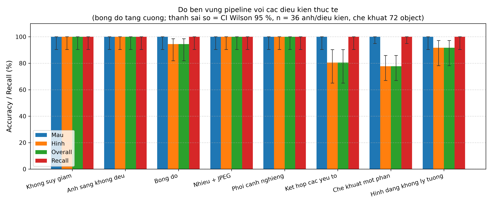
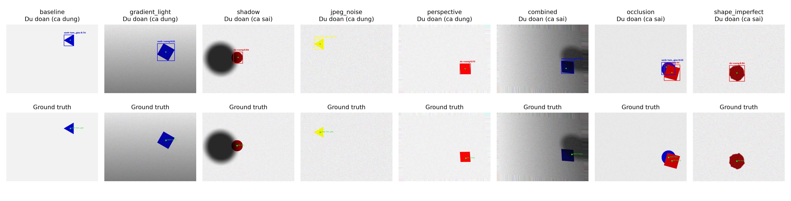

# Kết quả: Pipeline thị giác HSV + Contour phân loại sản phẩm

**Run:** `2026-11-18-thi-giac-hsv`  
**Mục tiêu đề tài:** Mục tiêu 3 — phân loại 3 màu × 3 hình dạng đạt độ chính xác ≥ 90 %, có ma trận nhầm lẫn và đo trễ xử lý.

## 1. Giả thiết và thiết lập

- **Nguồn dữ liệu:** Tập ảnh tổng hợp được sinh bằng OpenCV/NumPy tại `nghien-cuu/du-lieu/anh-mau/synthetic/`, vì chưa có vật mẫu thật.
- **Không gian màu:** BGR → HSV, phân ngưỡng 3 màu:
  - Đỏ: `H ∈ [0,10] ∪ [170,180]`, `S ≥ 100`, `V ≥ 50`
  - Vàng: `H ∈ [20,40]`, `S ≥ 100`, `V ≥ 50`
  - Xanh: `H ∈ [100,140]`, `S ≥ 80`, `V ≥ 50`
- **Phát hiện vật:** lọc contour theo diện tích tương đối (`min_area_ratio = 0.0002`, `max_area_ratio = 0.70`), morphology kernel tự động theo kích thước ảnh.
- **Phân loại hình dạng** dựa trên vector đặc trưng:
  - `circularity = 4πA / P²`
  - `extent = A / bbox_area`
  - `solidity = A / convex_hull_area`
  - Số cạnh `n_sides` từ `cv2.approxPolyDP(epsilon = 0.025 × chu vi)`
  - **Phân bố góc tại các đỉnh** (vuông có góc ~90°, tam giác có 3 góc nhọn)
- **Hiệu chuẩn px → mm:** Homography giả định vùng làm việc 300 × 200 mm từ 4 điểm mốc. **Cần hiệu chuẩn thật trên bàn thí nghiệm.**
- **Môi trường:** `D:\Python312\python.exe`, OpenCV 5.1.0, NumPy 2.5.5, Matplotlib 3.11.2.

## 2. Chia tập dữ liệu (4 tập tách biệt)

| Tập | Seed | Số ảnh | Số object | Điều kiện | Mục đích |
| --- | --- | --- | --- | --- | --- |
| **Train / Tune** | 42 | 273 | 285 | Sáng 0,7–1,3; xoay ≤ 30°; nhiễu ≤ 15; mờ 0–1 | Huấn luyện/tinh chỉnh ngưỡng HSV và tham số hình học |
| **Validation** | 555 | 60 | 75 | Sáng 0,7–1,3; xoay ≤ 30°; nhiễu ≤ 15; mờ 0–1 (trung bình-khó) | Chọn tham số, **không báo cáo** |
| **Test cũ** | 777 | 60 | 75 | Sáng 0,55–1,45; xoay ≤ 40°; nhiễu ≤ 25; mờ 0–2 | Đã dùng để **chẩn đoán lỗi** → không còn là test không chệch |
| **Test cuối** | **999** | **60** | **75** | **Sáng 0,55–1,45; xoay ≤ 40°; nhiễu ≤ 25; mờ 0–2** | **Báo cáo cuối cùng (chưa từng dùng để tinh chỉnh)** |

## 3. Phát hiện overfit và cách xử lý

**Phiên bản đầu:** đạt 100 % trên tập seed 42 sau khi chỉnh ngưỡng HSV, nhưng chỉ **84 %** trên tập kiểm tra độc lập (seed 777): màu 100 %, hình 84 %, tổng 84 %. Cụ thể, **12/25 hình vuông bị nhầm thành tam giác** do `approxPolyDP` sinh ra 3 đỉnh khi có mờ/nhiễu.

**Cải tiến để tổng quát hóa:**
1. **Thêm đặc trưng góc:** tính góc nội tiếp tại các đỉnh `approxPolyDP`. Vuông được nhận diện nếu có ít nhất 3 góc trong khoảng 70°–110°, kể cả khi số đỉnh bị nhiễu (3–6 cạnh).
2. **Làm mượt xấp xỉ:** giảm `epsilon` của `approxPolyDP` xuống `0,025 × chu vi` để giảm đỉnh giả do nhiễu.
3. **Ngưỡng HSV xanh:** giữ ngưỡng `[100, 140]` đã hiệu chỉnh trên tập train.

Các tham số trên được chọn dựa trên tập **validation (seed 555)**. Tập **777** sau đó đã được dùng để *chẩn đoán* lỗi (chính nhờ nó mới phát hiện 12/25 hình vuông bị nhầm thành tam giác và thêm đặc trưng góc), rồi chạy lại cho tới 100 %. Vì vậy **777 đã bị "nhìn" một lần và không còn là ước lượng không chệch** — không được trích 100 % trên 777 như bằng chứng tổng quát hóa. Để có con số không chệch, sau khi đóng băng `src/detect.py` và `src/evaluate.py`, một tập test mới **seed 999** (chưa từng dùng để tinh chỉnh) được chạy **đúng một lần**; đó là con số báo cáo.

## 4. Kết quả định lượng cuối cùng — Test cuối (seed 999, chưa từng dùng để tinh chỉnh)

**Con số dùng để báo cáo là kết quả trên tập test cuối (seed 999), chạy một lần sau khi đóng băng pipeline.** Kết quả seed 777 được giữ lại chỉ để đối chiếu lịch sử.

| Chỉ tiêu | Train (seed 42) | Validation (seed 555) | Test cũ (seed 777, đã dùng chẩn đoán) | **Test cuối (seed 999)** |
| --- | --- | --- | --- | --- |
| Số ảnh | 273 | 60 | 60 | **60** |
| Số object GT | 285 | 75 | 75 | **75** |
| Object khớp được | 285 | 75 | 75 | **75** |
| Accuracy màu | 100 % | 100 % | 100 % | **100 %** (CI95 95,1–100) |
| Accuracy hình | 100 % | 100 % | 100 % | **97,33 %** (CI95 90,8–99,3) |
| **Accuracy tổng** | **100 %** | **100 %** | **100 %** | **97,33 %** (CI95 90,8–99,3) |
| Recall tổng | 100 % | 100 % | 100 % | **100 %** (CI95 95,1–100) |
| Precision tổng | 100 % | 100 % | 100 % | **100 %** (CI95 95,1–100) |

> **Kết luận:** trên tập test không chệch, pipeline đạt **97,33 % accuracy tổng** (73/75 object đúng cả màu và hình), vẫn vượt mục tiêu ≥ 90 %, nhưng **không phải 100 %**. Khoảng tin cậy Wilson 95 % của 73/75 là 90,8–99,3 %, tức với chỉ 75 object thì sai số lấy mẫu còn lớn; không nên tuyên bố "chính xác tuyệt đối".

### Ma trận nhầm lẫn trên tập test cuối (seed 999)

Màu sắc (hàng = ground truth, cột = dự đoán): toàn bộ nằm trên đường chéo.

| GT \\ Pred | đỏ | vàng | xanh |
| --- | --- | --- | --- |
| đỏ | 29 | 0 | 0 |
| vàng | 0 | 25 | 0 |
| xanh | 0 | 0 | 21 |

Hình dạng — 2 ca sai đều là **tròn → vuông**:

| GT \\ Pred | tròn | vuông | tam giác |
| --- | --- | --- | --- |
| tròn | 26 | 2 | 0 |
| vuông | 0 | 25 | 0 |
| tam giác | 0 | 0 | 22 |

Hình vẽ chi tiết (sinh bởi `heldout-test.py --seed 999 --out-dir ket-qua/test-999`):

## 5. Ca sai còn lại

Trên tập test cuối (seed 999): **2/75 object sai, đều là đỏ-tròn bị nhận thành đỏ-vuông** (khoảng cách tâm 0,0 px và 1,4 px, nên chắc chắn là cùng một vật chứ không phải ghép cặp nhầm). Màu luôn đúng; lỗi nằm hoàn toàn ở phân loại hình dạng — cùng họ với lỗi gốc trên tập 777 (vuông → tam giác, do contour bị méo bởi mờ/nhiễu), chỉ khác hướng nhầm. Danh sách đầy đủ: `ket-qua/test-999/error_cases.csv`.

Trên tập test cũ (seed 777): không còn ca sai, nhưng tập này đã dùng để chẩn đoán nên **không dùng làm bằng chứng**.

Trên tập train (seed 42): không còn ca sai.

**Không chỉnh tham số sau khi thấy kết quả 999.** Nếu muốn cải thiện 2 ca tròn→vuông, phải đề xuất như một thay đổi mô hình mới và đánh giá lại trên một seed khác nữa (xem đề xuất ở mục 8).

## 5.5. Độ bền vững với điều kiện thực tế

Chạy `robustness-test.py` với **cùng pipeline đã cố định** (không chỉnh tham số sau khi thấy kết quả). Mỗi điều kiện 36 ảnh (riêng che khuất: 36 ảnh × 2 vật = 72 object).

**Cảnh báo về bảng cũ:** bảng công bố trước đây dùng phép thử bóng đổ quá nhẹ — chỉ làm tối một ellipse nhỏ, `mean|diff| = 3,48/255` (≈ 1,4 % ảnh), gần như không chứng minh được gì; bảng đó cũng **bỏ mất cột precision của bóng đổ (78,57 %)**, che đi một chỉ tiêu bất lợi. **Toàn bộ số liệu dưới đây là bản đã tăng cường và có đủ precision.** Phép thử bóng mới:

- alpha làm tối **0,45–0,60** (tự tăng tới 0,85 nếu chưa đạt ngưỡng tự kiểm tra), bóng là **bóng đổ lớn** chồng lên **trung bình 29,4 % diện tích vật** (khoảng 20,6–39,4 %), thêm **GaussianBlur lớn** (σ ≈ 0,28 × bán kính bóng) cho vùng nửa tối;
- script **tự kiểm tra `mean|diff| ≥ 20/255`** cho từng ảnh và **raise lỗi** nếu không đạt (không âm thầm bỏ qua) — thực tế đạt trung bình 23,0.

Với n = 36 ảnh/điều kiện, một tỷ lệ 100 % vẫn chỉ có CI95 là 90,4–100 %, còn 77,8 % có CI95 66,9–85,8 (rộng gần 19 điểm phần trăm). Vì vậy mọi tỷ lệ dưới đây đều kèm khoảng tin cậy Wilson 95 %.

| Điều kiện | n GT | Overall (CI95) | Màu | Hình (CI95) | Recall (CI95) | Precision (CI95) | mean\|diff\| | Bóng phủ |
| --- | --- | --- | --- | --- | --- | --- | --- | --- |
| Không suy giảm | 36 | 100,0 % (90,4–100) | 100,0 % | 100,0 % (90,4–100) | 100,0 % (90,4–100) | 100,0 % (90,4–100) | 0,0 | — |
| Ánh sáng không đều (gradient 40–60 %) | 36 | 100,0 % (90,4–100) | 100,0 % | 100,0 % (90,4–100) | 100,0 % (90,4–100) | 100,0 % (90,4–100) | 57,8 | — |
| **Bóng đổ (bản tăng cường)** | 36 | **94,4 % (81,9–98,5)** | 100,0 % | **94,4 % (81,9–98,5)** | 100,0 % (90,4–100) | 100,0 % (90,4–100) | **23,0** | **29,4 %** |
| Nhiễu cảm biến + JPEG (σ=15–25, Q=50–70) | 36 | 100,0 % (90,4–100) | 100,0 % | 100,0 % (90,4–100) | 100,0 % (90,4–100) | 100,0 % (90,4–100) | 9,4 | — |
| Phối cảnh nghiêng (dịch góc 8–12 %) | 36 | 100,0 % (90,4–100) | 100,0 % | 100,0 % (90,4–100) | 100,0 % (90,4–100) | 100,0 % (90,4–100) | 6,4 | — |
| Hình dạng không lý tưởng (jitter + blur) | 36 | 91,7 % (78,2–97,1) | 100,0 % | 91,7 % (78,2–97,1) | 100,0 % (90,4–100) | 100,0 % (90,4–100) | 10,8 | — |
| Che khuất một phần (15–25 %) | 72 | 77,8 % (66,9–85,8) | 100,0 % | 77,8 % (66,9–85,8) | 100,0 % (94,9–100) | 97,3 % (90,7–99,3) | 16,8 | — |
| **Kết hợp (gradient + bóng + JPEG + phối cảnh)** | 36 | **80,6 % (65,0–90,2)** | 100,0 % | **80,6 % (65,0–90,2)** | 100,0 % (90,4–100) | 100,0 % (90,4–100) | **66,9** | **32,1 %** |

Nguồn số liệu: `output/robustness.csv` (có đủ cột CI và `shadow_cover_pct`). Để so sánh: bản bóng nhẹ cũ báo 88,9 % overall / precision 78,57 % (3 false positive), nhưng với `mean|diff|` chỉ 3,48 — **hai bảng không so sánh trực tiếp được**, bảng mới khó hơn nhiều lần. Bản mới 0 false positive; giả thuyết (chưa kiểm chứng) là bóng nhẹ tạo mảng tối có viền tương đối sắc nên bị phát hiện như một vật, còn bóng lớn blur mạnh thành gradient mềm. Vì vậy accuracy bóng đổ *tăng* dù phép thử khó hơn: hai phép thử khác nhau, không phải cùng một điều kiện.

**Các ca sai điển hình (từ `output/robustness_errors.txt`):**
- *Bóng đổ (tăng cường):* 2 ca, cả hai là tròn → vuông (đỏ 1, xanh 1); không có false positive. Bóng đổ lớn không làm mất vật (recall 100 %) mà làm méo contour.
- *Che khuất:* 16 mismatch + 2 FP (`robustness_errors.txt` chỉ in 10 ca đầu/điều kiện); chủ yếu tròn bị che mép → vuông/tam giác và tam giác bị che góc → vuông.
- *Hình dạng không lý tưởng:* 3 ca, đều là tròn bị jitter → vuông.
- *Kết hợp:* 7 ca; tròn → vuông là chủ đạo, cộng một số vuông → tam giác.

**Nhận xét (kèm số):** Pipeline chịu tốt ánh sáng không đều, nhiễu + JPEG và phối cảnh nhẹ (đều 100 %, CI95 90,4–100). Nút thắt thật là **che khuất (77,8 % overall — thấp nhất)**, **kết hợp nhiều yếu tố (80,6 %)** và **hình dạng không lý tưởng (91,7 %)**; **bóng đổ tăng cường mạnh vẫn giữ 94,4 %**. Màu sắc giữ 100 % ở mọi điều kiện riêng lẻ (CI95 90,4–100), chứng tỏ ngưỡng HSV đủ rộng; **hình dạng là yếu tố dễ gãy nhất, và kiểu sai phổ biến nhất là "tròn → vuông"** (xuất hiện ở cả test 999, bóng đổ, che khuất, hình dạng không lý tưởng, kết hợp).

**Khuyến nghị cải tiến (chưa thực hiện):**
1. **Tách vật che khuất / bóng:** dùng watershed/GrabCut hoặc thiết kế hộp chụp không cho vật chồng nhau; áp dụng CLAHE trên kênh V trước khi phân ngưỡng HSV để giảm tác động cục bộ của bóng.
2. **Tăng tính bền hình dạng:** bổ sung đặc trưng Hu moments hoặc template matching tròn/vuông/tam giác để nhận diện ngay cả khi contour bị vỡ do bóng, che khuất hoặc biên nhiễu.
3. **Chuẩn hóa ánh sáng toàn cục:** chuyển sang không gian màu LAB hoặc chuẩn hóa histogram nền trước khi phát hiện màu, đặc biệt khi camera không có hộp chụp cố định.

## 6. Đo trễ xử lý

Nguồn: `output/metrics.json` → `timing_ms` (đo trên 273 ảnh tập train, cùng pipeline). File `output/timing_ms.csv` là dữ liệu thô từng ảnh.

| Chỉ tiêu | Giá trị (tập train) |
| --- | --- |
| Trung bình / ảnh | **3,41 ms** (std 0,47) |
| Trung vị (P50) | 3,31 ms |
| **P95** | **4,12 ms** |
| **P99** | **4,73 ms** |
| Số mẫu | 273 |

> Trễ xử lý thuật toán rất nhỏ so với chu kỳ phân loại 1,8 s/vật.
>
> *Đính chính:* bản `KETQUA.md` trước ghi P95 = 4,27 ms và P99 = 5,20 ms, không khớp `output/metrics.json` (4,12 / 4,73). Con số trong bảng này lấy theo `metrics.json` — file được sinh trực tiếp bởi `run.py` cùng lúc với dữ liệu thô `timing_ms.csv`; bản cũ là số chép tay sai.

## 7. Kiểm tra webcam

- **Webcam mở được:** Có, index 0 (`ACER HD User Facing Camera`).
- **Frame time trung bình:** 41,05 ms.
- **Frame time P95:** 79,06 ms.
- **FPS thực tế:** 24,4 fps.
- **Ghi chú:** Có thông báo `Camera index out of range` từ obsensor khi thử index 1, nhưng webcam 0 vẫn hoạt động bình thường. Ảnh mẫu có nhiều vùng phát hiện do nền phức tạp — cần ROI hoặc lọc nền khi triển khai thực tế.

## 8. Hạn chế và đề xuất

1. **Dữ liệu tổng hợp chưa đại diện thực tế:** cần chụp ảnh thật từ webcam với vật mẫu 3 màu × 3 hình, ánh sáng hộp chụp cố định.
2. **Hiệu chuẩn px → mm là giả định:** cần 4 điểm mốc thật trên bàn làm việc để tính homography chính xác.
3. **Nền phức tạp:** webcam sample có nhiều false positive do nền; nên thêm ROI cố định hoặc lọc màu nền trước khi phát hiện.
4. **Lỗi hệ thống "tròn → vuông":** xuất hiện ở test 999 (2/75), bóng đổ (2/36), che khuất và hình dạng không lý tưởng. Đề xuất (chưa thực hiện): thêm Hu moments hoặc template matching, hoặc dùng tỷ lệ diện tích/chu vi ổn định hơn; nếu làm thì phải đánh giá lại trên **seed mới** (1000+) chứ không dùng lại 999.

## 9. Tệp đầu ra

- `config.json`: tham số và giả thiết.
- `heldout-test.py`: `--seed` (mặc định 777) và `--out-dir`; báo cáo dùng `--seed 999 --out-dir ket-qua/test-999`.
- `output/metrics.json`: các chỉ số tổng hợp 3 tập + `timing_ms` (nguồn chuẩn cho mục 6).
- `ket-qua/validation/metrics-validation.json`: chỉ số validation.
- `ket-qua/heldout/metrics-heldout.json`: chỉ số test cũ (seed 777 — đã dùng để chẩn đoán).
- `ket-qua/test-999/metrics-heldout.json`, `error_cases.csv`: **test cuối (seed 999)** và 2 ca sai.
- `ket-qua/test-999/figures/confusion_color_test_999.png`, `..._shape_test_999.png`: ma trận nhầm lẫn test cuối (300 dpi).
- `output/confusion_color.csv`, `output/confusion_shape.csv`: ma trận nhầm lẫn train.
- `output/error_cases.csv`: danh sách ca sai trên tập train (hiện rỗng).
- `output/timing_ms.csv`: thời gian xử lý từng ảnh.
- `output/webcam_info.json`: thông tin webcam.
- `output/robustness.csv` (có cột CI Wilson 95 % và `shadow_cover_pct`), `output/robustness_errors.txt`: kết quả độ bền vững bản tăng cường.
- `figures/robustness-bar.png`, `figures/robustness-examples.png`: biểu đồ (có thanh sai số CI95) và ví dụ từng điều kiện (300 dpi).
- `figures/*.png`: ma trận nhầm lẫn, ảnh mẫu, ảnh webcam (300 dpi).
