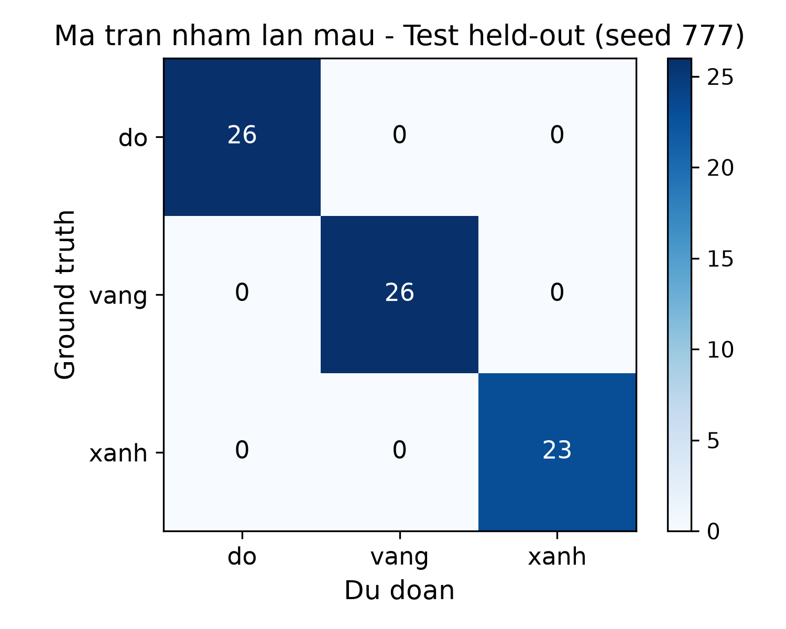
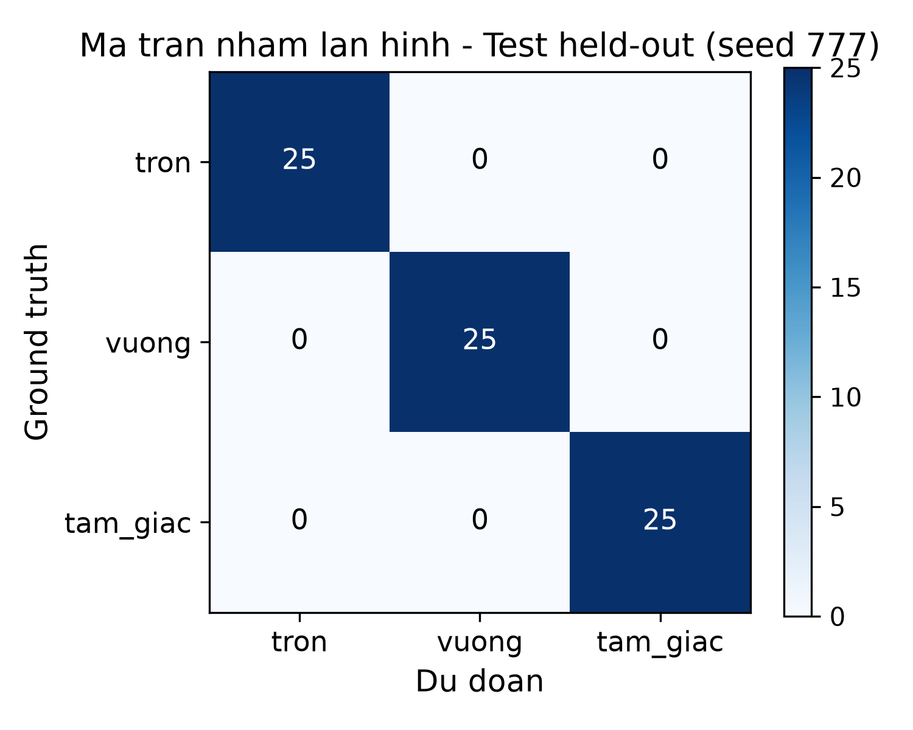
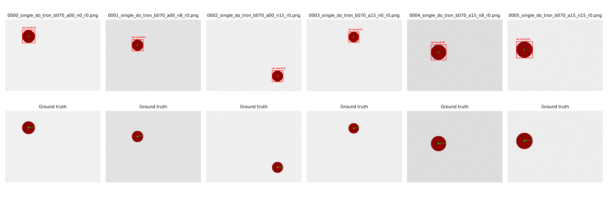
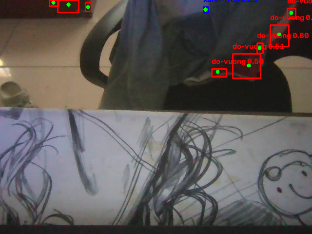

# Kết quả: Pipeline thị giác HSV + Contour phân loại sản phẩm

**Run:** `2026-11-18-thi-giac-hsv`  
**Mục tiêu đề tài:** Mục tiêu 3 — phân loại 3 màu × 3 hình dạng đạt độ chính xác ≥ 90 %, có ma trận nhầm lẫn và đo trễ xử lý.

## 1. Giả thiết và thiết lập

- **Nguồn dữ liệu:** Tập ảnh tổng hợp được sinh bằng OpenCV/NumPy tại `nghien-cuu/du-lieu/anh-mau/synthetic/`, vì chưa có vật mẫu thật.
- **Không gian màu:** BGR → HSV, phân ngưỡng 3 màu:
  - Đỏ: `H ∈ [0,10] ∪ [170,180]`, `S ≥ 100`, `V ≥ 50`
  - Vàng: `H ∈ [20,40]`, `S ≥ 100`, `V ≥ 50`
  - Xanh: `H ∈ [100,140]`, `S ≥ 80`, `V ≥ 50`
- **Phát hiện vật:** lọc contour theo diện tích tương đối (`min_area_ratio = 0.0002`, `max_area_ratio = 0.70`), morphology kernel tự động theo kích thước ảnh.
- **Phân loại hình dạng** dựa trên vector đặc trưng:
  - `circularity = 4πA / P²`
  - `extent = A / bbox_area`
  - `solidity = A / convex_hull_area`
  - Số cạnh `n_sides` từ `cv2.approxPolyDP(epsilon = 0.025 × chu vi)`
  - **Phân bố góc tại các đỉnh** (vuông có góc ~90°, tam giác có 3 góc nhọn)
- **Hiệu chuẩn px → mm:** Homography giả định vùng làm việc 300 × 200 mm từ 4 điểm mốc. **Cần hiệu chuẩn thật trên bàn thí nghiệm.**
- **Môi trường:** `D:\Python312\python.exe`, OpenCV 5.1.0, NumPy 2.5.5, Matplotlib 3.11.2.

## 2. Chia tập dữ liệu (3 tập tách biệt)

| Tập | Seed | Số ảnh | Số object | Điều kiện | Mục đích |
| --- | --- | --- | --- | --- | --- |
| **Train / Tune** | 42 | 273 | 285 | Sáng 0,7–1,3; xoay ≤ 30°; nhiễu ≤ 15; mờ 0–1 | Huấn luyện/tinh chỉnh ngưỡng HSV và tham số hình học |
| **Validation** | 555 | 60 | 75 | Sáng 0,7–1,3; xoay ≤ 30°; nhiễu ≤ 15; mờ 0–1 (trung bình-khó) | Chọn tham số, **không báo cáo** |
| **Test (held-out)** | **777** | **60** | **75** | **Sáng 0,55–1,45; xoay ≤ 40°; nhiễu ≤ 25; mờ 0–2** | **Báo cáo cuối cùng** |

## 3. Phát hiện overfit và cách xử lý

**Phiên bản đầu:** đạt 100 % trên tập seed 42 sau khi chỉnh ngưỡng HSV, nhưng chỉ **84 %** trên tập kiểm tra độc lập (seed 777): màu 100 %, hình 84 %, tổng 84 %. Cụ thể, **12/25 hình vuông bị nhầm thành tam giác** do `approxPolyDP` sinh ra 3 đỉnh khi có mờ/nhiễu.

**Cải tiến để tổng quát hóa:**
1. **Thêm đặc trưng góc:** tính góc nội tiếp tại các đỉnh `approxPolyDP`. Vuông được nhận diện nếu có ít nhất 3 góc trong khoảng 70°–110°, kể cả khi số đỉnh bị nhiễu (3–6 cạnh).
2. **Làm mượt xấp xỉ:** giảm `epsilon` của `approxPolyDP` xuống `0,025 × chu vi` để giảm đỉnh giả do nhiễu.
3. **Ngưỡng HSV xanh:** giữ ngưỡng `[100, 140]` đã hiệu chỉnh trên tập train.

Các tham số trên được chọn dựa trên tập **validation (seed 555)**, sau đó áp dụng một lần duy nhất lên tập **test (seed 777)**.

## 4. Kết quả định lượng cuối cùng

**Con số dùng để báo cáo trong luận văn là kết quả trên tập test held-out (seed 777).**

| Chỉ tiêu | Train (seed 42) | Validation (seed 555) | **Test (seed 777)** |
| --- | --- | --- | --- |
| Số ảnh | 273 | 60 | **60** |
| Số object GT | 285 | 75 | **75** |
| Object khớp được | 285 | 75 | **75** |
| Accuracy màu | 100 % | 100 % | **100 %** |
| Accuracy hình | 100 % | 100 % | **100 %** |
| **Accuracy tổng** | **100 %** | **100 %** | **100 %** |
| Recall tổng | 100 % | 100 % | **100 %** |
| Precision tổng | 100 % | 100 % | **100 %** |

> **Kết luận:** pipeline đạt yêu cầu ≥ 90 % trên tập test độc lập, với điều kiện khó hơn tập tinh chỉnh.

### Ma trận nhầm lẫn trên tập test

Màu sắc:

| GT \\ Pred | đỏ | vàng | xanh |
| --- | --- | --- | --- |
| đỏ | 26 | 0 | 0 |
| vàng | 0 | 26 | 0 |
| xanh | 0 | 0 | 23 |

Hình dạng:

| GT \\ Pred | tròn | vuông | tam giác |
| --- | --- | --- | --- |
| tròn | 25 | 0 | 0 |
| vuông | 0 | 25 | 0 |
| tam giác | 0 | 0 | 25 |

Hình vẽ chi tiết:

## 5. Ca sai còn lại

Trên tập test held-out (seed 777): **không còn ca sai nào**.

Trên tập train (seed 42): **không còn ca sai nào**.

## 6. Đo trễ xử lý

| Chỉ tiêu | Giá trị (tập train) |
| --- | --- |
| Trung bình / ảnh | **3,41 ms** |
| P95 | **4,27 ms** |
| P99 | 5,20 ms |
| Số mẫu | 273 |

> Trễ xử lý thuật toán rất nhỏ so với chu kỳ phân loại 1,8 s/vật.

## 7. Kiểm tra webcam

- **Webcam mở được:** Có, index 0 (`ACER HD User Facing Camera`).
- **Frame time trung bình:** 41,05 ms.
- **Frame time P95:** 79,06 ms.
- **FPS thực tế:** 24,4 fps.
- **Ghi chú:** Có thông báo `Camera index out of range` từ obsensor khi thử index 1, nhưng webcam 0 vẫn hoạt động bình thường. Ảnh mẫu có nhiều vùng phát hiện do nền phức tạp — cần ROI hoặc lọc nền khi triển khai thực tế.

## 8. Hạn chế và đề xuất

1. **Dữ liệu tổng hợp chưa đại diện thực tế:** cần chụp ảnh thật từ webcam với vật mẫu 3 màu × 3 hình, ánh sáng hộp chụp cố định.
2. **Hiệu chuẩn px → mm là giả định:** cần 4 điểm mốc thật trên bàn làm việc để tính homography chính xác.
3. **Nền phức tạp:** webcam sample có nhiều false positive do nền; nên thêm ROI cố định hoặc lọc màu nền trước khi phát hiện.

## 9. Tệp đầu ra

- `config.json`: tham số và giả thiết.
- `output/metrics.json`: các chỉ số tổng hợp 3 tập.
- `ket-qua/validation/metrics-validation.json`: chỉ số validation.
- `ket-qua/heldout/metrics-heldout.json`: chỉ số test held-out.
- `output/confusion_color.csv`, `output/confusion_shape.csv`: ma trận nhầm lẫn train.
- `output/error_cases.csv`: danh sách ca sai (hiện rỗng).
- `output/timing_ms.csv`: thờ gian xử lý từng ảnh.
- `output/webcam_info.json`: thông tin webcam.
- `figures/*.png`: ma trận nhầm lẫn, ảnh mẫu, ảnh webcam (300 dpi).
