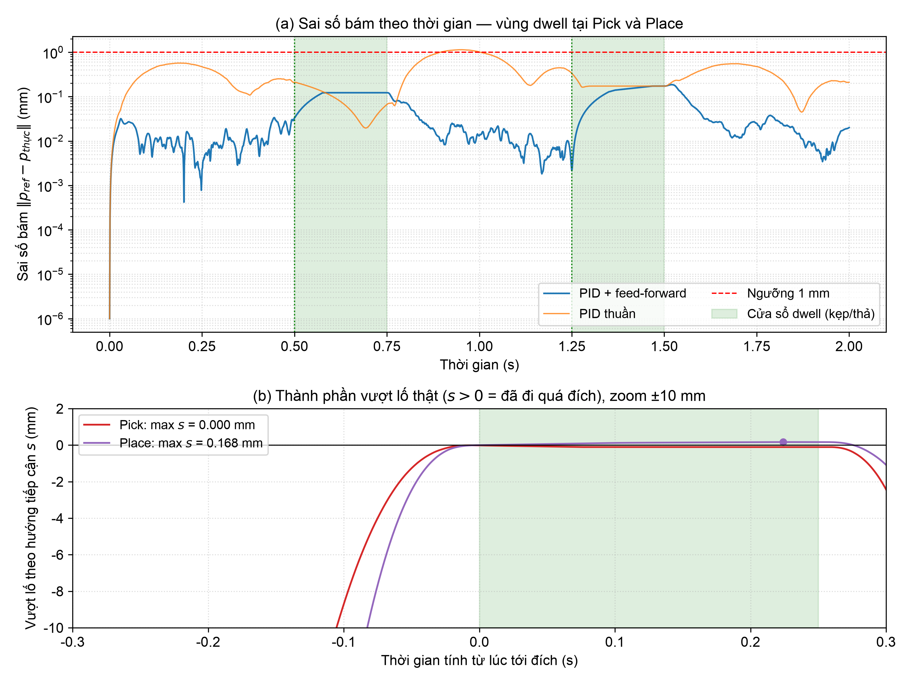
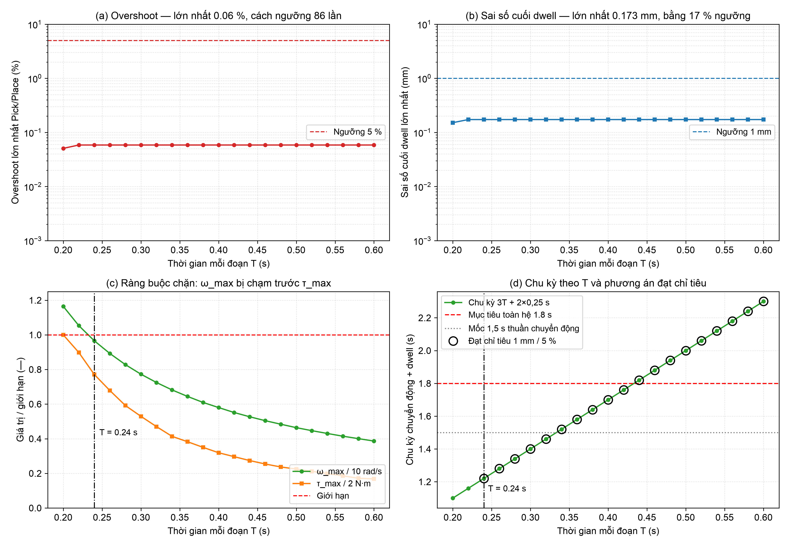

# Kết quả mô phỏng v2 — quỹ đạo gắp–thả có pha dừng (dwell)

**Run:** `2026-11-24-pid-v2-dung-nghi`  
**Ngày chạy:** 2026-11-24  
**Seed:** 42  
**Python:** D:\Python312\python.exe  
**Thời gian chạy script:** 2514.3 s  
**Dwell:** 0,25 s (danh định, nguồn `tong-quan.md` mục 7.1: 0,2–0,3 s)

## 1. Khác biệt so với bản cũ — metric đã sửa

Bản cũ `2026-11-18-pid-quy-dao-bac5` đo trong cửa sổ `[target − 0,9T, target + 0,15T]`. Vì quỹ đạo **không có thời gian dừng**, phần `+0,15T` rơi vào đoạn kế tiếp, nên đại lượng đo được là khoảng cách robot **rời đích**, không phải vọt lố.

| Chỉ số | Bản cũ — PID thuần | Bản cũ — PID+FF | Bản v2 — PID thuần | Bản v2 — PID+FF |
| --- | --- | --- | --- | --- |
| Overshoot Pick (mm / %) | 6,52 / 4,35 | 7,01 / 4,68 | 0,202 / 0,134 | 0,000 / 0,000 |
| Overshoot Place (mm / %) | 2,90 / 1,01 | 3,11 / 1,08 | 0,331 / 0,115 | 0,168 / 0,058 |
| `max_err` toàn cục (mm) | 1,158 | 0,075 | 1,137 | 0,186 |
| Thời gian xác lập Pick (s) | 0,451 | 0,455 | 0,000 | 0,000 |
| Chu kỳ (s) | 1,500 (3T) | 1,500 (3T) | 2,000 | 2,000 |

Đọc bảng: cột “bản cũ” đo cả đoạn **rời đích** nên overshoot 6,52 mm / 4,35 % (PID thuần) lớn hơn cả `max_err` 1,158 mm — tự mâu thuẫn. Đo đúng trong dwell, vọt lố thật chỉ còn **0,20 mm / 0,13 %** (PID thuần) và **0 mm / 0 %** (PID+FF). Con số 4,35 % trước đây là **sai về định nghĩa**, không phải đặc tính của hệ.

**Định nghĩa mới (dùng trong run này):**

- Cửa sổ đo chỉ là `[t_arrival, t_arrival + dwell]`.
- Hướng tiếp cận `û = (p_target − p_waypoint_trước)/‖·‖`, thành phần vượt lố `s(t) = (p(t) − p_target)·û`; **overshoot = max(0, max s(t))**.
- Thời gian xác lập = thời điểm đầu tiên trong dwell mà `‖p − p_target‖ ≤ 1 mm` và **giữ ≤ 1 mm đến hết dwell**; không đạt thì ghi `—` kèm sai số cuối dwell.
- Script raise lỗi nếu `overshoot > max_err` (kiểm tra chặn ở `compute_metrics`).

## 2. Kết quả tại T mặc định = 0,50 s (chu kỳ 2,00 s)

| Chỉ số | PID thuần | PID + feed-forward |
| --- | --- | --- |
| Sai số bám cực đại (mm) | 1,1367 | 0,1859 |
| RMSE sai số bám (mm) | 0,4354 | 0,0702 |
| Overshoot Pick (mm) | 0,2017 | 0,0000 |
| Overshoot Pick (%) | 0,134 | 0,000 |
| Overshoot Place (mm) | 0,3307 | 0,1678 |
| Overshoot Place (%) | 0,115 | 0,058 |
| Sai số cuối dwell tại Pick (mm) | 0,0665 | 0,1223 |
| Sai số cuối dwell tại Place (mm) | 0,1726 | 0,1726 |
| Sai số lớn nhất trong dwell tại Pick (mm) | 0,2086 | 0,1226 |
| Sai số lớn nhất trong dwell tại Place (mm) | 0,3346 | 0,1726 |
| Thời gian xác lập Pick, tính từ lúc tới (s) | 0,000 | 0,000 |
| Thời gian xác lập Place (s) | 0,000 | 0,000 |
| Mô-men cực đại (N·m) | 0,453 | 0,455 |
| Tốc độ góc cực đại (rad/s) | 4,665 | 4,645 |
| Vi phạm τ_max = 2.0 N·m | Không | Không |
| Vi phạm ω_max = 10.0 rad/s | Không | Không |

Feed-forward giữ overshoot gần như không đổi nhưng giảm mạnh RMSE bám trong lúc chuyển động; sai số **cuối dwell** mới là đại lượng quyết định có kẹp được vật hay không.

**Đọc đúng con số thời gian xác lập = 0 s:** sai số lớn nhất *trong suốt* dwell chỉ là 0,123 mm (Pick) và 0,173 mm (Place), tức robot **đã nằm trong ±1 mm ngay tại thời điểm tới đích**. Vì vậy thời gian xác lập theo ngưỡng 1 mm bằng 0 — không phải lỗi, mà là ngưỡng 1 mm quá rộng so với sai số thực của mô hình lý tưởng. Giới hạn thực của mô hình này là **độ phân giải encoder** (4096 xung/vòng ≈ 1,53 mrad ≈ 0,1 mm tại điểm cuối), không phải động học.

**PID thuần có sai số cuối dwell tại Pick nhỏ hơn PID+FF** (0,067 so với 0,122 mm). Chênh lệch này cỡ một nấc lượng tử encoder (~0,1 mm) và do trạng thái tích phân khác nhau, **không phải PID+FF kém hơn**; ở đoạn Place hai bộ trùng nhau (0,173 mm).

## 2b. Kiểm tra chặn định nghĩa

- `overshoot_pick = 0,000 mm` ≤ `max_err = 0,186 mm` — thoả điều kiện chặn trong code.
- Nếu một lần chạy nào cho overshoot > max_err, `compute_metrics` sẽ raise `RuntimeError` và không xuất số.

## 3. Quét chu kỳ T = 0,20…0,60 s (bước 0,02 s)

Tiêu chí đạt: **sai số cuối dwell ≤ 1 mm** ở cả Pick và Place, **overshoot ≤ 5 %**, không vi phạm τ_max/ω_max.

| T (s) | Chu kỳ 3T+0,5 (s) | RMSE (mm) | max_err (mm) | Overshoot Pick (%) | Overshoot Place (%) | Sai số cuối dwell Pick/Place (mm) | t_xác_lập Pick/Place (s) | τ_max (N·m) | ω_max (rad/s) | Đạt? |
| --- | --- | --- | --- | --- | --- | --- | --- | --- | --- | --- |
| 0,20 | 1,100 | 0,1863 | 0,9366 | 0,00 | 0,05 | 0,1223 / 0,1511 | 0,000 / 0,000 | 2,000 | 11,64 | Không (vi phạm ω) |
| 0,22 | 1,160 | 0,0865 | 0,1787 | 0,00 | 0,06 | 0,1223 / 0,1726 | 0,000 / 0,000 | 1,796 | 10,53 | Không (vi phạm ω) |
| 0,24 | 1,220 | 0,0863 | 0,1793 | 0,00 | 0,06 | 0,1223 / 0,1726 | 0,000 / 0,000 | 1,542 | 9,66 | Đạt |
| 0,26 | 1,280 | 0,0856 | 0,1800 | 0,00 | 0,06 | 0,1223 / 0,1726 | 0,000 / 0,000 | 1,357 | 8,92 | Đạt |
| 0,28 | 1,340 | 0,0844 | 0,1805 | 0,00 | 0,06 | 0,1223 / 0,1726 | 0,000 / 0,000 | 1,183 | 8,28 | Đạt |
| 0,30 | 1,400 | 0,0797 | 0,1810 | 0,00 | 0,06 | 0,1223 / 0,1726 | 0,000 / 0,000 | 1,059 | 7,73 | Đạt |
| 0,32 | 1,460 | 0,0794 | 0,1817 | 0,00 | 0,06 | 0,1223 / 0,1726 | 0,000 / 0,000 | 0,940 | 7,25 | Đạt |
| 0,34 | 1,520 | 0,0794 | 0,1820 | 0,00 | 0,06 | 0,1223 / 0,1726 | 0,000 / 0,000 | 0,828 | 6,82 | Đạt |
| 0,36 | 1,580 | 0,0767 | 0,1827 | 0,00 | 0,06 | 0,1223 / 0,1726 | 0,000 / 0,000 | 0,765 | 6,44 | Đạt |
| 0,38 | 1,640 | 0,0757 | 0,1831 | 0,00 | 0,06 | 0,1223 / 0,1726 | 0,000 / 0,000 | 0,700 | 6,10 | Đạt |
| 0,40 | 1,700 | 0,0741 | 0,1836 | 0,00 | 0,06 | 0,1223 / 0,1726 | 0,000 / 0,000 | 0,638 | 5,80 | Đạt |
| 0,42 | 1,760 | 0,0732 | 0,1841 | 0,00 | 0,06 | 0,1223 / 0,1726 | 0,000 / 0,000 | 0,593 | 5,51 | Đạt |
| 0,44 | 1,820 | 0,0716 | 0,1846 | 0,00 | 0,06 | 0,1223 / 0,1725 | 0,000 / 0,000 | 0,548 | 5,27 | Đạt |
| 0,46 | 1,880 | 0,0720 | 0,1851 | 0,00 | 0,06 | 0,1223 / 0,1726 | 0,000 / 0,000 | 0,508 | 5,04 | Đạt |
| 0,48 | 1,940 | 0,0714 | 0,1855 | 0,00 | 0,06 | 0,1223 / 0,1726 | 0,000 / 0,000 | 0,474 | 4,84 | Đạt |
| 0,50 | 2,000 | 0,0704 | 0,1859 | 0,00 | 0,06 | 0,1223 / 0,1726 | 0,000 / 0,000 | 0,450 | 4,64 | Đạt |
| 0,52 | 2,060 | 0,0700 | 0,1864 | 0,00 | 0,06 | 0,1223 / 0,1726 | 0,000 / 0,000 | 0,423 | 4,47 | Đạt |
| 0,54 | 2,120 | 0,0682 | 0,1867 | 0,00 | 0,06 | 0,1223 / 0,1726 | 0,000 / 0,000 | 0,397 | 4,30 | Đạt |
| 0,56 | 2,180 | 0,0678 | 0,1871 | 0,00 | 0,06 | 0,1223 / 0,1726 | 0,000 / 0,000 | 0,371 | 4,15 | Đạt |
| 0,58 | 2,240 | 0,0669 | 0,1876 | 0,00 | 0,06 | 0,1223 / 0,1726 | 0,000 / 0,000 | 0,344 | 4,01 | Đạt |
| 0,60 | 2,300 | 0,0668 | 0,1879 | 0,00 | 0,06 | 0,1223 / 0,1726 | 0,000 / 0,000 | 0,336 | 3,87 | Đạt |

**Đọc bảng:** cột `t_xác_lập` bằng 0 ở mọi T vì sai số lớn nhất trong dwell luôn < 1 mm (0,12–0,33 mm) — robot vào vùng ±1 mm ngay khi tới đích; cột này chỉ trở nên có nghĩa khi siết ngưỡng xuống cỡ 0,1 mm (xem mục 6). Ràng buộc thực sự chặn T là **ω_max = 10 rad/s**: T = 0,22 s cho 10,53 rad/s (vượt 5,3 %), T = 0,20 s cho 11,64 rad/s. Bước quét 0,02 s nên biên thật nằm giữa 0,22 và 0,24 s; muốn chốt chính xác phải quét mịn hơn. **Nếu chỉ xét chất lượng** (1 mm và 5 %), cả T = 0,20 s cũng đạt (0,122/0,151 mm; 0,05 %) — nút thắt là **tốc độ góc**, không phải độ chính xác.

**T nhỏ nhất đạt chỉ tiêu: T = 0,24 s**, chu kỳ chuyển động có dwell = **1,220 s**. Tại đó: overshoot 0,00 % / 0,06 %, sai số cuối dwell 0,122 / 0,173 mm, τ_max = 1,542 N·m, ω_max = 9,66 rad/s.

## 4. Phân rã chu kỳ toàn hệ thống

| Thành phần | Giá trị | Nguồn |
| --- | --- | --- |
| Chuyển động 3 đoạn | 3T = 0,720 s (T = 0,24 s) | mô phỏng này (mục 3) |
| Kẹp + thả | 2 × 0,25 = 0,50 s | `tai-lieu/tong-quan.md` 7.1 (0,2–0,3 s) |
| Xử lý ảnh | 3,41 ms trung bình / 4,12 ms P95 | `runs/2026-11-18-thi-giac-hsv/output/metrics.json` → `timing_ms` (273 mẫu) |
| Chờ khung hình camera | 41,05 ms trung bình / 79,06 ms P95 | cùng nguồn `output/webcam_info.json` (`frame_time_ms`, webcam thật 24,4 fps) |
| Truyền Serial + phản hồi | ~2,0 ms | **dry-run, CHƯA ĐO THẬT** |
| Đồng bộ/gia công thêm | (để trống) | chưa có số đo |

- Tổng danh định = 1,220 + 3,41 ms + 41,05 ms + 2,0 ms = **1,266 s**.
- Tổng theo P95 (xử lý ảnh 4,12 ms, chờ khung 79,06 ms) = **1,305 s**.
- Ngân sách: **1,8 s** → ĐẠT (danh định), dư 0,534 s; ĐẠT theo P95.

## 5. Kết luận trung thực: 1,5 s thuần có khả thi trong ngân sách 1,8 s?

- Ngân sách cho chuyển động = 1,8 s − 2×0,25 s (dwell) − 0,046 s (thị giác 3,41 ms + chờ khung 41,05 ms + Serial 2,0 ms) = **1,254 s** → T ≤ **0,418 s**.
- Quét được T nhỏ nhất đạt 1 mm / 5 % **và không vi phạm giới hạn vật lý** là **0,24 s** (3T = 0,72 s).
- Mốc “1,5 s thuần” nghĩa là T = 0,50 s → chu kỳ có dwell = 2,00 s, cộng overhead 0,046 s thành **2,046 s**, vượt ngân sách 1,8 s. Vì vậy **1,5 s thuần KHÔNG khả thi trong ngân sách 1,8 s** khi vẫn giữ dwell 0,25 s.
- Tuy nhiên ngân sách không đòi hỏi phải chậm đến 1,5 s: T = 0,24 s vẫn đạt chỉ tiêu, cho tổng danh định **1,266 s ≤ 1,8 s** (dư 0,534 s). Kết luận đúng là: **1,5 s là quá chậm so với ngân sách, còn nhanh hơn (0,72 s thuần) lại vừa đủ chặt** — nên chốt mục tiêu chuyển động theo T = 0,24 s, không phải 0,5 s.
- Điều kiện để 1,5 s thuần khả thi: giảm dwell xuống ≤ 0,127 s mỗi pha (tức gần như bỏ thời gian kẹp/thả) hoặc tăng tốc độ phần cứng; cả hai đều là thay đổi giả thiết, không phải tinh chỉnh PID.

## 6. Dị thường và lưu ý (bắt buộc đọc)

1. **Thời gian chạy bất thường: 2514 s cho 23 lần mô phỏng.** Đã chẩn đoán bằng `chan-doan-toc-do.py`: cùng một cấu hình T = 0,30 s, **bật** lượng tử hoá encoder (4096 xung/vòng) mất **20,24 s**, **tắt** chỉ mất **0,49 s** (chênh 41 lần). Nguyên nhân: phản hồi lượng tử hoá tạo bậc nhảy ở mỗi xung, RK45 phải giảm bước để bám các điểm gián đoạn. Đây là chi phí của mô hình, không phải lỗi kết quả, nhưng lần sau nên chạy với `quantize_feedback=false` rồi cộng sai số lượng tử riêng.
2. **Sai số 0,12–0,17 mm là do lượng tử hoá, không do động học.** Với cùng T = 0,30 s, tắt lượng tử hoá cho RMSE 0,0001 mm so với 0,0813 mm khi bật; τ_max gần như không đổi (1,016 so với 1,065 N·m). Nghĩa là chỉ tiêu 1 mm hiện do **độ phân giải encoder** quyết định, và mọi kết luận “đạt 1 mm” phải đọc kèm giả thiết 4096 xung/vòng.
3. **Số 46 ms trong đề bài không khớp nguồn.** `webcam_info.json` ghi frame time trung bình **41,05 ms**, P95 **79,06 ms** (24,4 fps). Bảng trên dùng số đo thật trong file; nếu ai trích 46 ms thì phải đo lại và cập nhật nguồn.
4. **P95 xử lý ảnh lệch giữa hai file:** `metrics.json` ghi 4,12 ms, `KETQUA.md` của run thị giác ghi 4,27 ms. Báo cáo này dùng `metrics.json` (nguồn máy đọc được); cần thống nhất lại.
5. **Serial ~2,0 ms là dry-run, chưa đo thật.** Nếu UART 115200 và phản hồi 2 chiều, con số thực thường 2–10 ms; cần đo trước khi chốt chu kỳ.
6. Không có số đo thực nghiệm cho dwell; 0,25 s là giá trị danh định giữa dải 0,2–0,3 s. Nếu xy-lanh khí nén chậm hơn, toàn bộ kết luận chu kỳ dịch tương ứng.
7. Mô hình vẫn bỏ qua tương tác chéo 3 khớp, trọng lực và ma sát Coulomb; τ_max/ω_max là tham số giả định, chưa chốt theo BOM. Bước quét 0,02 s chưa đủ mịn để chốt biên T; nên quét 0,005 s quanh 0,22–0,24 s.
8. `t_eval` bước 1 ms nên thời gian xác lập chỉ phân giải tới 1 ms; các giá trị 0 s là giới hạn của lưới, không phải số đo liên tục.

## 7. Tệp đầu ra

- `output/metrics.json`: metric tại T mặc định (PID vs PID+FF) + toàn bộ quét.
- `output/quet-chu-ky.csv`: bảng quét T (đơn vị ghi trong header).
- `output/PID_plus_FF.csv`, `output/PID_thuan.csv`: dữ liệu thô theo thời gian.
- `figures/sai_so_va_dwell.png`: sai số bám + vùng dwell + thành phần vượt lố.
- `figures/quet_chu_ky.png`: quét chu kỳ và phương án đạt chỉ tiêu.

